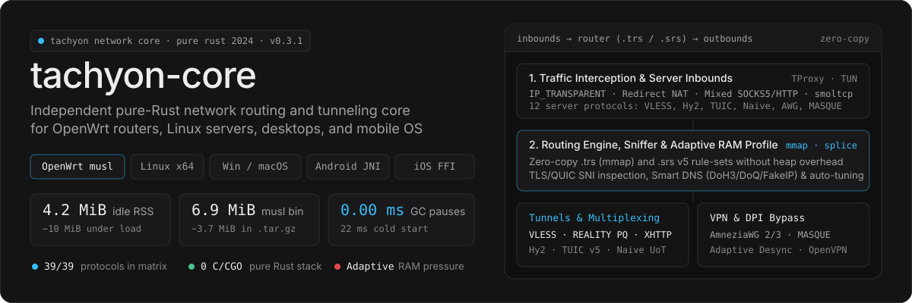
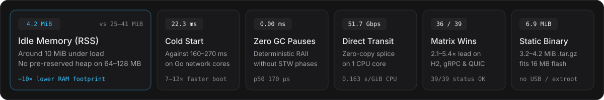
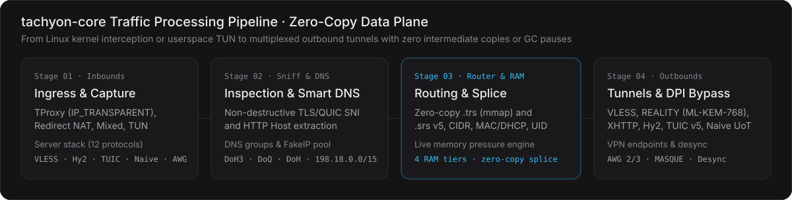
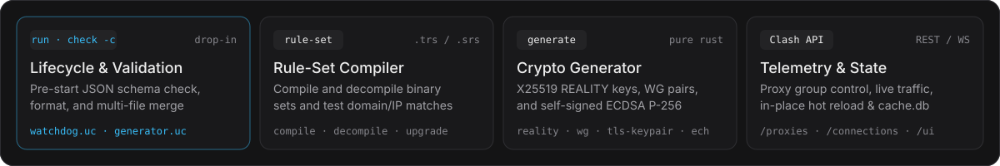

<p align="center">
  
</p>

<p align="center">
  <a href="https://github.com/Dushnilin/tachyon-core/releases/latest"></a>
  <a href="https://www.rust-lang.org/"></a>
  <a href="https://github.com/Dushnilin/tachyon-core/releases/latest"></a>
  <a href="./BENCHMARK.md"></a>
  <a href="https://openwrt.org/"></a>
  <a href="./LICENSE"></a>
</p>

<p align="center">
  <a href="./README.md">Русский</a> ·
  <a href="./README.en.md"><b>English</b></a> ·
  <a href="https://github.com/Dushnilin/tachyon-core/releases/latest">Release Builds</a> ·
  <a href="./BENCHMARK.md">Benchmark Report</a> ·
  <a href="./BENCHMARK.html">Interactive Dashboard</a> ·
  <a href="./docs/reference/README.md">Schema Reference</a>
</p>

> [!IMPORTANT]
> **Release Distribution Model Starting with `v0.1.3` (Builds-Only Releases)**
>
> The source tree in this public repository (`Dushnilin/tachyon-core`) is frozen at the historical `v0.1.2` snapshot. Starting with version `v0.1.3`, active development takes place in a private repository, and only prebuilt release artifacts (static `musl` binaries, `.ipk` / `.apk` router packages, desktop archives, Android JNI libraries, and iOS XCFrameworks), `SHA256SUMS` checksums, documentation, changelogs, and benchmark reports are automatically published here via GitHub Actions.

---

<p align="center">
  
</p>

<p align="center">
  
</p>

**tachyon-core** is an independent, high-performance network routing, tunneling, and traffic-shaping core for routers, servers, desktops, and mobile systems, written from scratch in 100% pure **Rust (Edition 2024)** with zero Go or C/C++ code. It supports standard JSON configuration schemas and CLI subcommands (`check -c`, `version`, `run`, `generate`, `rule-set`, `tools`) for drop-in operation in existing OpenWrt environments without the Go runtime or garbage collector.

It implements a complete stack of modern transport and tunneling protocols: **VLESS**, **REALITY** with automatic post-quantum `X25519MLKEM768` key exchange negotiation and decoy redirect protection, **XHTTP** (HTTP/2 XMUX pool + HTTP/1.1), **Hysteria2** (including `Salamander + Gecko` / `finalmask` obfuscation), **TUIC v5**, **NaiveProxy** (HTTP/2 and HTTP/3 QUIC with `UDP-over-TCP`), **AnyTLS**, **ShadowTLS v3**, **VMess**, **Trojan**, **Shadowsocks** (AEAD and 2022), **AmneziaWG 2.0/3.x** (`H1–H4` headers and `I1–I5` handshake framing), **MASQUE / WARP** (RFC 9484), **Mieru** (TCP/UDP), **Snell v4/v6**, **FPTN**, **OpenVPN**, **Tailscale**, **uTLS** (13 TLS ClientHello profiles), an adaptive L4/L7 packet segmentation engine (`desync`), a universal subscription loader and parser (`Remnawave`, `Marzban`, `3x-ui`, `Pasarguard`, `Hiddify`, `Happ crypt3/crypt4/crypt5`, `Amnezia vpn://`, `WG/AWG INI`), binary `.trs` (zero-copy `mmap`) and `.srs` v5 rule-sets, and an adaptive memory engine that scales pools and socket windows to the router's available RAM.

| Metric | `tachyon-core` (Rust) | Go Network Cores | Engineering Impact on Routers |
|:---|:---:|:---:|:---|
| **Binary size** | **6.9–10.2 MiB** (`3.2–4.2 MiB` in `.tar.gz`) | 35–76 MiB | **8–10× smaller**: installs directly into internal `/usr/bin/` flash on 16/32/128 MB routers without USB storage or `extroot` |
| **Idle RAM (RSS)** | **4.2 MiB** | 25–41 MiB | **~10× less**: leaves memory headroom for `conntrack`, Wi-Fi drivers, and LuCI on 64–128 MB RAM gateways |
| **RAM under load** | **~10 MiB** | 48–85 MiB | **~6× less**: no pre-reserved `mheap` arenas and protection against OOM-Killer triggers |
| **Garbage collector pauses** | **0.00 ms** | 2–15 ms | Deterministic RAII memory reclamation with zero Stop-The-World pauses, VoIP micro-stutters, or gaming latency spikes |
| **Cold start** | **22.3 ms** | 160–270 ms | **7–12× faster**: near-instant service readiness on reboot, WAN failover, or hot reload |
| **Adaptive memory profile** | **4 RAM tiers + 3 pressure levels** | Fixed buffers | Live `/proc/meminfo` (`MemAvailable`) and `cgroup` pressure tracking that automatically shrinks caches and stream windows |
| **C / CGO dependencies** | **0** | CGO / BoringSSL | Pure-Rust cryptography (`AEAD`, `X25519`, `ML-KEM-768`, `AF_ALG`) — clean static builds for any `mipsel`/`mips` soft-float and `armv6` target |

<details>
<summary><b>Architectural comparison: why pure Rust instead of Go</b></summary>

<br>

| Subsystem | Go Network Cores | `tachyon-core` (Pure Rust) |
|:---|:---|:---|
| **Memory management** | Continuous background heap scanning and Stop-The-World phases cause CPU spikes and 2–15 ms latency pauses on weak router SoCs | No garbage collector. Socket and buffer memory is freed deterministically the instant a connection goes out of scope (`0.00 ms` pauses) |
| **Scheduler and pools** | Internal thread pools, goroutine stacks, and `mheap` reservations hold 25–41 MiB even when completely idle | Zero upfront reservation: 4.2 MiB at idle, ~10 MiB under typical router workloads, and automatic cache eviction under memory pressure |
| **Cryptography on MIPS & ARM** | BoringSSL/CGO breaks cross-compilation on 32-bit `mipsel`/`mips` (`+soft-float`), while `gc` emits less optimal machine code than LLVM | End-to-end pure-Rust crypto provider with hardware `AES-NI` / `ARMv8 NEON` acceleration and Linux kernel `AF_ALG` support — zero C files or `libssl.so` |
| **Data pipeline** | Repeated userspace buffer copies between client sockets and outbound tunnels | Reusable `bytes::Bytes` buffer pools, Linux `splice` zero-copy forwarding, and transparent stream relaying without intermediate allocations |

</details>

---

<p align="center">
  
</p>

All measurements are taken from static `musl` builds compared against current releases of `sing-box`, `xray-core`, `mihomo`, and the modular C stack `steer`. Full methodology, hardware profiles, and tables across all 39 protocols are available in **[BENCHMARK.md](BENCHMARK.md)** and **[BENCHMARK.html](BENCHMARK.html)**.

### End-to-end routing benchmark (`SOCKS5 Inbound → Direct Outbound`), 1 CPU core

| Core | Binary Size | Cold Start | RAM (Idle / Peak) | Latency p50 / p99 | Throughput | CPU |
|:---|---:|---:|---:|---:|---:|---:|
| **`tachyon-core`** | **6.99–10.2 MiB** | **22.3 ms** | **4.2 / 4.6 MiB** | **170.0 / 221.4 µs** | **51.7 Gbps** | **0.163 s/G** |
| `steer` (C, 3 procs) | 1.76 MiB | 141.9 ms | 5.1 / 5.4 MiB | 173.6 / 221.7 µs | 8.0–9.6 Gbps | 1.067 s/G |
| `xray-core` (Go, XTLS) | 34.88 MiB | 161.1 ms | 25.0 / 25.6 MiB | 183.9 / 233.4 µs | 53.1 Gbps | 0.158 s/G |
| `mihomo` (Go, Clash Meta) | 59.12 MiB | 211.3 ms | 32.9 / 33.9 MiB | 188.5 / 251.3 µs | 48.2 Gbps | 0.174 s/G |
| `sing-box` (Go) | 76.01 MiB | 268.2 ms | 39.9 / 40.8 MiB | 182.6 / 232.8 µs | 51.5 Gbps | 0.166 s/G |

### Multi-protocol benchmark (single-core router profile, 1 stream / 8 streams, Gbit/s)

In the single-core router profile, `tachyon-core` leads in **36 out of 39 protocol scenarios** (`39/39` status `OK`, 3 ties, 0 losses). On multiplexed transports (`HTTP/2`, `gRPC`, `NaiveProxy`, `Hysteria2`, `TUIC v5`), throughput is **2.1–5.4× higher** at a fraction of the peak RSS:

| Protocol | `tachyon-core` | `sing-box` | `xray-core` | `mihomo` | `steer` | Ratio & RSS Notes |
|:---|---:|---:|---:|---:|---:|:---|
| **Shadowsocks AES-128-GCM** | **6.95 / 16.60** | 2.59 / 4.79 | 5.71 / 11.17 | 2.49 / 5.03 | 0.01 / 0.11 | **~3.5× faster** than `sing-box` |
| **AnyTLS (H2MUX TLS)** | **6.16 / 14.86** | 5.52 / 10.95 | — | — | — | **~1.4× faster** at 8 streams |
| **Mieru (TCP / UDP)** | **6.46 / 13.01** | — | — | 5.20 / 5.71 | — | **~2.3× faster** (client & server) |
| **VMess + HTTP/2 + TLS** | **2.48 / 11.31** | 1.58 / 2.09 | — | 1.21 / 3.06 | — | **~5.4× faster** over HTTP/2 |
| **VLESS + HTTP/2 + TLS** | **2.38 / 10.51** | 1.45 / 2.04 | — | 1.46 / 7.52 | — | **~5.2× faster** than `sing-box` |
| **NaiveProxy (HTTP/2 TLS)** | **2.80 / 10.47** | 2.49 / 2.41 | — | — | — | **~4.3× faster**, full `UoT` support |
| **Trojan + gRPC + TLS** | **2.80 / 10.45** | 1.40 / 1.92 | 1.55 / 2.47 | 1.45 / 2.23 | 1.63 / 2.09 | **~5.4× faster** over gRPC |
| **VLESS + gRPC + TLS** | **2.78 / 9.99** | 1.74 / 2.22 | 1.68 / 2.62 | 1.54 / 2.06 | 1.75 / 2.16 | **~4.5× faster** over gRPC |
| **VLESS + XHTTP + TLS** | **1.36 / 9.33** | 1.08 / 9.14 | 0.99 / 2.38 | — | 1.21 / 1.57 | **~73× lower p50** (`408 µs`, XMUX pool) |
| **VMess + WS + TLS** | **3.47 / 7.87** | 3.18 / 6.55 | 2.07 / 4.28 | 2.16 / 4.45 | 2.85 / 2.91 | **~1.2–1.8× faster** |
| **TUIC v5 (QUIC)** | **4.03 / 7.64** | 3.52 / 2.76 | — | 3.08 / 2.72 | — | **~2.8× faster** over QUIC |
| **Hysteria 2 (QUIC)** | **3.30 / 6.84** | 2.59 / 3.21 | — | 3.19 / 3.88 | 1.22 / 0.55 | **~2.1× faster** (`13.6M` vs `52M` RSS) |
| **VLESS + TLS + Vision** | **3.23 / 7.22** | 3.31 / 6.78 | 2.26 / 5.63 | 3.24 / 6.98 | 3.91 / 4.36 | 8-stream leader (`7.1M` RSS) |
| **ShadowTLS v3** | **48.47 / 45.53** | — | — | — | — | Zero-copy `splice` (`5.8M` RSS) |
| **VLESS (Plain)** | **25.31 / 30.97** | 25.25 / 30.89 | 8.66 / 16.90 | — | 4.24 / 5.27 | `5.4M` vs `42.4M` RSS |

---

<p align="center">
  
</p>

<p align="center">
  
</p>

| Subsystem | Supported Protocols & Capabilities |
|:---|:---|
| **Client & System Inbounds** | Transparent interception via Linux **TProxy** (IPv4/IPv6) using `IP_TRANSPARENT` and OOB `IP_RECVORIGDSTADDR`; **Redirect** (NAT) via `SO_ORIGINAL_DST`; **Mixed SOCKS/HTTP** (`CONNECT`, SOCKS4/4a/5, `UDP ASSOCIATE`, 407 auth, keep-alive); **Direct**; **TUN** (`/dev/net/tun`, userspace TCP stack on `smoltcp` with adaptive `TACHYON_SMOL_TCP_BUF` window, GSO segmentation, policy routing in table `2022`). |
| **Server Inbounds (12 Protocols)** | **VLESS**, **Trojan**, **VMess** (AEAD), **Shadowsocks** (AEAD, 2022, multi-user relay), **AnyTLS**, **NaiveProxy** (`UoT`), **Hysteria2** (full `hy2` client compatibility, `Hysteria-CC-RX`/`Hysteria-Padding` headers, `Salamander + Gecko` obfuscation, UDP sessions), **TUIC v5**, **ShadowTLS v3**, **MASQUE** (RFC 9484 `CONNECT-IP` over HTTP/3), **Mieru** (TCP/UDP), **AmneziaWG / WireGuard** responder, and **FPTN** — powered by pure-Rust TLS 1.3. |
| **Proxy Outbounds** | `direct`, `block`, `socks`, `http`, **Shadowsocks** (AEAD, 2022, UoT, TLS), **VLESS** (`xtls-rprx-vision`, `packet_encoding`, `h2mux`, uTLS), **VMess** (AEAD and legacy, `h2mux`), **Trojan** (SHA224), **Hysteria2** (BBR and Cubic, `Salamander + Gecko`, `udpHop`, `routing_mark`, `bind_interface`), **TUIC v5**, **AnyTLS**, **NaiveProxy** (HTTP/2 and HTTP/3 QUIC, `Padding`, `UoT`), **Snell v4/v6**, **ShadowTLS v3**, **MASQUE (WARP)**, **Mieru** (TCP/UDP), **FPTN**, **Tor**, **SSH**, **Chain** (`detour` chains). Dispatch groups: `urltest` and `selector` (`round_robin`, `least_test`, `least_ping`). |
| **Tunnel Endpoints** | **AmneziaWG 2.0/3.x** and **WireGuard** — lock-free multi-worker pool with `5-tuple` flow hashing, extended session header parameters (`jc`, `jmin`, `jmax`, `s1–s4`, `h1–h4`), `i1–i5` handshake packet generators, and Cloudflare WARP (`reserved`) support. **Tailscale** (`tsnet` endpoint). **OpenVPN client** (`static_key` over UDP and TCP, LZO compression, and fragmentation). |
| **Transports & Post-Quantum TLS** | TCP, WebSocket (`max_early_data`), HTTPUpgrade, gRPC, HTTP/2, QUIC/HTTP-3. **XHTTP**: `stream-up`, `packet-up`, `stream-one`, `extra` v2 options, and the HTTP/2 XMUX connection pool with least-loaded balancing and extended windows (`16 MiB` stream / `64 MiB` connection). **uTLS**: 13 byte-exact TLS ClientHello profiles. **REALITY**: end-to-end `splice`, X.509v1 certificate support, key pinning, and hybrid post-quantum **ML-KEM-768 (`X25519MLKEM768`)** with automatic decoy redirect detection and fallback. |
| **Packet Shaping (`desync`) & Subscriptions** | Adaptive L4/L7 packet segmentation engine (`preset: "adaptive"`, `tlsspoof`, `MultiDisorder` / `fakeddisorder`, `BadAck`, `IPv6 Hop-by-Hop`, `seqovl`, `ipfrag`, `syndata`, `wsize`, `rndsni`, `udplen`) with per-service profiling. Universal subscription loader and parser: `Remnawave`, `Marzban`, `3x-ui`, `Pasarguard`, `Hiddify`, encrypted `Happ` (`crypt3` / `crypt4` / `crypt5`) containers, `Amnezia` (`vpn://`), `WireGuard / AmneziaWG INI`, `Clash YAML`, `Xray JSON`, and `SIP008` with automatic info-node filtering. |
| **Adaptive RAM Profile** | At startup the core detects total RAM and CPU cores, selecting one of 4 hardware profiles (`Constrained ≤128 MB`, `Router 129–512 MB`, `Midrange 513–2048 MB`, `DesktopServer >2048 MB`), while monitoring `/proc/meminfo` (`MemAvailable`) and `cgroup` limits in real time to scale Tokio workers, `splice` and relay buffers, HTTP/2 and QUIC windows, UDP NAT tables, DNS caches, and `smoltcp` buffers. |
| **Smart DNS** | `udp`, `tcp`, `tls` (DoT), `https` (DoH), `quic` (DoQ), `h3` (DoH3 with QUIC session reuse), `fakeip` (`198.18.0.0/15`), `local`, `hosts`, and `mdns`. DNS `group` resolvers with `stable` / `fastest` / `parallel` strategies over rolling statistics and survival fallback, `reverse_mapping`, `client_subnet` (EDNS0), and an LRU cache with optimistic stale serving. |
| **Router, Sniffer & Rule-Sets** | Matchers: `inbound`, `network`, `protocol`, domain (`suffix`, `keyword`, `regex`, `exact`), `ip_cidr`, `ip_is_private`, `source_*`, `port`, `port_range`, `process_name`, `process_path`, `user`, `user_id` (`/proc/net/*`), `source_mac_address` and `source_hostname` (neighbour table & DHCP leases), `clash_mode`, `rule_set`. Non-destructive sniffer: TLS SNI, HTTP Host, QUIC SNI, DNS, BitTorrent, SSH, RDP. Native binary **`.trs` v2 (zero-copy `mmap`)** and **`.srs` v5** rule-sets with live route revalidation on hot reload. |
| **System Dialer & State API** | `netns` isolation (`CLONE_NEWNET`), `protect_path` socket passing over `SCM_RIGHTS`, Multipath TCP, Happy Eyeballs (RFC 6555), `routing_mark` (fwmark), `bind_interface`. Compatible **Clash REST / WebSocket API** (`/version`, `/proxies`, `/connections`, `/rules`, `/configs`, `/logs`, `/traffic`, `/providers/*`, built-in Yacd / Metacubexd UI under `/ui`), byte-compatible `bbolt` state store `cache.db`, and built-in NTP client. |

Complete configuration field documentation, defaults, and constraints are available in **[docs/reference/README.md](docs/reference/README.md)**.

---

<p align="center">
  
</p>

<p align="center">
  
</p>

```bash
tachyon-core check -c /etc/sing-box/config.json                    # pre-start configuration validation
tachyon-core version                                              # print core version (supports sing-box symlink)
tachyon-core run -c /etc/sing-box/config.json                     # start routing service
tachyon-core rule-set compile rules.json -o rules.srs            # compile binary SRS v5 rule-set
tachyon-core generate reality-keypair                             # generate X25519 keypair for REALITY
tachyon-core generate wg-keypair                                  # generate WireGuard / AmneziaWG keypair
tachyon-core generate tls-keypair example.com -m 12               # self-signed ECDSA P-256 TLS cert & key (PEM)
```

<details>
<summary><b>Complete CLI command and subcommand reference</b></summary>

<br>

| Command | Purpose | Status |
|:---|:---|:---:|
| `check -c <path>` | Pre-start schema and semantic config validation (used by `watchdog.uc`) | Done |
| `version` | Version output (automatically adapts format when invoked via a `sing-box` symlink) | Done |
| `run -c <path>` | Start the routing service daemon | Done |
| `format -c <path>` / `merge` | Format and merge JSON configuration files | Done |
| `rule-set compile\|decompile\|upgrade` | Compile and decompile binary `.srs` (SRS v5) rule-sets and upgrade remote lists | Done |
| `rule-set match\|format` | Test rule matching against target domains/IPs and format rule-set source files | Done |
| `api` | Control and monitoring client for the Clash REST API | Done |
| `generate reality-keypair` | Generate X25519 keypairs for REALITY | Done |
| `generate wg-keypair` | Generate WireGuard and AmneziaWG keypairs | Done |
| `generate tls-keypair <sni> [-m <months>]` | Generate self-signed ECDSA P-256 TLS certificates and keys in pure Rust | Done |
| `generate uuid` / `generate rand` | Generate UUID v4 and cryptographically random sequences (`--hex` / `--base64`) | Done |
| `tools synech` / `tools fptn-decode` | Generate `ECH ConfigList` blobs and decode FPTN access tokens | Done |

</details>

---

<p align="center">
  
</p>

Prebuilt static binaries with zero external dependencies (`musl`, `strip = "symbols"`, as well as `.ipk` packages for `opkg` and `.apk` packages for OpenWrt 24.10+/SNAPSHOT) are published on the **[Releases](https://github.com/Dushnilin/tachyon-core/releases/latest)** page alongside `SHA256SUMS`:

| Platform / Asset | Target Triple | Target Hardware & Environments | Artifact Formats |
|:---|:---|:---|:---:|
| **`aarch64`** | `aarch64-unknown-linux-musl` | MediaTek Filogic 820/830/880, GL.iNet Flint 2, NanoPi R3S/R4S/R6S, Qualcomm IPQ807x/60xx/50xx, RPi 4/5 | `.tar.gz` · `.ipk` · `.apk` (`~3.7 MiB`) |
| **`armv7`** | `armv7-unknown-linux-musleabihf` | Qualcomm IPQ4019, MediaTek MT7622/MT7623, Marvell Armada 385, Keenetic Hopper/Peak | `.tar.gz` · `.ipk` · `.apk` (`~3.8 MiB`) |
| **`armv6`** | `arm-unknown-linux-musleabi` | Broadcom BCM2835, Raspberry Pi Zero / 1, embedded ARMv6 gateways | `.tar.gz` · `.ipk` · `.apk` (`~3.9 MiB`) |
| **`mipsel`** | `mipsel-unknown-linux-musl` (`+soft-float`) | MediaTek MT7621, MT7628, Ralink RT305x/RT5350, Keenetic Extra/Viva/Giga/Speedster | `.tar.gz` · `.ipk` · `.apk` (`~4.2 MiB`) |
| **`mips`** | `mips-unknown-linux-musl` (`+soft-float`) | Qualcomm Atheros AR71xx / AR934x / QCA95xx (`ath79` Big-Endian) | `.tar.gz` · `.ipk` · `.apk` (`~4.2 MiB`) |
| **`riscv64`** | `riscv64gc-unknown-linux-musl` | StarFive VisionFive 2, Milk-V, SiFive, and RISC-V boards | `.tar.gz` · `.ipk` · `.apk` (`~3.9 MiB`) |
| **`x86_64`** | `x86_64-unknown-linux-musl` | Mini-PCs (Intel N100/N5105), x86 OpenWrt, Alpine containers, and static Linux environments | `.tar.gz` · `.ipk` · `.apk` (`~3.9 MiB`) |
| **`linux-amd64`** | `x86_64-unknown-linux-gnu` | Dedicated servers and VPS running Debian, Ubuntu, Fedora, Arch, and Proxmox | `.tar.gz` (`~3.9 MiB`) |
| **`windows-amd64`** | `x86_64-pc-windows-msvc` | Windows x64 desktops and servers | `.zip` (`~3.4 MiB`) |
| **`darwin-arm64` / `amd64`** | `aarch64` / `x86_64-apple-darwin` | macOS systems on Apple Silicon (M1–M4) and Intel | `.tar.gz` (`~3.2–3.5 MiB`) |
| **`android` (JNI & CLI)** | `aarch64` / `armv7` / `x86_64-linux-android` | Direct embedding into Android clients (`VpnService`, 16 KB page alignment for Android 15+) | `libtachyon-*.so` · `.tar.gz` |
| **`ios` (XCFramework)** | `aarch64-apple-ios` (+ Simulator) | Direct embedding into iOS Network Extensions (`NEPacketTunnelProvider`, C-FFI + `module.modulemap`) | `tachyon-core-ios-xcframework-*.tar.gz` |

**Quick install or upgrade on an OpenWrt router or Linux server:**

```bash
ARCH="aarch64"
VER="v0.3.1"
wget -O /tmp/tachyon-core.tar.gz "https://github.com/Dushnilin/tachyon-core/releases/download/${VER}/tachyon-core-${ARCH}-${VER}.tar.gz"
tar -xzf /tmp/tachyon-core.tar.gz -C /usr/bin/
mv -f "/usr/bin/tachyon-core-${ARCH}-${VER}" /usr/bin/tachyon-core 2>/dev/null || true
chmod +x /usr/bin/tachyon-core
/usr/bin/tachyon-core version
```

---

<p align="center">
  
</p>

| Phase | Development Area | Status |
|:---:|:---|:---:|
| **F0** | Foundation: configuration schema validator `check` and `version` CLI (247/0 corpus tests) | Done |
| **F1** | Data Plane v1: `tproxy`/`redirect`/`mixed`/`direct` inbounds, `socks`/`ss`/`vless`/`trojan`/`vmess` outbounds, Smart DNS + FakeIP + LRU, router and sniffer | Done |
| **F2** | Transport protocols: Hysteria2, TUIC v5, WireGuard + AmneziaWG, XHTTP, uTLS/REALITY, NaiveProxy, Snell, AnyTLS, ShadowTLS v3 | Done |
| **F3** | Binary `.trs` (zero-copy `mmap`) and `.srs` (SRS v5) rule-sets, remote list synchronization | Done |
| **F4** | Experimental stack: Clash API (Yacd / Metacubexd, secret, WebSocket), byte-compatible `cache.db` (bbolt r/w) | Done |
| **F5** | Server side: all 12 server inbounds (VLESS, Trojan, VMess, SS, Hy2, TUIC, AnyTLS, Naive, ShadowTLS, MASQUE, Mieru, AWG) with pure-Rust TLS 1.3 and UDP | Done |
| **F6** | TUN subsystem: userspace stack on `smoltcp`, TCP proxy, UDP NAT, routing table `2022` + fwmark, GSO/GRO | Done |
| **F7** | System daemon and extended telemetry: Windows service and daemon integration | Planned |
| **F8** | Mobile platforms: native Android JNI libraries (`libtachyon-*.so`, 16 KB page alignment) and iOS C-FFI (`TachyonCore.xcframework`) | Done |
| **F9** | MIPS soft-float musl: static `mipsel` and `mips` (`+soft-float`) builds via `-Zbuild-std` | Done |
| **F10** | Tachyon ecosystem integration, adaptive memory engine (4 RAM tiers, 3 pressure levels), and transition to builds-only public distribution (`v0.1.3+`) | Done |
| **F11** | Native configuration system and unified on-flash state storage (`/etc/tachyon/`) with automatic migration | December 2026 |
| **F12** | Complete transition to native Tachyon configuration format | 1 January 2027 |

<details>
<summary><b>Migration plan to the native configuration format (F11–F12)</b></summary>

<br>

- **December 2026 (F11) — native format and unified storage.** The core receives its own configuration format tailored for router workloads and a single compact state store in `/etc/tachyon/` instead of scattered files. An automatic migration tool ships with F11: on first start of the new version, any existing JSON configuration is converted in place with a backup and verification pass.
- **1 January 2027 (F12) — transition completed.** Legacy third-party JSON schema support is retired, and the core operates exclusively on its native configuration format.

</details>

---

## Support the Project

If Tachyon is useful in your infrastructure or daily workflow, you can support ongoing development:

- **Boosty:** [boosty.to/tachyon](https://boosty.to/tachyon)
- **Russian Cards & SBP (CloudTips):** [pay.cloudtips.ru/p/449c5ef9](https://pay.cloudtips.ru/p/449c5ef9)
- **Bitcoin (BTC):** `bc1q9ehdv7y9g948jejyflkq7xmau3tytgunxgh35h`
- **Ethereum (ETH / ERC-20):** `0x6CB7a4547eD62EF64990D5C6B5D9fdA58EB223E6`
- **TON:** `UQDPhLRjMz5KltDLACAT3YXXHDVEtIDOHky2i33ZIOtsMEoR`
- **Solana (SOL):** `3csTGaNeU9KjhCKHEKAU3XLS5UfVjEeBVhXihpsETZwh`

---

## License & Legal Notice

Starting with version **`v0.1.3`**, **tachyon-core** is distributed as prebuilt executable binaries under the proprietary **[TACHYON CORE BINARY LICENSE v1.0](LICENSE)** (`Copyright (c) 2026 Dushnilin. All rights reserved.`):

- You are granted a free license to download, install, and run unmodified official release binaries for personal non-commercial use and internal network infrastructure operations.
- **Redistribution, repackaging, bundling into third-party firmware or packages, commercial use, sale, reverse engineering, modification, creation of derivative works, or removal of copyright notices is strictly prohibited** without prior written permission from the copyright holder.
- Historical releases up to and including `v0.1.2` remain governed by the `GPL-3.0-only` license under which they were originally published.

**Disclaimer:**

1. **Purpose of the Software.** `tachyon-core` is a general-purpose technical networking utility designed for network traffic routing, load balancing, network diagnostics, information security, and establishing secure corporate or personal communication channels (VPN).
2. **Compliance with Applicable Laws.** The Software was not created, is not intended, and is not distributed for the purpose of violating the laws of the Russian Federation (including Federal Law No. 149-FZ) or any other jurisdiction, nor for obtaining unauthorized access to restricted information resources.
3. **Use at Your Own Risk.** The author and copyright holder do not provide any proxy/VPN servers, network nodes, subscriptions, access keys, or routing lists. The Software is provided `"AS IS"` without warranty of any kind. Any installation, configuration, and operation of the Software is performed by the user strictly on their own initiative, at their own risk, and under their sole responsibility. The copyright holder assumes no liability for user actions, configurations, or any consequences arising from the use of the Software.
