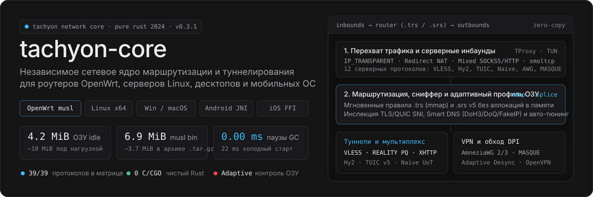
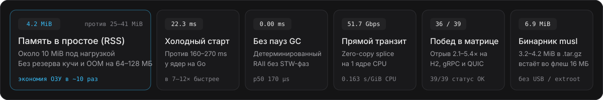
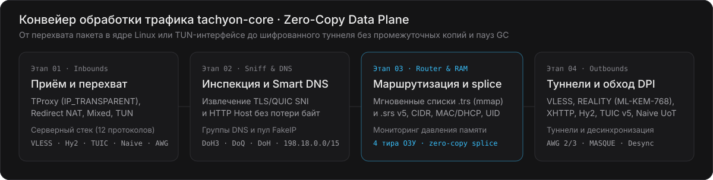
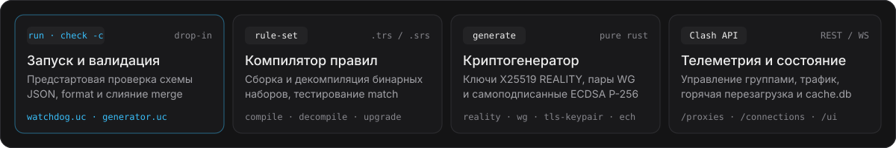

<p align="center">
  
</p>

<p align="center">
  <a href="https://github.com/Dushnilin/tachyon-core/releases/latest"></a>
  <a href="https://www.rust-lang.org/"></a>
  <a href="https://github.com/Dushnilin/tachyon-core/releases/latest"></a>
  <a href="./BENCHMARK.md"></a>
  <a href="https://openwrt.org/"></a>
  <a href="./LICENSE"></a>
</p>

<p align="center">
  <a href="./README.md"><b>Русский</b></a> ·
  <a href="./README.en.md">English</a> ·
  <a href="https://github.com/Dushnilin/tachyon-core/releases/latest">Релизные сборки</a> ·
  <a href="./BENCHMARK.md">Отчёт бенчмарков</a> ·
  <a href="./BENCHMARK.html">Интерактивный дашборд</a> ·
  <a href="./docs/reference/README.md">Справочник схемы</a>
</p>

> [!IMPORTANT]
> **Формат публикаций начиная с версии `0.1.3` (Builds-Only Releases)**
>
> Исходный код в этом публичном репозитории (`Dushnilin/tachyon-core`) заморожен на историческом снимке `v0.1.2`. Начиная с релиза `v0.1.3`, разработка ведётся в закрытом репозитории, а в этот репозиторий через GitHub Actions автоматически публикуются только готовые релизные сборки (статические бинарники и пакеты `.ipk` / `.apk`, десктопные архивы, библиотеки Android JNI и iOS XCFramework), контрольные суммы `SHA256SUMS`, документация, список изменений и отчёты бенчмарков.

---

<p align="center">
  
</p>

<p align="center">
  
</p>

**tachyon-core** — независимое сетевое ядро маршрутизации, туннелирования и управления трафиком для роутеров, серверов, настольных и мобильных систем, написанное с нуля на 100% чистом **Rust (Edition 2024)** без единой строчки кода на Go или C/C++. Ядро поддерживает стандартный синтаксис JSON-конфигураций и командный интерфейс (`check -c`, `version`, `run`, `generate`, `rule-set`, `tools`) для прямой работы в существующих окружениях OpenWrt без рантайма Go и сборщика мусора.

Реализован полный стек транспортных и туннельных протоколов: **VLESS**, **REALITY** с автоматическим подбором постквантового обмена `X25519MLKEM768` и защитой от подмены сертификата маскировочного домена, **XHTTP** (HTTP/2 XMUX-пул + HTTP/1.1), **Hysteria2** (включая маскировку `Salamander + Gecko` / `finalmask`), **TUIC v5**, **NaiveProxy** (HTTP/2 и HTTP/3 QUIC с поддержкой `UDP-over-TCP`), **AnyTLS**, **ShadowTLS v3**, **VMess**, **Trojan**, **Shadowsocks** (AEAD и 2022), **AmneziaWG 2.0/3.x** (заголовки `H1–H4` и фрейминг рукопожатий `I1–I5`), **MASQUE / WARP** (RFC 9484), **Mieru** (TCP/UDP), **Snell v4/v6**, **FPTN**, **OpenVPN**, **Tailscale**, **uTLS** (13 профилей TLS ClientHello), адаптивный движок L4/L7-сегментации пакетов (`desync`), универсальный загрузчик и парсер подписок (`Remnawave`, `Marzban`, `3x-ui`, `Pasarguard`, `Hiddify`, `Happ crypt3/crypt4/crypt5`, `Amnezia vpn://`, `WG/AWG INI`), бинарные наборы правил `.trs` (zero-copy `mmap`) и `.srs` v5, а также адаптивный менеджер памяти, масштабирующий пулы и буферы под доступный объём ОЗУ роутера.

| Показатель | `tachyon-core` (Rust) | Сетевые ядра на Go | Инженерный эффект на роутере |
|:---|:---:|:---:|:---|
| **Размер бинарника** | **6.9–10.2 MiB** (`3.2–4.2 MiB` в `.tar.gz`) | 35–76 MiB | В **8–10× меньше**: устанавливается напрямую во внутренний флеш `/usr/bin/` роутеров с 16/32/128 МБ без USB и `extroot` |
| **Память в простое (Idle RSS)** | **4.2 MiB** | 25–41 MiB | В **~10× меньше**: запас памяти под `conntrack`, драйверы Wi-Fi и веб-интерфейс LuCI на устройствах с 64–128 МБ ОЗУ |
| **Память под нагрузкой** | **~10 MiB** | 48–85 MiB | В **~6× меньше**: отсутствие предрезервированной кучи `mheap` и защита от вызова OOM-Killer |
| **Паузы сборщика мусора** | **0.00 ms** | 2–15 ms | Детерминированное освобождение памяти (RAII) без фаз Stop-The-World, микрофризов в VoIP и скачков пинга в играх |
| **Холодный старт** | **22.3 ms** | 160–270 ms | В **7–12× быстрее**: мгновенный перезапуск службы при переключении интерфейса или рестарте сети |
| **Адаптивный профиль памяти** | **4 тира ОЗУ + 3 уровня давления** | Фиксированные буферы | Живой мониторинг `/proc/meminfo` (`MemAvailable`) и лимитов `cgroup` с автоматическим сжатием кэшей и окон |
| **Зависимости от C / CGO** | **0** | CGO / BoringSSL | Чистый Rust-криптопровайдер (`AEAD`, `X25519`, `ML-KEM-768`, `AF_ALG`) — статическая сборка под любой `mipsel`/`mips` soft-float и `armv6` |

<details>
<summary><b>Архитектурное сравнение: почему чистый Rust вместо Go</b></summary>

<br>

| Подсистема | Сетевые ядра на Go | `tachyon-core` (Pure Rust) |
|:---|:---|:---|
| **Управление памятью** | Непрерывный фоновый обход кучи и фазы Stop-The-World создают всплески нагрузки на CPU и паузы 2–15 мс на роутерных процессорах | Сборщика мусора нет. Память сокетов и буферов освобождается детерминированно при выходе из области видимости (`0.00 ms` пауз) |
| **Планировщик и пулы** | Внутренние пулы потоков, стеки горутин и резервирование виртуальной памяти через `mheap` удерживают 25–41 MiB даже без трафика | Память выделяется строго под активные соединения: 4.2 MiB в простое, ~10 MiB в типовом режиме и автоматическая очистка при нехватке ОЗУ |
| **Криптография на MIPS и ARM** | Зависимость от BoringSSL/CGO усложняет сборку под 32-битный `mipsel`/`mips` (`+soft-float`), а стандартный компилятор Go уступает LLVM по генерации кода | Полностью собственный криптостек на Rust с аппаратным ускорением `AES-NI` / `ARMv8 NEON` и поддержкой ядерного `AF_ALG` без `libssl.so` и Си-компилятора |
| **Конвейер передачи данных** | Многократные копирования буферов в пользовательском пространстве между клиентским сокетом и туннелем | Переиспользуемые пулы `bytes::Bytes`, системный вызов `splice` на Linux и сквозная передача данных без лишних аллокаций |

</details>

---

<p align="center">
  
</p>

Замеры выполнены на статических `musl`-сборках в сравнении с актуальными версиями `sing-box`, `xray-core`, `mihomo` и модульным C-стеком `steer`. Полная методика, профили окружения и таблицы по всем 39 протоколам приведены в **[BENCHMARK.md](BENCHMARK.md)** и интерактивном отчёте **[BENCHMARK.html](BENCHMARK.html)**.

### Сквозной тест маршрутизации (`SOCKS5 Inbound → Direct Outbound`), 1 ядро CPU

| Ядро | Размер бинарника | Холодный старт | RAM (Idle / Peak) | Задержка p50 / p99 | Пропускная способность | CPU |
|:---|---:|---:|---:|---:|---:|---:|
| **`tachyon-core`** | **6.99–10.2 MiB** | **22.3 ms** | **4.2 / 4.6 MiB** | **170.0 / 221.4 µs** | **51.7 Gbps** | **0.163 s/G** |
| `steer` (C, 3 процесса) | 1.76 MiB | 141.9 ms | 5.1 / 5.4 MiB | 173.6 / 221.7 µs | 8.0–9.6 Gbps | 1.067 s/G |
| `xray-core` (Go, XTLS) | 34.88 MiB | 161.1 ms | 25.0 / 25.6 MiB | 183.9 / 233.4 µs | 53.1 Gbps | 0.158 s/G |
| `mihomo` (Go, Clash Meta) | 59.12 MiB | 211.3 ms | 32.9 / 33.9 MiB | 188.5 / 251.3 µs | 48.2 Gbps | 0.174 s/G |
| `sing-box` (Go) | 76.01 MiB | 268.2 ms | 39.9 / 40.8 MiB | 182.6 / 232.8 µs | 51.5 Gbps | 0.166 s/G |

### Мульти-протокольный бенчмарк (роутерный профиль, 1 поток / 8 потоков, Gbit/s)

В одноядерном роутерном профиле `tachyon-core` лидирует в **36 из 39 протокольных сценариев** (`39/39` в статусе `OK`, 3 паритета, 0 поражений). На мультиплексированных транспортах (`HTTP/2`, `gRPC`, `NaiveProxy`, `Hysteria2`, `TUIC v5`) отрыв составляет **2.1–5.4×** по пропускной способности при кратно меньшем пиковом RSS:

| Протокол | `tachyon-core` | `sing-box` | `xray-core` | `mihomo` | `steer` | Соотношение и RSS |
|:---|---:|---:|---:|---:|---:|:---|
| **Shadowsocks AES-128-GCM** | **6.95 / 16.60** | 2.59 / 4.79 | 5.71 / 11.17 | 2.49 / 5.03 | 0.01 / 0.11 | **~3.5× быстрее** `sing-box` |
| **AnyTLS (H2MUX TLS)** | **6.16 / 14.86** | 5.52 / 10.95 | — | — | — | **~1.4× быстрее** на 8 потоках |
| **Mieru (TCP / UDP)** | **6.46 / 13.01** | — | — | 5.20 / 5.71 | — | **~2.3× быстрее** (клиент и сервер) |
| **VMess + HTTP/2 + TLS** | **2.48 / 11.31** | 1.58 / 2.09 | — | 1.21 / 3.06 | — | **~5.4× быстрее** на H2 |
| **VLESS + HTTP/2 + TLS** | **2.38 / 10.51** | 1.45 / 2.04 | — | 1.46 / 7.52 | — | **~5.2× быстрее** `sing-box` |
| **NaiveProxy (HTTP/2 TLS)** | **2.80 / 10.47** | 2.49 / 2.41 | — | — | — | **~4.3× быстрее**, поддержка `UoT` |
| **Trojan + gRPC + TLS** | **2.80 / 10.45** | 1.40 / 1.92 | 1.55 / 2.47 | 1.45 / 2.23 | 1.63 / 2.09 | **~5.4× быстрее** на gRPC |
| **VLESS + gRPC + TLS** | **2.78 / 9.99** | 1.74 / 2.22 | 1.68 / 2.62 | 1.54 / 2.06 | 1.75 / 2.16 | **~4.5× быстрее** на gRPC |
| **VLESS + XHTTP + TLS** | **1.36 / 9.33** | 1.08 / 9.14 | 0.99 / 2.38 | — | 1.21 / 1.57 | **p50 в ~73× ниже** (`408 µs`, пул XMUX) |
| **VMess + WS + TLS** | **3.47 / 7.87** | 3.18 / 6.55 | 2.07 / 4.28 | 2.16 / 4.45 | 2.85 / 2.91 | **~1.2–1.8× быстрее** |
| **TUIC v5 (QUIC)** | **4.03 / 7.64** | 3.52 / 2.76 | — | 3.08 / 2.72 | — | **~2.8× быстрее** на QUIC |
| **Hysteria 2 (QUIC)** | **3.30 / 6.84** | 2.59 / 3.21 | — | 3.19 / 3.88 | 1.22 / 0.55 | **~2.1× быстрее** (`13.6M` против `52M` RSS) |
| **VLESS + TLS + Vision** | **3.23 / 7.22** | 3.31 / 6.78 | 2.26 / 5.63 | 3.24 / 6.98 | 3.91 / 4.36 | Лидер на 8 потоках (`7.1M` RSS) |
| **ShadowTLS v3** | **48.47 / 45.53** | — | — | — | — | Zero-copy `splice` (`5.8M` RSS) |
| **VLESS (Plain)** | **25.31 / 30.97** | 25.25 / 30.89 | 8.66 / 16.90 | — | 4.24 / 5.27 | `5.4M` против `42.4M` RSS |

---

<p align="center">
  
</p>

<p align="center">
  
</p>

| Подсистема | Реализованные протоколы и механизмы |
|:---|:---|
| **Клиентские и системные инбаунды** | Прозрачный перехват Linux **TProxy** (IPv4/IPv6) через `IP_TRANSPARENT` и OOB `IP_RECVORIGDSTADDR`; **Redirect** (NAT) через `SO_ORIGINAL_DST`; **Mixed SOCKS/HTTP** (`CONNECT`, SOCKS4/4a/5, `UDP ASSOCIATE`, код 407, keep-alive); **Direct**; **TUN** (`/dev/net/tun`, стек TCP в пространстве пользователя на `smoltcp` с адаптивным окном `TACHYON_SMOL_TCP_BUF`, GSO-сегментация, policy routing в таблице `2022`). |
| **Серверные инбаунды (12 протоколов)** | **VLESS**, **Trojan**, **VMess** (AEAD), **Shadowsocks** (AEAD, 2022, multi-user relay), **AnyTLS**, **NaiveProxy** (`UoT`), **Hysteria2** (совместимость с клиентами `hy2`, заголовки `Hysteria-CC-RX`/`Hysteria-Padding`, обфускация `Salamander + Gecko`, UDP-сессии), **TUIC v5**, **ShadowTLS v3**, **MASQUE** (RFC 9484 `CONNECT-IP` поверх HTTP/3), **Mieru** (TCP/UDP), **AmneziaWG / WireGuard** responder и **FPTN** — поверх собственного TLS 1.3 на чистом Rust. |
| **Прокси-аутбаунды** | `direct`, `block`, `socks`, `http`, **Shadowsocks** (AEAD, 2022, UoT, TLS), **VLESS** (`xtls-rprx-vision`, `packet_encoding`, `h2mux`, uTLS), **VMess** (AEAD и legacy, `h2mux`), **Trojan** (SHA224), **Hysteria2** (BBR и Cubic, `Salamander + Gecko`, `udpHop`, `routing_mark`, `bind_interface`), **TUIC v5**, **AnyTLS**, **NaiveProxy** (HTTP/2 и HTTP/3 QUIC, `Padding`, `UoT`), **Snell v4/v6**, **ShadowTLS v3**, **MASQUE (WARP)**, **Mieru** (TCP/UDP), **FPTN**, **Tor**, **SSH**, **Chain** (`detour`-цепочки). Группы: `urltest` и `selector` (`round_robin`, `least_test`, `least_ping`). |
| **Эндпоинты туннелей** | **AmneziaWG 2.0/3.x** и **WireGuard** — многопоточный пул воркеров с хешированием потоков `5-tuple` без блокировок, расширенные заголовки сессии (`jc`, `jmin`, `jmax`, `s1–s4`, `h1–h4`), генератор пакетов инициализации `i1–i5` и поддержка профилей Cloudflare WARP (`reserved`). **Tailscale** (`tsnet` endpoint). **OpenVPN-клиент** (`static_key` поверх UDP и TCP, сжатие LZO и фрагментация). |
| **Транспорты и постквантовый TLS** | TCP, WebSocket (`max_early_data`), HTTPUpgrade, gRPC, HTTP/2, QUIC/HTTP-3. **XHTTP**: режимы `stream-up`, `packet-up`, `stream-one`, поддержка `extra` v2 и пул мультиплексирования HTTP/2 (XMUX) с балансировкой least-loaded и окнами `16 MiB` stream / `64 MiB` connection. **uTLS**: 13 байт-точных профилей TLS ClientHello. **REALITY**: сквозной `splice`, поддержка X.509v1, пиннинг ключей и гибридный постквантовый обмен **ML-KEM-768 (`X25519MLKEM768`)** с защитой от редиректа на маскировочный домен (`decoy`). |
| **Адаптивная сегментация (`desync`) и подписки** | Адаптивный движок L4/L7-сегментации пакетов (`preset: "adaptive"`, `tlsspoof`, `MultiDisorder` / `fakeddisorder`, `BadAck`, `IPv6 Hop-by-Hop`, `seqovl`, `ipfrag`, `syndata`, `wsize`, `rndsni`, `udplen`) с контекстным профилированием сервисов. Универсальный парсер подписок: `Remnawave`, `Marzban`, `3x-ui`, `Pasarguard`, `Hiddify`, зашифрованные контейнеры `Happ` (`crypt3` / `crypt4` / `crypt5`), `Amnezia` (`vpn://`), `WireGuard / AmneziaWG INI`, `Clash YAML`, `Xray JSON`, `SIP008` с фильтрацией сервисных заглушек. |
| **Адаптивный профиль ОЗУ** | При старте ядро определяет объём ОЗУ и число ядер CPU, выбирая один из 4 аппаратных профилей (`Constrained ≤128 MB`, `Router 129–512 MB`, `Midrange 513–2048 MB`, `DesktopServer >2048 MB`), и в реальном времени отслеживает `/proc/meminfo` (`MemAvailable`) и лимиты `cgroup`. Автоматически масштабируются потоки Tokio, буферы `splice` и TCP/UDP-релея, окна HTTP/2 и QUIC, таблицы UDP NAT, кэш DNS и буферы `smoltcp`. |
| **Smart DNS** | Транспорты `udp`, `tcp`, `tls` (DoT), `https` (DoH), `quic` (DoQ), `h3` (DoH3 с переиспользованием QUIC-сессий), `fakeip` (`198.18.0.0/15`), `local`, `hosts` и `mdns`. DNS-группы (`group`) со стратегиями `stable` / `fastest` / `parallel` на скользящей статистике и аварийным режимом, `reverse_mapping`, `client_subnet` (EDNS0) и LRU-кэш с оптимистичной отдачей устаревших записей. |
| **Роутер, сниффер и наборы правил** | Матчеры: `inbound`, `network`, `protocol`, домены (`suffix`, `keyword`, `regex`, `exact`), `ip_cidr`, `ip_is_private`, `source_*`, `port`, `port_range`, `process_name`, `process_path`, `user`, `user_id` (`/proc/net/*`), `source_mac_address` и `source_hostname` (таблица соседей и DHCP), `clash_mode`, `rule_set`. Неразрушающий сниффер: TLS SNI, HTTP Host, QUIC SNI, DNS, BitTorrent, SSH, RDP. Поддержка нативных бинарных списков **`.trs` v2 (zero-copy `mmap`)** и **`.srs` v5** с горячей перезагрузкой маршрутов. |
| **Системный диалер и API состояния** | Изоляция `netns` (`CLONE_NEWNET`), передача сокетов через `protect_path` (`SCM_RIGHTS`), Multipath TCP, Happy Eyeballs (RFC 6555), `routing_mark` (fwmark), `bind_interface`. Совместимый **Clash REST / WebSocket API** (`/version`, `/proxies`, `/connections`, `/rules`, `/configs`, `/logs`, `/traffic`, `/providers/*`, панели Yacd / Metacubexd по `/ui`), побайтово совместимый с `bbolt` файл состояния `cache.db` и встроенный NTP-клиент. |

Полное описание всех полей конфигурации, значений по умолчанию и ограничений приведено в справочнике **[docs/reference/README.md](docs/reference/README.md)**.

---

<p align="center">
  
</p>

<p align="center">
  
</p>

```bash
tachyon-core check -c /etc/sing-box/config.json                    # предстартовая валидация конфигурации
tachyon-core version                                              # вывод версии ядра (поддержка симлинка sing-box)
tachyon-core run -c /etc/sing-box/config.json                     # запуск рабочего процесса службы
tachyon-core rule-set compile rules.json -o rules.srs            # компиляция бинарного набора правил SRS v5
tachyon-core generate reality-keypair                             # генерация пары ключей X25519 для REALITY
tachyon-core generate wg-keypair                                  # генерация пары ключей WireGuard / AmneziaWG
tachyon-core generate tls-keypair example.com -m 12               # самоподписанный сертификат ECDSA P-256 (PEM)
```

<details>
<summary><b>Полная таблица команд и подкоманд CLI</b></summary>

<br>

| Команда | Назначение | Статус |
|:---|:---|:---:|
| `check -c <path>` | Предстартовая проверка схемы и семантики конфига (интеграция с `watchdog.uc`) | Готово |
| `version` | Определение версии ядра (автоматическая адаптация вывода при вызове через симлинк `sing-box`) | Готово |
| `run -c <path>` | Запуск рабочего процесса службы маршрутизации | Готово |
| `format -c <path>` / `merge` | Форматирование и слияние JSON-конфигураций | Готово |
| `rule-set compile\|decompile\|upgrade` | Сборка и декомпиляция бинарных наборов `.srs` (SRS v5) и обновление удалённых списков | Готово |
| `rule-set match\|format` | Проверка срабатывания правил на тестовом адресе/домене и форматирование исходников | Готово |
| `api` | Клиент управления и мониторинга через Clash REST API | Готово |
| `generate reality-keypair` | Генерация пары ключей X25519 для протокола REALITY | Готово |
| `generate wg-keypair` | Генерация ключей WireGuard и AmneziaWG | Готово |
| `generate tls-keypair <sni> [-m <months>]` | Генерация самоподписанного TLS-сертификата и ключа ECDSA P-256 на чистом Rust | Готово |
| `generate uuid` / `generate rand` | Генерация UUID v4 и криптостойких случайных последовательностей (`--hex` / `--base64`) | Готово |
| `tools synech` / `tools fptn-decode` | Генерация `ECH ConfigList` и декодирование токенов доступа FPTN | Готово |

</details>

---

<p align="center">
  
</p>

Готовые сборки без внешних системных зависимостей (`musl`, `strip = "symbols"`, а также пакеты `.ipk` для `opkg` и `.apk` для OpenWrt 24.10+/SNAPSHOT) публикуются на странице **[Releases](https://github.com/Dushnilin/tachyon-core/releases/latest)** вместе с файлом контрольных сумм `SHA256SUMS`:

| Платформа / Ассет | Таргет сборки | Целевые устройства и окружения | Форматы поставки |
|:---|:---|:---|:---:|
| **`aarch64`** | `aarch64-unknown-linux-musl` | MediaTek Filogic 820/830/880, GL.iNet Flint 2, NanoPi R3S/R4S/R6S, Qualcomm IPQ807x/60xx/50xx, RPi 4/5 | `.tar.gz` · `.ipk` · `.apk` (`~3.7 MiB`) |
| **`armv7`** | `armv7-unknown-linux-musleabihf` | Qualcomm IPQ4019, MediaTek MT7622/MT7623, Marvell Armada 385, Keenetic Hopper/Peak | `.tar.gz` · `.ipk` · `.apk` (`~3.8 MiB`) |
| **`armv6`** | `arm-unknown-linux-musleabi` | Broadcom BCM2835, Raspberry Pi Zero / 1, встраиваемые ARMv6-шлюзы | `.tar.gz` · `.ipk` · `.apk` (`~3.9 MiB`) |
| **`mipsel`** | `mipsel-unknown-linux-musl` (`+soft-float`) | MediaTek MT7621, MT7628, Ralink RT305x/RT5350, Keenetic Extra/Viva/Giga/Speedster | `.tar.gz` · `.ipk` · `.apk` (`~4.2 MiB`) |
| **`mips`** | `mips-unknown-linux-musl` (`+soft-float`) | Qualcomm Atheros AR71xx / AR934x / QCA95xx (`ath79` Big-Endian) | `.tar.gz` · `.ipk` · `.apk` (`~4.2 MiB`) |
| **`riscv64`** | `riscv64gc-unknown-linux-musl` | StarFive VisionFive 2, Milk-V, SiFive и платы на архитектуре RISC-V | `.tar.gz` · `.ipk` · `.apk` (`~3.9 MiB`) |
| **`x86_64`** | `x86_64-unknown-linux-musl` | Мини-ПК (Intel N100/N5105), x86 OpenWrt, контейнеры Alpine и статические Linux-окружения | `.tar.gz` · `.ipk` · `.apk` (`~3.9 MiB`) |
| **`i386_pentium4`** | `i686-unknown-linux-musl` | 32-битные маршрутизаторы x86 OpenWrt (`x86/generic`, Pentium 4, Celeron M, Intel Atom, AMD Geode) | `.tar.gz` · `.ipk` · `.apk` (`~3.8 MiB`) |
| **`linux-amd64`** | `x86_64-unknown-linux-gnu` | Выделенные серверы и VPS на Debian, Ubuntu, Fedora, Arch и Proxmox | `.tar.gz` (`~3.9 MiB`) |
| **`windows-amd64`** | `x86_64-pc-windows-msvc` | Настольные системы и серверы Windows x64 | `.zip` (`~3.4 MiB`) |
| **`darwin-arm64` / `amd64`** | `aarch64` / `x86_64-apple-darwin` | Компьютеры macOS на базе Apple Silicon (M1–M4) и Intel | `.tar.gz` (`~3.2–3.5 MiB`) |
| **`android` (JNI & CLI)** | `aarch64` / `armv7` / `x86_64-linux-android` | Встраивание в Android-клиенты (`VpnService`, выравнивание страниц 16 KB для Android 15+) | `libtachyon-*.so` · `.tar.gz` |
| **`ios` (XCFramework)** | `aarch64-apple-ios` (+ Simulator) | Встраивание в сетевые расширения iOS (`NEPacketTunnelProvider`, C-FFI + `module.modulemap`) | `tachyon-core-ios-xcframework-*.tar.gz` |

**Быстрая установка или обновление бинарника на роутере OpenWrt / Linux-сервере:**

```bash
ARCH="aarch64"
VER="v0.3.1"
wget -O /tmp/tachyon-core.tar.gz "https://github.com/Dushnilin/tachyon-core/releases/download/${VER}/tachyon-core-${ARCH}-${VER}.tar.gz"
tar -xzf /tmp/tachyon-core.tar.gz -C /usr/bin/
mv -f "/usr/bin/tachyon-core-${ARCH}-${VER}" /usr/bin/tachyon-core 2>/dev/null || true
chmod +x /usr/bin/tachyon-core
/usr/bin/tachyon-core version
```

---

<p align="center">
  
</p>

| Фаза | Область разработки | Статус |
|:---:|:---|:---:|
| **F0** | Фундамент: валидатор схемы конфигурации `check` и CLI `version` (247/0 тестов корпуса) | Завершено |
| **F1** | Data Plane v1: инбаунды `tproxy`/`redirect`/`mixed`/`direct`, аутбаунды `socks`/`ss`/`vless`/`trojan`/`vmess`, Smart DNS + FakeIP + LRU, роутер и сниффер | Завершено |
| **F2** | Транспортные протоколы: Hysteria2, TUIC v5, WireGuard + AmneziaWG, XHTTP, uTLS/REALITY, NaiveProxy, Snell, AnyTLS, ShadowTLS v3 | Завершено |
| **F3** | Бинарные правила `.trs` (zero-copy `mmap`) и `.srs` (SRS v5), удалённая синхронизация списков | Завершено |
| **F4** | Экспериментальный стек: Clash API (Yacd / Metacubexd, secret, WebSocket), побайтово совместимый `cache.db` (bbolt r/w) | Завершено |
| **F5** | Серверная часть: все 12 серверных инбаундов (VLESS, Trojan, VMess, SS, Hy2, TUIC, AnyTLS, Naive, ShadowTLS, MASQUE, Mieru, AWG) с собственным TLS 1.3 и UDP | Завершено |
| **F6** | TUN-подсистема: стек в пространстве пользователя на `smoltcp`, TCP-прокси, UDP NAT, таблица маршрутизации `2022` + fwmark, GSO/GRO | Завершено |
| **F7** | Системный демон и расширенная телеметрия: интеграция со службой Windows и системным демоном | Запланировано |
| **F8** | Мобильные платформы: нативные библиотеки Android JNI (`libtachyon-*.so`, 16 KB page alignment) и iOS C-FFI (`TachyonCore.xcframework`) | Завершено |
| **F9** | MIPS soft-float musl: статические сборки `mipsel` и `mips` (`+soft-float`) через `-Zbuild-std` | Завершено |
| **F10** | Интеграция в экосистему Tachyon, адаптивный менеджер памяти (4 профиля ОЗУ, 3 уровня давления) и переход на поставку готовых сборок (`v0.1.3+`) | Завершено |
| **F11** | Собственная система конфигурации и единое хранилище состояния на флеше (`/etc/tachyon/`) с автоматической миграцией | Декабрь 2026 |
| **F12** | Полный переход на нативный формат конфигурации Tachyon | 1 января 2027 |

<details>
<summary><b>План миграции на нативный формат конфигурации (F11–F12)</b></summary>

<br>

- **Декабрь 2026 (F11) — нативный формат и единое хранилище.** Ядро получает собственный формат конфигурации, спроектированный под роутерные сценарии, и компактное хранилище состояния в `/etc/tachyon/` вместо разрозненных файлов. Вместе с обновлением поставляется встроенный конвертер: при первом запуске существующий JSON-конфиг автоматически переводится в новый формат с сохранением резервной копии и проверкой результата.
- **1 января 2027 (F12) — завершение переходного периода.** Обратная совместимость со сторонней JSON-схемой отключается, и ядро переходит на работу исключительно с нативным форматом конфигурации.

</details>

---

## Поддержать разработку

Если Tachyon помогает в работе, вы можете поддержать развитие проекта:

- **Boosty:** [boosty.to/tachyon](https://boosty.to/tachyon)
- **Карты РФ и СБП (CloudTips):** [pay.cloudtips.ru/p/449c5ef9](https://pay.cloudtips.ru/p/449c5ef9)
- **Bitcoin (BTC):** `bc1q9ehdv7y9g948jejyflkq7xmau3tytgunxgh35h`
- **Ethereum (ETH / ERC-20):** `0x6CB7a4547eD62EF64990D5C6B5D9fdA58EB223E6`
- **TON:** `UQDPhLRjMz5KltDLACAT3YXXHDVEtIDOHky2i33ZIOtsMEoR`
- **Solana (SOL):** `3csTGaNeU9KjhCKHEKAU3XLS5UfVjEeBVhXihpsETZwh`

---

## Лицензия и правовая информация

Начиная с версии **`v0.1.3`**, программное обеспечение **tachyon-core** распространяется в виде готовых исполняемых сборок на условиях проприетарной лицензии **[TACHYON CORE BINARY LICENSE v1.0](LICENSE)** (`Copyright (c) 2026 Dushnilin. All rights reserved.`):

- Разрешается бесплатная загрузка, установка и использование неизменённых официальных бинарных сборок в личных некоммерческих целях и во внутренней сетевой инфраструктуре.
- **Запрещается** копирование, переупаковка, повторное распространение в составе сторонних прошивок или пакетов, коммерческое использование, продажа, декомпиляция, модификация, создание производных продуктов или удаление уведомлений об авторских правах без предварительного письменного разрешения правообладателя.
- Исторические выпуски до версии `v0.1.2` включительно остаются доступными на условиях лицензии `GPL-3.0-only`, действовавшей на момент их публикации.

**Отказ от ответственности:**

1. **Назначение программного обеспечения.** `tachyon-core` является универсальным техническим средством маршрутизации сетевого трафика, балансировки нагрузки, диагностики сетевых соединений, обеспечения информационной безопасности и построения защищённых корпоративных и личных каналов связи (VPN).
2. **Соблюдение законодательства.** Программное обеспечение не создавалось, не предназначено и не распространяется для целей нарушения законодательства Российской Федерации (включая ФЗ № 149-ФЗ «Об информации, информационных технологиях и о защите информации») или законодательства любой иной юрисдикции, а равно для неправомерного получения доступа к информационным ресурсам, доступ к которым ограничен в соответствии с законом.
3. **Использование на собственный страх и риск.** Автор и правообладатель не предоставляют никаких прокси/VPN-серверов, узлов связи, подписок, ключей доступа или готовых списков маршрутизации. Программное обеспечение поставляется по принципу «КАК ЕСТЬ» (`AS IS`). Любая установка, настройка и эксплуатация программы осуществляются пользователем исключительно по собственной инициативе, на свой страх и риск и под свою полную единоличную ответственность. Правообладатель не несёт ответственности за действия пользователя, выбранные им конфигурации и любые последствия использования программного обеспечения.
