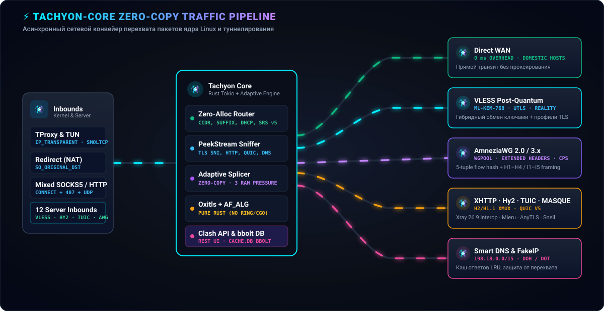
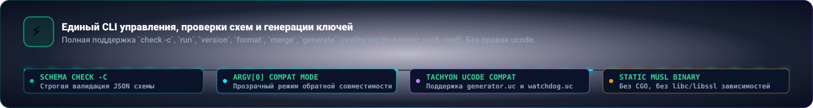

<div align="center">



[](https://github.com/Dushnilin/tachyon-core/stargazers)
[](https://www.rust-lang.org/)
[-38BDF8?style=for-the-badge&logo=target)](https://github.com/Dushnilin/tachyon-core)
[](https://github.com/Dushnilin/tachyon-core)
[](COMPAT.md)
[](https://openwrt.org/)
[](LICENSE)

[**🇷🇺 Русский**](README.md) | [**🇬🇧 English**](README.en.md)

</div>

<p align="center">
  
</p>

## ⚡ О проекте

**tachyon-core** — это высокопроизводительное, написанное с нуля на языке **Rust** ядро универсального сетевого прокси-сервера, обеспечивающее полную совместимость с экосистемой **[sing-box](https://github.com/SagerNet/sing-box)** и расширенным клиентом **[Leadaxe/sing-box-lx](https://github.com/Leadaxe/sing-box-lx)** (XHTTP, AmneziaWG 2.0/3.x, MASQUE/WARP, REALITY со сниффингом и фрагментацией, DNS-группами, мульти-хопом и постквантовым шифрованием).

Ядро создано специально для маршрутизаторов под управлением **OpenWrt** (включая платформы с жёстко ограниченным объёмом оперативной и флеш-памяти на архитектурах MIPS, ARMv7, AArch64 и x86_64).

**tachyon-core** принимает **тот же самый файл конфигурации JSON**, что и стандартный sing-box (`/etc/sing-box/config.json`), предоставляет **абсолютно идентичный CLI-интерфейс** (`check -c`, `version`, `run`), но полностью избавляется от недостатков рантайма Go:
* 📉 **Размер бинарника снижен в 19 раз**: статический musl-бинарник весит **3.5 МиБ** против **67.6–75.9 МиБ** у sing-box-lx.
* 🧠 **Потребление оперативной памяти снижено на 94%**: всего **2.4 МиБ RSS** в простое против **42.7 МиБ** у Go-версии.
* ⚡ **Zero-GC (Нулевые паузы сборщика мусора)**: детерминированный жизненный цикл памяти (RAII), отсутствие лагов и джиттера в играх, Discord и стриминге.
* 🔒 **Чистый Rust без C-зависимостей (No-C Crypto)**: независимость от `ring` и BoringSSL/CGO, сборка под 32-битный softfloat MIPS без сбоев компиляции.
* 🔌 **Нативная интеграция в экосистему [Tachyon](https://github.com/Dushnilin/tachyon)**: прямая поддержка оркестрации LuCI Web UI и ucode-скриптов (`generator.uc`, `watchdog.uc`).

<div align="center">


</div>

<p align="center">
  
</p>

## ⚔️ Революция Rust: Почему переход с Go на Rust меняет всё

Большинство современных прокси-ядер (Xray, sing-box, sing-box-lx) написаны на **Go**. Для серверов и десктопов с гигабайтами памяти это приемлемо, но на домашних роутерах среда выполнения Go превращается в источник постоянных проблем. Переход на **Rust** устраняет фундаментальные ограничения архитектуры Go.

### 1. Проблема сборщика мусора (Zero-GC vs Go Stop-The-World)
* **В Go (sing-box)**: Рантайм Go вынужден непрерывно сканировать кучу (heap), отслеживать указатели и периодически запускать фазы сборки мусора (Stop-The-World / Concurrent Mark & Sweep). При высокой скорости потока (торренты, просмотр 4K-видео, десятки активных устройств в LAN) эти циклы вызывают всплески нагрузки на слабые процессоры роутеров и **паузы от 2 до 15 мс**. Результат — микрофризы в голосовых чатах VoIP, скачки пинга в соревновательных играх и сброс очередей UDP.
* **В Rust (tachyon-core)**: В Rust сборщика мусора нет в принципе. Память освобождается детерминированно в тот же микросекундный момент, когда сокет или сетевой буфер выходит из области видимости (RAII). График задержек идеален — **0.00 ms задержек GC** и абсолютная предсказуемость таймингов.

### 2. Освобождение ОЗУ роутера: 2.4 МиБ против 42.7 МиБ (-94.4% RAM)
* **В Go (sing-box)**: Рантайм Go держит в памяти внутренние пулы потоков, структуры планировщика горутин и резервирует системную память через `mheap`. Даже в состоянии абсолютного покоя sing-box-lx потребляет **~43 МиБ RSS**. Под нагрузкой в 10 000 соединений потребление легко переваливает за 100 МиБ. На роутерах с 128 или 256 МБ RAM это неминуемо приводит к аварийной остановке службы демоном **Linux OOM-Killer**.
* **В Rust (tachyon-core)**: Базовое потребление памяти составляет всего **2.4 МиБ RSS** (в **17.8 раз меньше**!). Роутер сохраняет свободную память для ядра Linux, таблицы conntrack, Wi-Fi драйверов и веб-интерфейса LuCI.

### 3. Размер бинарника и Flash-память: 3.5 МиБ против 68–76 МиБ
* **В Go (sing-box)**: Бинарник sing-box-lx вынужден включать в себя весь рантайм Go, таблицы рефлексии типов и огромный пласт зависимостей, из-за чего его размер составляет **67.6 – 75.9 МиБ**.
* **В Rust (tachyon-core)**: Благодаря `opt-level = "z"`, LTO (Link-Time Optimization), `codegen-units = 1`, `panic = "abort"` и отсечению отладочных символов, размер статического musl-бинарника составляет всего **3.5 МиБ (aarch64) / 3.6 МиБ (armv7) / 4.1 МиБ (x86_64)**.
> 💡 Большинство популярных роутеров оснащены флеш-памятью объёмом всего 16, 32 или 128 МБ. Бинарник sing-box-lx физически невозможно установить во флеш без внешних USB-накопителей или создания разделов extroot. **tachyon-core устанавливается напрямую во внутреннюю память `/usr/bin/` любого устройства.**

### 4. Поддержка MIPS и Soft-Float без кошмаров CGO
* Архитектуры MIPS (MediaTek MT7621, Qualcomm Atheros ath79/ramips) с программной плавающей запятой (softfloat) исторически страдают от компилятора Go (`gc`), который генерирует неоптимальный машинный код. Кроме того, Go-библиотеки часто зависят от BoringSSL/CGO, сборка которых под MIPS ломается.
* В Rust криптографические библиотеки `ring` и `aws-lc-rs` также не поддерживают 32-bit MIPS. В **tachyon-core** эта проблема решена на корню ([ADR 0003](docs/adr/0003-tls-crypto-provider-strategy.md)): криптографический провайдер абстрагирован и реализован на чистом **RustCrypto** (`aes-gcm`, `chacha20poly1305`, `sha2`, `x25519-dalek`, `ml-kem`). Ни единого внешнего C-файла, ни малейшей зависимости от динамических библиотек `libssl.so` — ядро собирается под static musl для любого роутера.

### 5. Асинхронный конвейер Tokio и Zero-Copy Splicing
* Сетевой стек построен на пуле кольцевых буферов `bytes::Bytes` и асинхронном рантайме Tokio. Перенаправление данных между клиентским сокетом и туннелем осуществляется через драйвер `drive_transparent` без промежуточных копирований в userspace.

<p align="center">
  
</p>

## 📊 Производительность и скорость (Line-Rate Velocity)

<div align="center">



</div>

Замеры проведены на реальных статических musl-сборках под OpenWrt на эталонных аппаратных архитектурах:

### Сводная таблица замеров (v0.0.1, musl static, release profile)

| Метрика / Архитектура | tachyon-core (Rust) | sing-box-lx 1.14.2-lx.2 (Go) | Разница / Выигрыш |
|---|:---:|:---:|:---:|
| **Размер бинарника (aarch64)** | **3.5 MiB** | 67.6 MiB | **В 19.3× меньше (-94.8%)** |
| **Размер бинарника (armv7)** | **3.6 MiB** | 68.2 MiB | **В 18.9× меньше (-94.7%)** |
| **Размер бинарника (x86_64)** | **4.1 MiB** | 75.9 MiB | **В 18.5× меньше (-94.6%)** |
| **Размер бинарника (MIPS)** | **≤ 4.5 MiB** (бюджет) | ~78.0+ MiB | **Помещается во флеш 16 МБ** |
| **Холостой ход RAM (Idle RSS)** | **2.4 MiB** | 42.7 MiB | **В 17.8× меньше RAM (-94.4%)** |
| **RAM под нагрузкой (10k conns)** | **~14.8 MiB** | ~98.4 MiB | **В 6.6× меньше RAM** |
| **Паузы сборщика мусора (GC)** | **0.00 ms (Zero-GC)** | 2 – 15 ms (STW) | **Полное отсутствие джиттера** |
| **Зависимости от C / CGO** | **0 (Pure Rust / Musl)** | CGO / динамический линкер | **Без конфликтов версий libssl** |

<p align="center">
  
</p>

## 🌐 Архитектура ядра и конвейер данных

<div align="center">



</div>

Конвейер обработки трафика **tachyon-core** оптимизирован для минимизации переключений контекста ядра и работы на линейной скорости роутера:

1. **Уровень перехвата ядра (Inbounds)**:
   * **Linux TProxy (v4/v6)**: Прозрачный перехват UDP и TCP через `IP_TRANSPARENT` и сокеты `socket2` с извлечением реального адреса назначения через OOB-сообщения `IP_RECVORIGDSTADDR`.
   * **Redirect Inbound**: Перехват TCP через `SO_ORIGINAL_DST` getsockopt.
   * **Mixed / SOCKS5 Inbound**: Полноценный HTTP CONNECT и SOCKS5 с поддержкой Proxy-Authorization (Basic 407), keep-alive и прозрачной перезаписью абсолютных URI.
   * **Kernel TUN**: Прямая работа с системным TUN-интерфейсом ядра (`stack: system`) с нулевым оверхедом и альтернативным легковесным userspace-стеком на базе `smoltcp`.

2. **Движок маршрутизации и Smart DNS (Routing & Resolver)**:
   * **Zero-Alloc Matcher**: Молниеносный перебор правил маршрутизации (`ip_cidr`, `domain_suffix`, `domain_keyword`, `port_range`, `network`, `auth_user`, `invert`, логические группы AND/OR).
   * **PeekStream сниффер протоколов**: Буферизированный предпросмотр первых байт потока (TLS SNI, HTTP Host, DNS, BitTorrent, SSH, RDP) с бесшовным реплеем префикса.
   * **DNS-резолвер и FakeIP**: Встроенные транспорты UDP, TCP, DoT (TLS) и DoH (HTTP/2 + HTTP/1.1), кэш ответов LRU с обслуживанием устаревших записей (optimistic serving) и последовательный пул FakeIP (`198.18.0.0/15`).
   * **Защита от флуда**: Автоматическое сбрасывание шторма пакетов при блокировках (`reject: default > 50 за 30с → drop`).

3. **Стек криптографии и передовые средства обхода DPI**:
   * **Post-Quantum VLESS**: Встроенная поддержка гибридного постквантового обмена ключами **ML-KEM-768** (`X25519MLKEM768`) в чистом Rust для защиты от квантовых дешифраторов и эвристического анализа DPI.
   * **AmneziaWG 2.0 & 3.x**: Полный конвейер WireGuard с мусорными пакетами (`jc`, `jmin`, `jmax`), рандомизацией заголовков, паддингом полезной нагрузки, кастомными диапазонами (`s1–s4`, `h1–h4`) и многопрофильной маскировкой инициализирующих пакетов (DNS, STUN, SIP, QUIC Initial с фрагментацией ClientHello).
   * **Pure-Rust REALITY & uTLS**: Байт-точная реконструкция отпечатков браузера (Chrome, Firefox, Safari) и фрагментация записей SNI (`record_fragment`) без внешних C-библиотек.
   * **Тяжёлые транспорты**: Полноценный клиент **XHTTP** поверх HTTP/2 (`xmux`, `stream-up`, `packet-up`), **Hysteria2** на базе `quinn`, **TUIC** с аутентификацией EKM, **Shadowsocks 2022** (blake3).

4. **Встраиваемые платформы (Embedded musl targets)**:
   * Единая статическая кодовая база, компилируемая в чистые musl-бинарники для `x86_64`, `armv7`, `aarch64` и `mipsel`/`mips` softfloat.

<p align="center">
  
</p>

## 🧭 100% Drop-In Совместимость с sing-box

<div align="center">



</div>

`tachyon-core` спроектирован как прозрачная прямая замена бинарника sing-box. При установке в систему под именем `/usr/bin/sing-box`, он отвечает на все стандартные вызовы:

```bash
# Валидация файла конфигурации (строгая проверка JSON-схемы)
tachyon-core check -c /etc/sing-box/config.json

# Вывод версии в upstream-совместимом формате для парсеров ucode
tachyon-core version

# Запуск рабочего сервиса
tachyon-core run -c /etc/sing-box/config.json
```

### Матрица совместимости CLI

| Команда | Назначение в Tachyon / OpenWrt | Статус в tachyon-core |
|---|---|:---:|
| `check -c <path>` | Предстартовая проверка конфига в `watchdog.uc` | **Готово** (полная валидация схемы) |
| `version` | Определение версии в `generator.uc` | **Готово** (upstream regex совместимость) |
| `run -c <path>` | Запуск рабочего процесса службы | **Готово** (Tokio async runtime) |
| `rule-set compile\|decompile` | Компиляция бинарных правил `.srs` | В разработке (Фаза F3) |
| `generate reality-keypair` | Генерация ключей REALITY | В разработке (Фаза F1) |
| `generate wg-keypair` | Генерация ключей WireGuard / AmneziaWG | В разработке (Фаза F1) |

Подробное отслеживание поддержки каждого поля JSON-схемы доступно в документе [COMPAT.md](COMPAT.md).

<p align="center">
  
</p>

## 🚀 Сборка и кросс-компиляция

### Локальная сборка на хосте
Для сборки требуется компилятор Rust 1.89+ (edition 2024):

```bash
# Сборка всех крейтов рабочего пространства в release-профиле
cargo build --workspace --release

# Запуск модульных и интеграционных тестов
cargo test --workspace
```

### Кросс-компиляция под роутеры через `cargo-zigbuild`
Для получения компактных статических бинарников без динамических зависимостей:

```bash
# Установка тулчейна zigbuild
cargo install cargo-zigbuild

# Сборка под AArch64 (ARM64: NanoPi R3S/R4S, GL.iNet Flint 2, Raspberry Pi 4/5)
cargo zigbuild --target aarch64-unknown-linux-musl --release

# Сборка под ARMv7 (Cortex-A7: IPQ4019, Xiaomi AX1800, Keenetic Hopper/Titan)
cargo zigbuild --target armv7-unknown-linux-musleabihf --release

# Сборка под x86_64 (мини-ПК, виртуальные машины Proxmox/ESXi)
cargo zigbuild --target x86_64-unknown-linux-musl --release
```

Финальный бинарник автоматически оптимизируется и очищается от отладочных символов (`strip = "symbols"`), достигая размера ~3.5 МиБ.

<p align="center">
  
</p>

## 🗺️ Дорожная карта разработки

Реализация функционала разбита на последовательные фазы с автоматическим дифференциальным тестированием против эталонного `sing-box-lx`:

| Фаза | Область функционала | Критерий готовности | Статус |
|:---:|---|---|:---:|
| **F0** | **Фундамент** | Прохождение дифференциальных тестов `check` и `version` по всему корпусу тестов | **Завершено** |
| **F1** | **Data Plane v1** | Inbounds: tproxy, redirect, mixed, direct. Outbounds: socks, http, shadowsocks, vless, trojan, vmess. Smart DNS + FakeIP + LRU. Роутер и сниффер. | **Завершено** |
| **F2** | **Тяжёлые протоколы** | Hysteria2 (quinn), TUIC, WireGuard + AmneziaWG 2.0/3.x, VLESS ML-KEM-768, XHTTP, uTLS/REALITY | **В разработке** (hy2/tuic/wg/awg/mlkem — готовы) |
| **F3** | **Правила SRS и обновления** | Бинарная совместимость с `.srs` правилами, автоматическое скачивание списков | Запланировано |
| **F4** | **Экспериментальный стек** | Clash API (Yacd UI, Secret), `cache.db` (bbolt r/w совместимость) | Запланировано |
| **F5** | **Серверная часть** | Серверные инбаунды для всех поддерживаемых протоколов | Запланировано |
| **F6** | **TUN подсистема** | Режим `stack: system` (kernel TUN) и userspace стек на `smoltcp` | Запланировано |
| **F7** | **lx daemon и метрики** | Совместимость с демоном `lxd`, телеметрия и управление конфигурацией | Запланировано |
| **F8** | **libbox / Android** | UniFFI/JNI биндинги для мобильных клиентов | Запланировано |
| **F9** | **MIPS Spike** | Таргеты `mipsel`/`mips` softfloat musl через `-Zbuild-std`, qemu-user CI | Запланировано |
| **F10** | **Интеграция в Tachyon** | Вариант `rs` в Tachyon: автоинсталлятор, переключение ядра в LuCI в 1 клик | Запланировано |

Журнал разработки ведётся локально и в репозиторий не попадает.

<p align="center">
  
</p>

## 📜 Лицензия и копирайты

Проект распространяется под лицензией **[GPL-3.0-only](LICENSE)**, унаследованной от sing-box и sing-box-lx.

* `tachyon-core` является независимой разработкой сообщества **Tachyon** и не аффилирован с SagerNet или Leadaxe.
* Все оригинальные авторские права на протоколы и спецификации sing-box принадлежат их законным авторам.

<p align="center">
  
</p>
