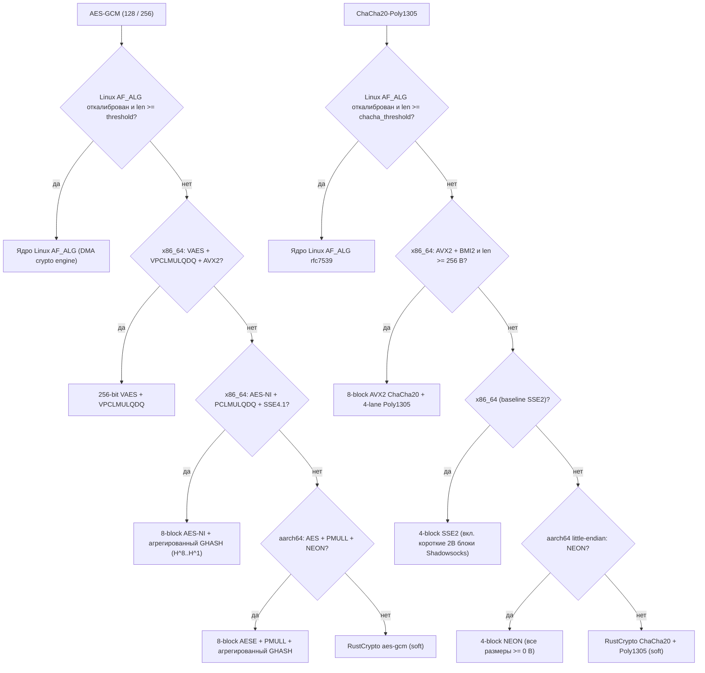
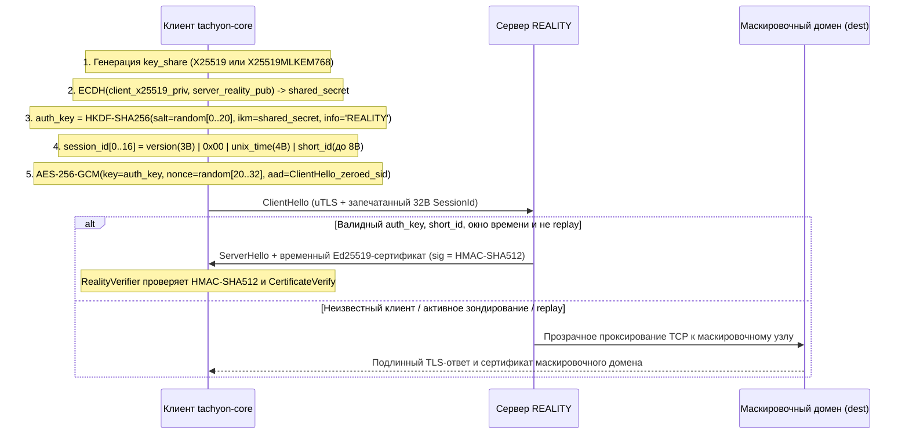

# Криптография, TLS, uTLS, REALITY, ECH и QUIC

Криптографическая и TLS-подсистема `tachyon-core` сосредоточена в двух крейтах: `core-crypto` и `core-tls`. Вся реализация написана на чистом Rust без C/C++, CGO, `ring`, `aws-lc-rs`, `openssl` и кросс-компилятора C. Это обеспечивает единую сборку для всех целевых архитектур, включая tier-3 `mips`/`mipsel` и `armv6` soft-float.

---

## 1. Pure-Rust криптография и профиль компиляции

Крейт `core-crypto` реализует интерфейс `rustls::crypto::CryptoProvider` и криптографический слой QUIC (`quinn_proto::crypto`) поверх примитивов RustCrypto (`aes`, `aes-gcm`, `chacha20poly1305`, `sha2`, `sha3`, `hmac`, `hkdf`, `x25519-dalek`, `p256`, `p384`, `ml-kem`, `blake2`, `argon2`, `subtle`) и собственных SIMD-реализаций AEAD.

### Стратегия оптимизации сборки

В `Cargo.toml` применено разделение оптимизаций:
- **Плоскость управления (`[profile.release]`)**: `opt-level = "z"`, `lto = true`, `codegen-units = 1`, `panic = "abort"`, `strip = "symbols"`, `overflow-checks = false` — минимальный размер бинарника для роутеров с ограниченной flash-памятью.
- **Горячий путь криптографии и данных (`[profile.release.package.*]`)**: `opt-level = 3` для `core-crypto`, `core-tls`, `aes`, `aes-gcm`, `ghash`, `polyval`, `chacha20`, `chacha20poly1305`, `poly1305`, `ctr`, `cipher`, `universal-hash`, `sha2`, `hmac`, `memchr`, `curve25519-dalek`, `x25519-dalek`, `ml-kem`, `blake2`, `rustls`, `tokio-rustls`, `quinn*`, `h2`, `h3*`, `smoltcp`, `tokio`, `bytes`.

### Поддерживаемые алгоритмы `CryptoProvider`

| Категория | Алгоритмы |
|---|---|
| TLS 1.3 шифронаборы | `TLS_AES_128_GCM_SHA256` (`0x1301`), `TLS_AES_256_GCM_SHA384` (`0x1302`), `TLS_CHACHA20_POLY1305_SHA256` (`0x1303`) — все с поддержкой QUIC (`KeyBuilder`). |
| TLS 1.2 шифронаборы | `TLS_ECDHE_{ECDSA,RSA}_WITH_{AES_128_GCM_SHA256, AES_256_GCM_SHA384, CHACHA20_POLY1305_SHA256}`. |
| Обмен ключами (KX) | `X25519MLKEM768` (`0x11ec`, гибридный постквантовый для TLS 1.3), `X25519`, `secp256r1` (P-256), `secp384r1` (P-384). |
| Подпись и верификация | ECDSA (P-256/SHA-256, P-384/SHA-384, P-521/SHA-512), Ed25519, RSA PKCS#1 / PSS (SHA-256/384/512), чистая Rust-верификация постквантовых подписей FIPS 204 (`ML-DSA-44`, `ML-DSA-65`, `ML-DSA-87`). |
| Генератор энтропии | Системный `OsRng` (`getrandom`). |

### Автоматическая приоритизация шифронаборов по ISA

При инициализации провайдера `CpuCaps::detect().prefers_chacha()` проверяет наличие аппаратного `AES + PMULL` (`AES-NI + PCLMULQDQ` на `x86_64` или `AES + PMULL` на `aarch64`):
- На процессорах с аппаратным AES-GCM в начало списка ставятся `TLS_AES_128_GCM_SHA256`, `TLS_AES_256_GCM_SHA384`, затем `TLS_CHACHA20_POLY1305_SHA256`.
- На процессорах без аппаратного AES (`MIPS 24Kc`/`1004Kc`, `ARMv6`/`ARMv7`, `Cortex-A53` без Crypto Extensions, `RISC-V`) приоритет автоматически отдаётся `TLS_CHACHA20_POLY1305_SHA256`, при этом `TLS_AES_128_GCM_SHA256` сохраняется в списке (обязателен по RFC 9001 для пакетов QUIC Initial).

---

## 2. Runtime ISA Dispatch (`cpu.rs`, `fastgcm.rs`, `fastchacha.rs`)

Базовые цели компилируются без глобального включения расширений, способных вызвать `SIGILL` на старых CPU:
- `x86_64-unknown-linux-musl` собирается с `-C target-cpu=x86-64` (v1 baseline), подходит для Celeron/Atom J1900/J4125/N5105 и виртуальных машин `kvm64`.
- `aarch64-unknown-linux-musl` и Android/Apple `aarch64` собираются с `--cfg aes_armv8 --cfg polyval_armv8 --cfg chacha20_force_neon` (без глобального `-C target-feature=+aes,+pmull`): инструкции генерируются только внутри функций с `#[target_feature]`, вызываемых строго после runtime-проверки.
- `armv7` собирается под базовый `v7a + vfp3-d16` (без принудительного `+neon`, чтобы избежать `SIGILL` на SoC без NEON).
- `armv6` и `mips`/`mipsel` собираются в режиме soft-float (`+soft-float`, без аппаратного FPU и SIMD).

### Механизм определения возможностей CPU (`CpuCaps`)

| Архитектура | Способ определения в runtime | Отслеживаемые расширения |
|---|---|---|
| `x86_64` | `std::is_x86_feature_detected!` (CPUID) | `aes`, `pclmulqdq`, `sha`, `sse4.2` (`crc32`), `avx2`, `ssse3`, `sse4.1`, `bmi2`, `vaes`, `vpclmulqdq`. |
| `aarch64` (Linux/Android) | `libc::getauxval(AT_HWCAP)` (с fallback на `is_aarch64_feature_detected!`) | `ASIMD` (`neon`), `AES`, `PMULL`, `SHA2`, `CRC32`. |
| `aarch64` (macOS/iOS) | `std::arch::is_aarch64_feature_detected!` | `aes`, `pmull`, `sha2`, `crc`, `neon`. |
| `arm` (Linux/Android) | `getauxval(AT_HWCAP)` + `getauxval(AT_HWCAP2)` | `NEON`, `AES`, `PMULL`, `SHA2`, `CRC32`. |
| `mips`, `mipsel`, `riscv64`, `no_std` | Compile-time `probe_const()` | Базовый программный путь (`soft`). |

### Иерархия диспетчеризации AEAD

При ошибке проверки тега аутентификации (`open() == false`) все ветки принудительно зануляют выходной буфер, не оставляя расшифрованных фрагментов в памяти.

---

## 3. Ядерное ускорение Linux `AF_ALG`

Модуль `core-crypto/src/afalg.rs` позволяет переносить операции `AES-GCM` и `ChaCha20-Poly1305` (`rfc7539(chacha20,poly1305)`) на аппаратные DMA-ускорители ядра Linux (например, NXP CAAM, MediaTek EIP93) через сокеты семейства `AF_ALG` (`38`, `SOL_ALG = 279`, тип `aead`).

### Контракт взаимодействия и самокалибровка

1. **Исключение лишних копий**: `sendmsg` передаёт `aad || plaintext` (или `aad || ciphertext || tag`) как scatter-iovec с управляющими сообщениями `ALG_SET_OP`, `ALG_SET_IV` (12 байт), `ALG_SET_AEAD_ASSOCLEN`; `recvmsg` использует точную суммарную длину буферов (исключает блокировку `af_alg_wait_for_data`).
2. **Условия автоактивации**:
   - Для AES-GCM `AF_ALG` не запускается, если CPU уже имеет аппаратный SIMD (`has_aes_gcm_simd()`).
   - Для ChaCha20-Poly1305 `AF_ALG` не запускается, если доступны `AVX2 + BMI2` или `NEON`.
3. **Самопроверка (`self_test`)**: выполняется однократно на процесс против эталона RustCrypto (ключи 16 и 32 байта, AAD до и свыше стекового порога 128 байт, тест искажённого тега с проверкой зануления буфера, тест искажённого nonce). При любом расхождении `AF_ALG` полностью отключается.
4. **Калибровка порога (`threshold`)**: ядро соревнуется с программной веткой на возрастающем ряде размеров записи `256`, `1024`, `1440`, `4096`, `16384` байт. Первый размер, на котором `AF_ALG` не медленнее программного пути, становится порогом отсечения; более короткие пакеты остаются в userspace (из-за стоимости пары системных вызовов `sendmsg`/`recvmsg`). Если ядро проигрывает на всех размерах или `AF_ALG` заблокирован seccomp (как по умолчанию в Docker), порог равен `0` (отключено).
5. **Ручное управление**:
   - `TACHYON_AF_ALG=off` или `0` — принудительно отключить `AF_ALG`.
   - `TACHYON_AF_ALG=on`, `1` или `force` — принудительный режим (порог `1` байт, используется в тестах и при принудительной разгрузке на DMA).

---

## 4. Стек TLS 1.3 и верификация сертификатов

`tachyon-core` использует два взаимодополняющих пути TLS:
- **Стандартный `rustls` / `tokio-rustls`** (с провайдером `core-crypto`): используется для обычного TLS (вкл. TLS 1.2/1.3) и QUIC.
- **Собственный асинхронный стек TLS 1.3 (`core-tls::{client, server, record, tls13, messages}`)** поверх любого `AsyncRead + AsyncWrite`: обеспечивает полный контроль над байтовым представлением `ClientHello` (uTLS), встраивание аутентификации REALITY, ECH, прямой переход потока без повторного шифрования (`Vision` direct read/write) и сжатие сертификатов.

### Возможности собственного стека `core-tls`

| Компонент | Реализованное поведение |
|---|---|
| Записной слой (`record.rs`, `tls_utls.rs`) | Батчинг чтения записей TLS 1.3 (`2` записи на `< 56 MiB`, `3` на `< 96 MiB`, `7` записей `~114.8 KiB` на `>= 96 MiB` — строго ниже 128 KiB порога `mmap` в musl), постепенный разгон размера исходящего фрагмента до `MAX_FRAGMENT` (16 KiB), режим одиночной записи (`vision_framing`) и прямое переключение read/write (`enable_direct_read` / `enable_direct_write`) для XTLS Vision. |
| Возобновление сессий (PSK) | Клиентский кэш `NewSessionTicket` (`MAX_PSK_CACHE_KEYS = 256`, до 4 тикетов на ключ, макс. время жизни 7 суток). |
| Сжатие сертификатов (RFC 8879) | Декодирование `CompressedCertificate` для алгоритмов `zlib` (`1`), `brotli` (`2`) и `zstd` (`3`, чистый Rust `ruzstd`) с жёстким лимитом распаковки `1 MiB` и проверкой, что алгоритм действительно объявлялся в `ClientHello`. |
| Защита сервера от replay (`ReplayBloomFilter`) | Двухпоколенный lock-free атомарный Bloom-фильтр (`2 × 8 KiB = 16 KiB`, `AtomicU32` для 32-битных `mips`/`mipsel`, ротация каждые 120 с или 8192 записи) для отсечения повторных ClientHello / REALITY-пакетов. |
| Учёт смещения часов (`NtpTimeProvider`) | Глобальный атомарный сдвиг `NTP_OFFSET_MS` применяется при проверке сроков действия сертификатов и временных меток REALITY, даже если системные часы роутера не синхронизированы. |
| Верификация сертификатов (`verify.rs`) | `WebpkiVerifier` на встроенном корневом хранилище Mozilla (`webpki-roots`, общий `Arc<RootCertStore>` без копирования ~140 корней на соединение), SHA-256 pinning (hex и base64), `RealityVerifier`, явный `AcceptsAnything` для `insecure: true`. |

---

## 5. Профили uTLS ClientHello

В `core-tls/src/fingerprints.rs` и валидаторе `core-config` поддерживаются **13 именных профилей** и **2 динамических режима** (всего 15 канонических идентификаторов), а также нормализация псевдонимов в формате `hello*` / `okhttp*` / `randomizedalpn` / `randomizednoalpn`.

Отпечаток хранится как компактная таблица данных: список шифронаборов, упорядоченный список расширений и статические тела расширений. Поля `random`, `session_id`, `SNI`, `ALPN`, `GREASE` (свежие уникальные значения RFC 8701 на каждое соединение, без коллизий между слотами) и эфемерные ключи `key_share` генерируются заново при каждом рукопожатии в `hello::build`.

| Профиль | Тип | Описание и особенности |
|---|---|---|
| `chrome` | Статический | Современный Google Chrome 155: GREASE, `X25519MLKEM768` + `X25519` в `key_share`, ALPS, `compress_certificate`, `ECH` GREASE. На CPU без аппаратного AES доступен вариант с порядком шифронаборов ChaCha20-first (как у BoringSSL). |
| `chrome_psk` | Статический | Профиль Chrome с поддержкой PSK-возобновления сессий. |
| `chrome_psk_shuffle` | Перемешиваемый | Профиль Chrome с PSK и перестановкой внутренних расширений (между крайними GREASE-слотами) на каждое рукопожатие. |
| `chrome_padding_psk_shuffle` | Перемешиваемый | Профиль Chrome с PSK, padding и перестановкой расширений на каждое рукопожатие. |
| `chrome_pq` | Статический | Профиль Chrome с явным постквантовым обменом `X25519MLKEM768`. |
| `chrome_pq_psk` | Статический | Профиль Chrome с постквантовым обменом `X25519MLKEM768` и PSK. |
| `firefox` | Статический | Современный Firefox 148: `X25519MLKEM768` (переиспользование X25519-половины гибрида в отдельном share, как в браузере), `zlib`/`brotli`/`zstd` сжатие сертификатов. |
| `safari` | Статический | Современный Safari: характерный порядок шифронаборов и расширений, независимые ключи X25519. |
| `edge` | Статический | Профиль Microsoft Edge. |
| `ios` | Статический | Профиль Safari/TLS на iOS. |
| `android` | Статический | Профиль Android OkHttp/TLS (принимает псевдонимы `okhttp*`, `helloandroid_*`). |
| `360` | Статический | Профиль браузера 360. |
| `qq` | Статический | Профиль браузера QQ. |
| `random` | Динамический (на процесс) | Однократно при первом обращении выбирает случайный профиль из пула `{chrome, firefox, safari, qq}` и закрепляет его за процессом (`OnceLock`). |
| `randomized` | Динамический (на соединение) | На каждое рукопожатие формирует перемешанный набор расширений и опциональных шифронаборов на базе Chrome при сохранении обязательных полей TLS 1.3 (`SNI`, `ALPN`, `supported_groups`, `key_share`). |

---

## 6. Протокол REALITY (X25519 и постквантовый `X25519MLKEM768`)

REALITY реализован на обеих сторонах (клиент и сервер) в `core-tls/src/{reality.rs, keyshare.rs, verify.rs, server.rs}`.

### Аутентификация клиента внутри `ClientHello`

### Постквантовый гибрид `X25519MLKEM768` (`0x11ec`)

- Структура `key_share` соответствует `draft-ietf-tls-ecdhe-mlkem-05`:
  - клиентская доля: `ML-KEM-768 encapsulation key (1184 B) || X25519 pub (32 B) = 1216 B`;
  - серверная доля: `ML-KEM-768 ciphertext (1088 B) || X25519 pub (32 B) = 1120 B`;
  - общий секрет TLS: `ML-KEM shared secret (32 B) || X25519 shared secret (32 B) = 64 B`.
- Для вычисления `auth_key` REALITY при наличии гибридной доли в `key_share` используется именно X25519-половина этой доли (`offered[1184..1216]`), чтобы клиент и сервер гарантированно вывели одинаковый 32-байтный секрет без дополнительного обмена.
- Флаг `tls.reality.support_x25519mlkem768` принудительно добавляет гибридную долю в `ClientHello` даже для профилей браузеров, которые по умолчанию отправляют только имя группы без самой доли.

### Проверка сертификата и защита от тихой подмены

- **Проверка подлинности REALITY-сервера (`RealityVerifier`)**: сервер выпускает временный Ed25519-сертификат (поддерживаются как X.509 v3, так и X.509 v1 без тега версии `[0]`, а также оба варианта ASN.1 SPKI — с `NULL` и без `NULL`), внешней подписью которого служит `HMAC-SHA512(auth_key, ed25519_pub)`. Клиент проверяет равенство HMAC и затем валидирует подпись `CertificateVerify` этим Ed25519-ключом.
- **Обнаружение fallback на маскировочный домен**: если сервер не признал клиента (неверный ключ, `short_id`, рассинхронизация времени), он прозрачно перенаправляет соединение на маскировочный сайт, и тот возвращает настоящий сертификат с валидной цепочкой доверия. `RealityVerifier` фиксирует вердикт (`verdict()`): если сертификат не содержит Ed25519-ключа или подпись не совпадает с `HMAC-SHA512(auth_key, pub)`, проверка проваливается в обычный `WebpkiVerifier` и сообщает об этом вызывающему слою, не позволяя незаметно установить туннель с посторонним хостом.
- **Анти-replay на сервере**: `ReplayBloomFilter` отсекает повторно предъявленные ClientHello, переводя их на маскировочный домен.

---

## 7. Encrypted Client Hello (ECH)

Модуль `core-tls/src/ech.rs` реализует ECH по стандарту **RFC 9849** (`draft-ietf-tls-esni-18`, расширение `0xfe0d`) поверх собственной pure-Rust реализации **HPKE (RFC 9180)**:
- **KEM**: `DHKEM(X25519, HKDF-SHA256)` (`0x0020`).
- **KDF**: `HKDF-SHA256` (`0x0001`).
- **AEAD**: `AES-128-GCM` (`0x0001`), `AES-256-GCM` (`0x0002`), `ChaCha20-Poly1305` (`0x0003`).

Поддерживаемые режимы получения и применения `ECHConfigList`:
1. Статическая конфигурация из поля `tls.ech.config` / `config_path` (PEM или Base64/URL-safe Base64).
2. Автоматическое получение записей `HTTPS` (`TYPE65`) / `SVCB` (`TYPE64`) через DNS-сервис (`query_server_name`, `dns_server`, `auto_dns`) с кэшированием `public_name`.
3. Формирование внешнего `ClientHelloOuter` (с открытым `public_name` в SNI) и зашифрованного `ClientHelloInner` (с реальным целевым SNI и общими сжатыми расширениями), а также `grease_fallback` при отсутствии валидной ECH-конфигурации.

---

## 8. Стек QUIC (`quinn` + pure-Rust бэкенд)

В `Cargo.toml` зависимость `quinn` подключается с `default-features = false, features = ["runtime-tokio"]`, что полностью исключает `ring` и `aws-lc-rs`. Криптографический бэкенд для `quinn-proto` реализован в `core-tls/src/quic/`:

- **`rustls_backend.rs`**: адаптеры `QuinnHeaderKey`, `QuinnPacketKey`, `TlsSession`, `QuicClientConfig`, `QuicServerConfig`, подключённые к `core_crypto::provider()`. Целостность Retry-пакетов (RFC 9001 §5.8) вычисляется на чистом `aes-gcm` (AES-128-GCM).
- **`rustcrypto.rs`**: реализации `quinn_proto::crypto::{HmacKey, AeadKey, HandshakeTokenKey}` на `hmac`/`hkdf`/`aes-gcm` для stateless-reset и токенов валидации адреса.
- **`core-crypto/src/quic.rs`**: защита заголовков QUIC (RFC 9001 §5.4) — маскирование 5-байтовой маской через `AES-128-ECB`, `AES-256-ECB` (с однократным расширением расписания ключей) и `ChaCha20`, а также пакетный AEAD поверх `fastgcm` / `fastchacha` с поддержкой SIMD и `AF_ALG`.

Этот же стек QUIC используется во всех QUIC-протоколах ядра: `hysteria2`, `tuic`, `masque`, `naive` (H3), `tewfai`, `dns` (`quic` / `h3`) и `transport: quic`.

---

## Навигация

- [Оглавление документации](../README.md)
- [Архитектура ядра](./overview.md)
- [Аппаратная адаптация, управление памятью и защита flash](./memory-and-hardware.md)
- [Общие объекты конфигурации (TLS, uTLS, REALITY, ECH)](../02-config/common-objects.md)
- [Протокольные спецификации и совместимость](../03-protocols-and-formats/proxy-wire-specs.md)
- [Эксплуатация, sizing и целевые платформы](../04-api-and-cli/operations-and-sizing.md)
