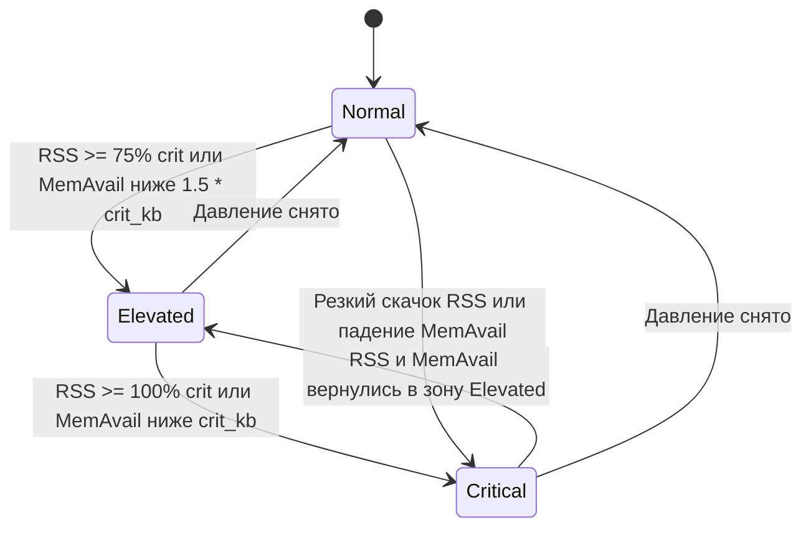
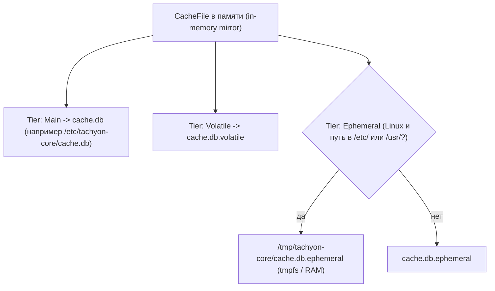

# Аппаратная адаптация, управление памятью и защита flash

`tachyon-core` предназначен для работы в единой сборке на всём спектре оборудования: от встраиваемых роутеров MIPS/ARMv6 с 16–32 MiB ОЗУ и расширений iOS NetworkExtension (жёсткий потолок Jetsam 50 MiB) до роутеров OpenWrt класса Filogic 820/830 (256–512 MiB) и серверов 10+ Gbit/s с десятками гигабайт памяти. Вместо жёстко заданных констант ядро на старте строит непрерывный аппаратный профиль (`HardwareProfile`), динамически корректирует окна по измеренному BDP, отслеживает давление памяти и изолирует частые записи состояния от энергонезависимой NAND/NOR flash-памяти.

---

## 1. Непрерывная аппаратная адаптация (`hardware.rs`)

При запуске процесса `HardwareProfile::detect()` однократно собирает телеметрию хоста и вычисляет параметры всех подсистем. Сводка профиля выводится одной строкой в журнал при первом старте `BoxInstance`:

```text
[INFO] workers=2 (cpu.max 1.5) crypto=0.22 GiB/s (armv8 aes+pmull) link=1 Gbit/s bdp=250 KiB h2win=1024 KiB relay=120 KiB
```

### Источники телеметрии хоста

| Подсистема | Платформа | Источник данных | Переопределение (env) |
|---|---|---|---|
| Объём доступной ОЗУ (`total_ram_mb`) | Linux / Android | `/proc/meminfo` (`MemTotal`), ограничивается сверху cgroup v2 (`/sys/fs/cgroup/memory.max`), cgroup v1 (`/sys/fs/cgroup/memory/memory.limit_in_bytes`) и `2 × memlimit` (если задан `TACHYON_MEMLIMIT_MB` или `GOMEMLIMIT`). Минимум 16 MiB. | `TACHYON_RAM_MB`, `TACHYON_MEMLIMIT_MB`, `GOMEMLIMIT` |
| Объём доступной ОЗУ | iOS | `sysctlbyname("hw.memsize")`, принудительно ограничивается потолком **50 MiB** (лимит Jetsam для `NEPacketTunnelProvider`), даже если на устройстве 6–8 GiB физической DRAM. | `TACHYON_RAM_MB`, `TACHYON_MEMLIMIT_MB` |
| Объём доступной ОЗУ | macOS / FreeBSD / DragonFly | `sysctlbyname("hw.memsize")` (macOS) или `sysctlbyname("hw.physmem")` (BSD). | `TACHYON_RAM_MB`, `TACHYON_MEMLIMIT_MB` |
| Объём доступной ОЗУ | OpenBSD / NetBSD | `sysctl(CTL_HW, HW_PHYSMEM64)`. | `TACHYON_RAM_MB`, `TACHYON_MEMLIMIT_MB` |
| Объём доступной ОЗУ | Windows | Win32 API `GlobalMemoryStatusEx` (`ullTotalPhys`). | `TACHYON_RAM_MB`, `TACHYON_MEMLIMIT_MB` |
| Размер страницы памяти | Unix / Linux / Android / Apple | `libc::sysconf(_SC_PAGESIZE)` — определяет фактический размер страницы **4 KiB**, **16 KiB** (Apple Silicon, Android 15+) или **64 KiB** (серверные ARM64). Используется для точного пересчёта страниц из `/proc/self/statm` и `vm_statistics64` в байты. | — |
| Топология CPU и квоты | Linux / Android | Маска разрешённых ядер `sched_getaffinity`, квота cgroup v2 (`cpu.max`) / v1 (`cpu.cfs_quota_us` / `cpu.cfs_period_us`), частоты из `/sys/devices/system/cpu/cpuN/cpufreq/{cpuinfo_max_freq,scaling_max_freq}` или `cpu_capacity`. Если самое быстрое ядро быстрее самого медленного на `>= 15%`, включается режим `heterogeneous` (`fast_cpus` для воркеров Tokio, `slow_cpus` для `spawn_blocking`). | `TACHYON_WORKERS` |
| Скорость криптографии | Все | Стартовый микробенчмарк (~6 мс: 3 серии по ~2 мс, сохраняется лучший результат для устойчивости к помехам планировщика) на 1400-байтовых записях `AES-128-GCM` и `ChaCha20-Poly1305`. Вычисляется оценка пропускной способности ядра `per_core_gbit = max(aes, chacha) × 2.5`. | — |
| Скорость сетевого линка (`link_mbps`) | Linux / Android | `/sys/class/net/<iface>/speed` с fallback на `ioctl(SIOCETHTOOL, ETHTOOL_GSET)` среди активных (`operstate != down`) физических интерфейсов (исключаются `lo` и виртуальные шины `vmbus`, `virtio`, `xen`, `virtual`). Для виртуальных сред устанавливается `(1000 Mbit/s, link_is_virtual = true)`. | `TACHYON_LINK_MBPS` |
| Базовый и фактический RTT | Все | Базовый RTT: `20 ms` при `link_mbps < 1000`, иначе `2 ms`. В процессе работы обновляется из реальных TCP/TLS/QUIC рукопожатий (фильтруются loopback `< 100 us` и выбросы `> 1 s`; при скачке `> 2x` — мгновенный переход, иначе сглаживание `EWMA (3·prev + cur) / 4`). | `TACHYON_RTT_MS` |

---

## 2. Непрерывное масштабирование параметров по классам ОЗУ

Все лимиты вычисляются непрерывными формулами от `total_ram_mb`, `workers`, `per_core_gbit` и `bdp_bytes` с ограничением сверху бюджетом памяти (`total_ram_bytes / 16`). В таблице показаны расчётные значения для характерных классов устройств (в режиме `PressureLevel::Normal` при базовом RTT):

| Параметр | 16–32 MiB (MIPS / ARMv6) | 50 MiB (iOS Jetsam) | 64 MiB (OpenWrt) | 256–512 MiB (Filogic 820/830) | 4–64 GiB (Сервер 10G+) |
|---|---|---|---|---|---|
| `workers` (Tokio) | `1` (`current_thread`) | `1` (C ABI cap `<= 2`) | `1` (`current_thread`) | `2–4` (по ядрам и `RAM/48`) | Все доступные ядра / квота |
| `max_blocking_threads` | `2` | `2` | `2` | `8–16` | до `16 × workers` |
| `relay_buf_size` | `64 KiB` | `64 KiB` | `64 KiB` | `120 KiB` | `120 KiB` |
| `splice_pipe_size` | `256 KiB` | `256 KiB` | `256 KiB` | `512 KiB–1 MiB` | `1 MiB` |
| `stream_max_buf` | `32–48 KiB` | `56 KiB` | `128 KiB` | `200–256 KiB` | `256 KiB` |
| `smoltcp` init / max TCP | `16 KiB` / `128–240 KiB` | `64 KiB` / `368 KiB` | `64 KiB` / `2 MiB` | `64 KiB` / `4 MiB` | `64 KiB` / `4 MiB` |
| `h2_stream_window` / `conn` | `512 KiB–1 MiB` / `1–2 MiB` | `1.5 MiB` / `3 MiB` | `1 MiB` / `4 MiB` | `1–2 MiB` / `4–8 MiB` | `8–32 MiB` / `32–128 MiB` |
| `h2_pool` (sessions × streams) | `1 × 2` | `2 × 2` | `2 × 2` | `4–8 × 2` (`×1` при `>= 512M`) | `4–8 × 1` |
| `quic_stream` / `conn` / `dg` | `0.5–1 MiB` / `1.5–3 MiB` / `256 KiB` | `1.5 MiB` / `4.5 MiB` / `384 KiB` | `2 MiB` / `5 MiB` / `512 KiB` | `2–3 MiB` / `5–6 MiB` / `1 MiB` | `8–32 MiB` / `20–64 MiB` / `2–4 MiB` |
| `quic_pool` (conns × streams) | `1 × 8` | `1 × 16` | `1 × 16` | `2–8 × 8` | `2–8 × 8` |
| `udp_socket_buffer` | `256 KiB` | `512 KiB` | `512 KiB` | `2–4 MiB` | `16 MiB` |
| `dns_cache_capacity` (профиль / `DnsService` min `1024`) | `512` (`1024`) | `512` (`1024`) | `512` (`1024`) | `2048–4096` | `8192` |
| `fakeip` LRU capacity (v4 / v6) | `4096` | `4096` | `4096` | `8192–16384` | `32768` |
| `udp_nat_max_sessions` | `128` | `128` | `128` | `512–1024` | `8192` |
| `tun_max_tcp_sessions` | `256` | `256` | `256` | `1024–2048` | `8192` |
| `ruleset_fetch_concurrency` | `1` | `1` | `1` | `1` (`< 320M`) / `2` | `2–4` |
| `wg_rx_batch_len` | `128` | `128` | `128` | `128–256` | `256` |

### Почему буфер `relay_buf_size` ограничен 120 KiB

На статических musl-сборках аллокатор `mallocng` переводит выделения размером от `128 KiB` (`131 052 B`) в отдельные системные вызовы `mmap`/`munmap`, что вызывает межъядерные TLB shootdown и фрагментацию RSS. Значение `120 KiB` (и аналогичный батч `7 × TLS 1.3 record ≈ 114.8 KiB` в `tls_utls.rs`) остаётся строго ниже этого порога и повторно используется внутри slab/пулов без системных вызовов.

### Динамический BDP-скейлинг

Произведение пропускной способности на задержку вычисляется как:

```text
BDP (bytes) = max(16 KiB, (effective_link_mbps * observed_rtt_us / 8000) * 1024)
```

При наблюдаемом WAN RTT (`>= 5 ms` для HTTP/2 и `>= 10 ms` для QUIC) методы `current_h2_windows()` и `current_quic_windows()` динамически расширяют окна потока и соединения до `2 × BDP` (с округлением до степени двойки), но никогда не выходят за пределы бюджета памяти данного класса ОЗУ и за текущие ограничения клапана давления памяти.

Для пользовательского TCP-стека `smoltcp` (`tun`, `wireguard`, `masque`) используется справедливое распределение бюджета между `N` одновременными потоками (`smol_tcp_fair_max_buf(active_streams)`): каждый сокет стартует с `16 KiB` (`< 48 MiB`) или `64 KiB` (`>= 48 MiB`), а верхняя граница автонастройки одного потока делится от суммарного потолка стека (`0.25–1 MiB` на `< 56 MiB`, `4 MiB` на `<= 160 MiB`, `8 MiB` на `< 512 MiB`, `16 MiB` на `>= 512 MiB`), предотвращая вытеснение памяти при сотнях параллельных соединений.

---

## 3. Клапан давления памяти (`PressureLevel`)

Фоновая задача `memory-pressure` в `BoxInstance` каждые **5 секунд** замеряет текущий RSS процесса (`process_memory_bytes()` с учётом реального `page_size`) и доступную физическую память системы (`MemAvailable` на Linux/Android, `GlobalMemoryStatusEx` на Windows, `host_statistics64` на macOS/iOS), обновляя lock-free атомарный индикатор `MEMORY_PRESSURE`.



### Пороговые значения RSS и `MemAvailable`

| Класс `total_ram_mb` | Критический порог RSS (`rss_crit_mb`) | Порог `Elevated` RSS | Критический `MemAvailable` (`crit_kb`) |
|---|---|---|---|
| `< 56 MiB` | `45%` RAM (ограничен `6..25 MiB`) | `75%` от `rss_crit_mb` | `ram_mb × 96 KiB` (`min 1.5 MiB`) |
| `56..=192 MiB` | `55%` RAM (ограничен `32..96 MiB`) | `75%` от `rss_crit_mb` | `ram_mb × 96 KiB` |
| `193..=512 MiB` | `45%` RAM (ограничен `96..230 MiB`) | `75%` от `rss_crit_mb` | `ram_mb × 96 KiB` (`max 48 MiB`) |
| `513..=2048 MiB` | `45%` RAM (ограничен `230..920 MiB`) | `75%` от `rss_crit_mb` | `48 MiB` |
| `> 2048 MiB` | `RAM / 16` (ограничен `256..512 MiB`) | `75%` от `rss_crit_mb` | `32 MiB` |

Если задана переменная `TACHYON_MEMLIMIT_MB` или `GOMEMLIMIT`, `rss_crit_mb` дополнительно ограничивается сверху этим лимитом (не ниже 6 MiB для `< 56 MiB` и 24 MiB для остальных устройств).

### Реакция подсистем на давление и простой

| Состояние / триггер | Действия рантайма |
|---|---|
| Переход `Normal -> Elevated` или пребывание в `Critical` | Вызов `purge_all_runtime_pools()`: очистка thread-local и глобальных буферных пулов (`inbound`, `tls_utls`, `h2io`, `shadowsocks`, `anytls`, `vmess`), усечение `clash_state`, очистка пулов DNS-транспортов, вызов `SLAB_PURGE_HOOK`, `malloc_trim(0)` на Linux glibc, инкремент метрики `tachyon_pool_purges_total`. |
| `Elevated` | Буферы перестают возвращаться в пулы (сразу освобождаются); H2/QUIC окна и пулы сокращаются вдвое; `smoltcp` max-буфер делится на 4 (`min 64/128 KiB`); очереди mux и `tun_max_tcp_sessions` делятся на 2; `splice_pipe_size` ограничивается `64 KiB`, idle-таймаут `splice` снижается с 900 с до 180 с; XHTTP `packet-up` урезает pipe до `64 KiB`, пакет до `120 KiB`, inflight до 8. |
| `Critical` | H2 окна сжимаются до `256 KiB / 1 MiB`, QUIC до `512 KiB / 2 MiB`, пулы до 1 соединения; `smoltcp` max-буфер `32/64 KiB`; очереди mux и `tun_max_tcp_sessions` делятся на 4; XHTTP pipe `32 KiB`, пакет `64 KiB`, inflight 4; дополнительно вызывается `DnsService::trim_caches()`. |
| Простой без трафика `>= 15 с` | Однократный `purge_all_runtime_pools()` для возврата памяти ОС в состоянии покоя. |
| Простой без трафика `>= 60 с` | Однократный `DnsService::trim_caches()`. |

---

## 4. Защита NAND/NOR flash-памяти (`cache.db` и sidecar-файлы)

Встраиваемые роутеры OpenWrt используют SPI NOR/NAND flash с ограниченным ресурсом циклов стирания/записи (P/E cycles). Частые синхронные записи кэша DNS, задержек, устройств и FakeIP на `/etc/` или `/usr/` приводят к преждевременному износу накопителя и деградации overlayfs. В `tachyon-core` реализована многоуровневая защита flash.

### Чистый потоковый писатель `bbolt` (`core-experimental`)

Хранилище `experimental.cache_file` совместимо по бинарному формату с `go.etcd.io/bbolt` (версия 2, страницы 4 KiB, двойная мета-страница с контрольной суммой FNV-1a64). Запись выполняется потоково через 32 KiB `BufWriter` во временный файл `<target>.tmp.<pid>.<seq>` с последующим атомарным `rename` — без выделения полного образа базы в RAM и без риска повреждения файла при внезапном отключении питания.

### Трёхуровневое разделение бакетов

При работе с `cache.db` все бакеты распределяются по трём независимым уровням (`BucketTier`), каждый из которых имеет собственный флаг `dirty_*` и сбрасывается отдельно:



| Уровень | Файл на диске | Бакеты | Частота изменений и политика записи |
|---|---|---|---|
| `Main` | `<path>` (`cache.db`) | `selected`, `group_expand`, `clash_mode`, `rule_set`, `chain_disabled_lx`, `_id`, прочие внешние бакеты | Редкие изменения (переключение группы пользователем, обновление метаданных `rule_set`). При сбросе `Ephemeral` основной файл вообще не затрагивается. Для удалённых `rule_set` > 64 KiB в `rule_set` хранится только 48-байтный заголовок метаданных (`last_updated`, `etag`, `url_hash`), а само тело `.trs` размещается в `/tmp/tachyon-rulesets/`. |
| `Volatile` | `<path>.volatile` | `fakeip`, `fakeip_address`, `fakeip_domain4`, `fakeip_domain6`, `desync_adaptive` | Состояние, которое должно пережить перезагрузку устройства, но меняется чаще, чем `Main`. Отдельный файл не вынуждает переписывать основной `cache.db`. |
| `Ephemeral` | `/tmp/tachyon-core/<file>.ephemeral` (если `<path>` в `/etc/` или `/usr/` на Linux), иначе `<path>.ephemeral` | `dns_cache`, `rdrc2`, `tachyon_devices`, `tachyon_delays` | Высокочастотные кэши и телеметрия. При размещении `cache.db` на flash (`/etc/`, `/usr/`) автоматически уводятся в `tmpfs` (`/tmp/tachyon-core/`), обеспечивая **нулевой износ flash** от DNS, RDRC, задержек и таблицы устройств. Туда же выносится файл блокировки `<hash>-<file>.lock`. |

При открытии старого `cache.db`, созданного другой реализацией, бакеты `Volatile` и `Ephemeral` прозрачно считываются из основного файла и при следующем сбросе мигрируют в свои sidecar-файлы.

### Подавление избыточных записей (`write_if_changed` и батчинг)

1. **Дедупликация значений при записи**: методы `CacheFile::put` и `CacheFile::apply_changes` сравнивают новое значение с текущим в памяти (`existing == &value`). Если байты идентичны, флаг `dirty_*` не выставляется, счётчик `pending` не растёт и запись на диск не планируется.
2. **Квантование метаданных FakeIP**: помимо пропуска неизменившихся соответствий `domain <-> IP`, обновление записи `fakeip_metadata` (позиция курсора выделения) выполняется только раз в **128 новых выделений** (`FAKEIP_CURSOR_CHECKPOINT_STRIDE`) либо при корректном завершении процесса.
3. **Побайтовая проверка `.trs`**: перед атомарной записью скомпилированного `.trs` на диск проверяется побайтовое совпадение с существующим файлом (`file_equals`); при совпадении файл не перезаписывается.
4. **Отложенный сброс (`flush_interval` и `buffer_size`)**: по умолчанию `flush_interval = 60s`, `buffer_size = 0` (сброс только по времени, не по каждому изменению). Фоновая задача `cache-flush` проверяет необходимость сброса каждые 1–3 с; при ошибке записи (например, переполненная ФС или read-only overlayfs) ядро логирует предупреждение и продолжает работать в памяти.
5. **Безопасный перехват блокировки внутри процесса**: при пересоздании экземпляра (например, в FFI или при холодном рестарте) новый `CacheFile` принимает дескриптор ОС-блокировки и переносит накопленные в памяти FakeIP-таблицы, помечая старый дескриптор как `retired` (устаревший дескриптор не перезаписывает диск поверх нового).

---

## 5. Переменные окружения аппаратной настройки

| Переменная | Диапазон / формат | Назначение |
|---|---|---|
| `TACHYON_RAM_MB` | `>= 16` (целое, MiB) | Принудительно задать `total_ram_mb` для всех формул профилирования. |
| `TACHYON_MEMLIMIT_MB` / `GOMEMLIMIT` | `>= 16`, суффиксы `KiB`/`MiB`/`GiB`/`MB`/`GB` или байты; `off` | Потолок RSS процесса для клапана давления памяти и ограничения `total_ram_mb` в контейнерах без cgroup `memory.max`. |
| `TACHYON_WORKERS` | `>= 1` | Фиксированное число воркеров Tokio (`1` включает `current_thread`). |
| `TACHYON_RELAY_BUF` | `4096..=1048576` (байты) | Размер буфера userspace relay. |
| `TACHYON_RELAY_QUANTUM_KIB` | `0` (откл.) или KiB (по умолчанию `4096`) | Квантование передачи в `splice(2)` перед `yield_now()`. |
| `TACHYON_SMOL_TCP_BUF` | `64..=4096` (KiB, округляется до степени 2) | Явный размер буфера TCP-сокета пользовательского стека `smoltcp`. |
| `TACHYON_LINK_MBPS` | `1..=100000` (Mbit/s) | Ручное задание скорости сетевого линка для расчёта BDP. |
| `TACHYON_RTT_MS` | `1..=1000` (мс) | Ручное задание стартового RTT для расчёта BDP. |
| `TACHYON_AF_ALG` | `0`/`off`, `1`/`on`/`force` | Управление ядерным ускорителем `AF_ALG`. |
| `TACHYON_VMESS_BATCH` | целое | Управление батчингом записей VMess. |
| `TACHYON_RULESET_SOFT_START` | `0`/`false`/`no` (по умолчанию вкл.) | Отключение мягкого старта удалённых `rule_set` (сделать ошибку первой загрузки фатальной). |
| `TACHYON_TCP_CONGESTION` | строка (напр. `bbr`, `cubic`) | Алгоритм управления перегрузкой TCP (`TCP_CONGESTION`) для исходящих сокетов. |

---

## Навигация

- [Оглавление документации](../README.md)
- [Архитектура ядра](./overview.md)
- [Маршрутизация, сниффинг, FakeIP, DNS и наборы правил](./routing-and-dns.md)
- [Секция `experimental` (`cache_file`, `clash_api`)](../02-config/experimental.md)
- [Эксплуатация, sizing и целевые платформы](../04-api-and-cli/operations-and-sizing.md)
- [Интеграция с OpenWrt](../05-integration/openwrt.md)
- [Мобильные платформы (iOS и Android)](../05-integration/mobile-ios-android.md)
