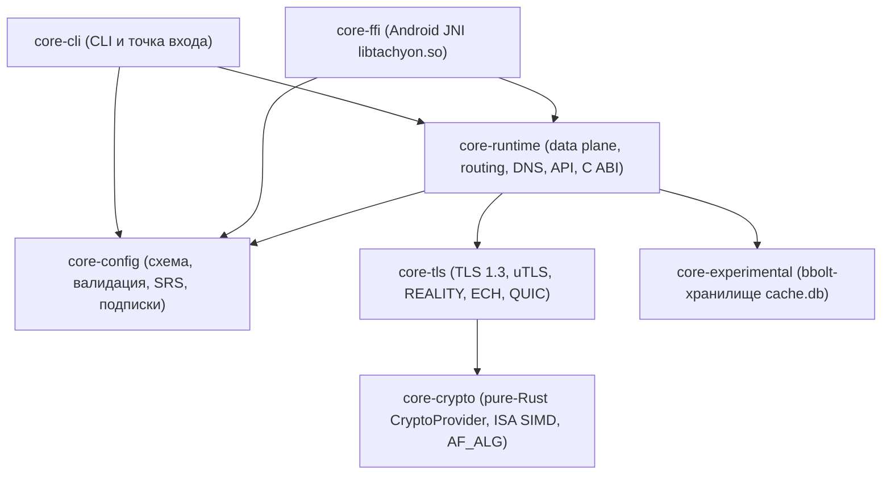
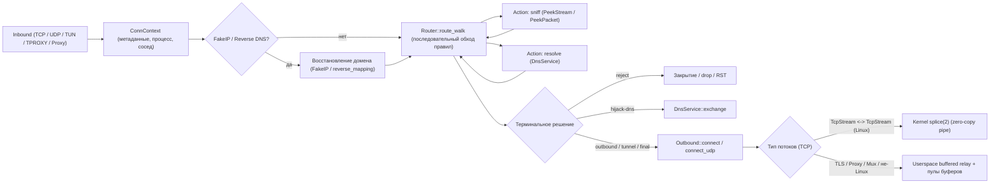
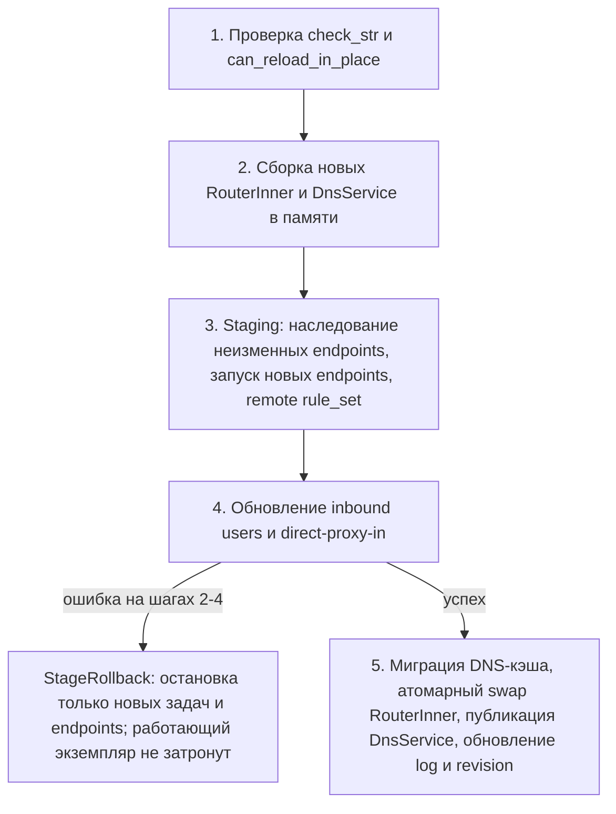

# Архитектура ядра `tachyon-core`

`tachyon-core` (v0.6.2) — автономное ядро маршрутизации и туннелирования трафика на Rust (edition 2024, MSRV 1.89), собираемое в единый статический исполняемый файл или встраиваемую библиотеку (C ABI / JNI). Конфигурационная схема и CLI совместимы с контрактом `sing-box` (`check` / `run`), при этом ядро во всех выводах и журналах идентифицируется как `tachyon-core` и не зависит от C-криптографических библиотек (`ring`, `aws-lc-rs`, `openssl`).

---

## 1. Структура Cargo workspace

Рабочее пространство состоит из семи крейтов с однонаправленным графом зависимостей: слой CLI и FFI использует валидатор схемы и асинхронный рантайм, а криптография и TLS вынесены в изолированные модули.



| Крейт | Назначение и зона ответственности | Ключевые особенности |
|---|---|---|
| `core-cli` | Точка входа бинарника `tachyon-core`: разбор аргументов, загрузка/слияние JSON-конфигов (`-c`, `-C`), `check`, `run`, `reload-preview`, `api`, `generate`, `format`, `merge`, `rule-set`, `fptn`, `subscription`. | Единственная точка конструирования Tokio runtime для CLI; подъём мягкого лимита `RLIMIT_NOFILE` (до `min(rlim_max, 65535)`); шим `fmaximum_num` для soft-float `arm`/`mips`; опциональная фича `allocstat`. |
| `core-config` | Строгая валидация конфигурации, нормализация диагностик, декодер/энкодер бинарных наборов правил `.srs` (v1–v5), парсер подписок/URI, расшифровка подписок `Happ`, разбор токенов `fptn:`/`fptnb:`, схема `desync` и VLESS `encryption`. | Не эмитирует сообщения в формате Go `encoding/json` — преобразует диагностику к собственному формату с указанием JSON-пути, ожидаемого и фактического типа. |
| `core-runtime` | Плоскость данных и управления: все входящие и исходящие обработчики, маршрутизатор, DNS-сервис, FakeIP, Zero-Copy `mmap` наборы правил `.trs`, аппаратная адаптация, `cache_file`, Clash/Tachyon REST API, телеметрия, логирование, NTP, сетевые пространства имён Linux, C ABI (`ffi`). | Единый экземпляр `BoxInstance`; атомарная горячая перезагрузка `reload_in_place`; изоляция состояния per-router; сборка в `staticlib` для Apple `TachyonCore.xcframework`. |
| `core-crypto` | `no_std + alloc` криптографический провайдер для `rustls` и `quinn` на базе RustCrypto без C-зависимостей. | Runtime ISA-диспетчеризация (`VAES`/`VPCLMULQDQ`, `AES-NI`/`PCLMULQDQ`, `AVX2`/`SSE2`, `ARMv8` AES/PMULL/`NEON`), Linux `AF_ALG` с автокалибровкой, постквантовый обмен ключами `X25519MLKEM768` и верификация подписей FIPS 204 (`ML-DSA-44/65/87`). |
| `core-tls` | Собственный асинхронный стек TLS 1.3 (клиент и сервер), таблицы отпечатков uTLS ClientHello, протокол REALITY, ECH (RFC 9849 + pure-Rust HPKE RFC 9180), сжатие сертификатов (RFC 8879), ring-free QUIC-бэкенд для `quinn`. | Поддержка временных X.509 v1 сертификатов REALITY, двухпоколенный lock-free Bloom-фильтр защиты от повторов (16 KiB), корректировка времени через NTP-смещение. |
| `core-ffi` | Нативная JNI-обёртка (`cdylib`, `libtachyon.so`) для встраивания ядра в процесс Android `VpnService` (`org.tachyon.vpn.TachyonCore`). | Инъекция платформенных параметров (`tun` `fd`, `protect_path`, `log.output`) после прохождения строгой валидации `core-config`; автоматическое исключение `ntp` без `protect_path` для предотвращения петли через TUN. |
| `core-experimental` | Потоковый читальщик и атомарный писатель B+tree-файлов, байтово совместимый с `go.etcd.io/bbolt` (`MAGIC = 0xED0CDAED`, версия 2). | Потоковая запись буфером 32 KiB без полной буферизации файла в RAM; поддержка overflow-страниц и многоуровневых branch-страниц. |

### Вендорированные патчи транспортного уровня

В `[patch.crates-io]` зафиксированы пять локальных форков транспортных крейтов (исключены из членов workspace, собираются как зависимости):

| Крейт | Назначение модификации |
|---|---|
| `vendor/h2` | Увеличен делитель `UNCLAIMED_DENOMINATOR` (`2 -> 32`): кадры `WINDOW_UPDATE` отправляются каждые `window/32` вместо `window/2`, что устраняет паузы однопоточных gRPC/HTTP2-потоков при работе с 64 KiB квотой отправки на стороне сервера. |
| `vendor/h3` | Исправлена утечка буферизованных QUIC-чанков в `BufList` внутри `FrameStream::poll_next` / `poll_data`, ранее вызывавшая обход flow control и рост RSS на HTTP/3-трафике. |
| `vendor/quinn`, `vendor/quinn-proto` | Адаптация под ring-free криптобэкенд `core-tls::quic` и управление темпом отправки (pacing) и окнами. |
| `vendor/smoltcp` | Автонастройка TCP-буферов (`set_auto_tune_max`) для пользовательских IP-стеков (`tun`, `wireguard`, `masque`) с низким стартовым размером и ростом на высокоскоростных WAN-соединениях с высоким RTT. |

---

## 2. Конвейер обработки соединений

Каждое входящее TCP-соединение или UDP-поток проходит единый конвейер от приёмного обработчика до двунаправленной пересылки данных.



### Основные этапы конвейера

1. **Приём на Inbound (`inbound/*`)**: слушатель открывает сокет с `SO_REUSEADDR` (на Unix) и dual-stack для `[::]` (если не задан `ipv6_only: true`). При ошибках `accept` (например, временное исчерпание дескрипторов `EMFILE`) цикл не завершается: ошибка логируется, выполняется пауза 1 с, слушатель продолжает работу.
2. **Формирование `ConnContext`**: фиксируются тег и тип инбаунда, исходный и целевой адреса (`Target::Ip` или `Target::Domain`), транспорт (`tcp`/`udp`), пользователь аутентификации, при необходимости — метаданные процесса (`route.find_process`) и таблицы соседей (`route.find_neighbor`).
3. **Предварительное восстановление домена**: если адрес назначения принадлежит диапазону FakeIP, домен подставляется из `FakeIpStore`. Если запись отсутствует в кэше (например, после очистки), выполняется автоматический сниффинг первого пакета с восстановлением соответствия `IP -> domain` через `restore_fakeip`.
4. **Обход правил маршрутизатора (`RouterInner::route_walk`)**:
   - Правила проверяются строго сверху вниз.
   - Нетерминальные действия (`sniff`, `resolve`, `route-options`) обогащают `ConnContext` (протокол, SNI/Host, разрешённые IP, стратегия доменов, переопределение адреса) и передают управление следующему правилу.
   - Терминальные действия (`route`, `bypass` с указанным `outbound`, `reject`, `hijack-dns`) завершают обход.
   - Если ни одно правило не сработало, проверяются динамические маршруты активных туннелей (`OpenConnect`, `WireGuard`, `Tailscale`), после чего применяется `route.final` (или первый аутбаунд по умолчанию).
5. **Установка исходящего соединения (`Outbound`)**: выполняется разрешение групп (`selector`, `urltest`), цепочек `detour`, опциональное разрешение домена через `DnsService` (с принудительным обходом FakeIP для предотвращения циклов), учёт `DialOptions` (`bind_interface`, `routing_mark`, `netns`, `protect_path`, `tcp_fast_open`, `tcp_multi_path`).
6. **Регистрация в `clash_state`**: соединение получает `ConnHandle` с атомарными счётчиками upload/download, сигналом принудительного закрытия (`CloseSignal`), опциональным rate-limiter на устройство и сохранённой копией начального `ConnContext` для последующей перевалидации маршрутов.
7. **Пересылка данных (Relay / Splice)**:
   - **Kernel zero-copy `splice(2)` (Linux / Android)**: для пары сырых `TcpStream <-> TcpStream` (обнаруживается через `ProxyStream::as_any()` downcast, включая `direct` и поток после пропуска заголовка VLESS / перехода Vision в прямой режим) данные перемещаются между сокетами через неблокирующий `pipe2` в пространстве ядра без копирования в userspace. Канал `pipe` выделяется лениво — только после появления первого байта, поэтому простаивающие соединения не расходуют файловые дескрипторы на каналы. Размер `pipe` (`F_SETPIPE_SZ`) масштабируется от `HardwareProfile::splice_pipe_size` (256 KiB–1 MiB) и автоматически снижается при высокой конкурентности (`> 64` -> `<= 128 KiB`, `> 256` -> `<= 64 KiB`) или под давлением памяти (`<= 64 KiB`). При исчерпании дескрипторов направление автоматически переключается на малый буферизованный цикл (16 KiB) без разрыва соединения. Для честного планирования полного дуплекса выполняется `yield_now()` каждые `TACHYON_RELAY_QUANTUM_KIB` (по умолчанию 4 MiB).
   - **Userspace relay**: для шифрованных и инкапсулированных потоков используется двунаправленная пересылка с переиспользуемыми буферами из локального (thread-local) и глобального пулов (размер буфера — `HardwareProfile::relay_buf_size`, по умолчанию 64 KiB на `< 96 MiB` RAM и 120 KiB на `>= 96 MiB` RAM, ниже порога 128 KiB `mmap` в musl `mallocng`).
   - **Ограничение полузакрытия (`HALF_CLOSE_TIMEOUT = 15 s`)**: после EOF в одном направлении второе направление ограничивается 15 секундами, предотвращая накопление сокетов в состоянии `CLOSE_WAIT`. На idle-соединениях в `splice` действует лимит простоя (900 с в норме, 180 с под давлением памяти).

---

## 3. Жизненный цикл `BoxInstance`

`BoxInstance` инкапсулирует работающий экземпляр ядра: активный `Arc<Router>`, задачи слушателей и фоновых служб, слабые ссылки на UDP-сокеты и QUIC-эндпоинты, службу `DnsService`, адрес `clash_api` и дескриптор `CacheFile`.

### Порядок запуска (`start`)

Запуск выполняется транзакционно (принцип «всё или ничего»): на время инициализации все запущенные задачи удерживаются в `TaskGuard`, а глобальные ссылки — в `StartRollback`. При ошибке на любом этапе все уже открытые слушатели, QUIC-эндпоинты, фоновые задачи и туннели немедленно отменяются и освобождают порты.

1. Установка глобального pure-Rust `CryptoProvider` в `rustls`.
2. Предупреждения об опциях диалера, принятых валидатором, но не поддерживаемых текущей ОС (например, `netns` вне Linux).
3. Инициализация логирования (`log.output`, `log.level`, `log.timestamp`, `log.disabled`).
4. На Linux — настройка `network_namespaces` до первого исходящего подключения.
5. Открытие `experimental.cache_file` (с файловой блокировкой ОС и механизмом безопасного перехвата блокировки внутри процесса при пересоздании экземпляра) и привязка хранилища к `clash_mode`, `clash_state` и `desync`.
6. Построение `Router::new(root)` и `DnsService::build_with_registry(root, &router.rule_sets())`; взаимная привязка `Router <-> DnsService` через `Weak` во избежание циклических ссылок.
7. Запуск туннельных эндпоинтов (`WireGuard`, `Tailscale`), первичная загрузка и запуск фоновых обновлений удалённых `rule_set`.
8. Запуск контроллера `clash_api`, клиента `ntp`, наблюдателя подписок `subscription-watcher`.
9. Привязка и запуск всех `inbounds` из конфигурации.
10. Запуск двух системных фоновых задач:
    - `memory-pressure` (период 5 с): оценка давления памяти, очистка пулов при простое `>= 15 с` и усечение DNS-кэшей при простое `>= 60 с` или уровне `Critical`.
    - `cache-flush` (тик `flush_interval.clamp(1s, 3s)`): сброс изменённых бакетов `cache.db` при срабатывании лимита по времени или объёму.
11. Фиксация первой ревизии конфигурации (`revision = 1`, SHA-256 `digest`) и телеметрии запуска.

### Контролируемое завершение (`shutdown_wait`)

Обычный `abort()` асинхронных задач недостаточен: задача, чей `Drop` ещё не выполнен, продолжает удерживать сокет, что при перезапуске приводит к `EADDRINUSE`. Поэтому `shutdown_wait` выполняет детерминированное освобождение ресурсов:

1. Закрытие всех QUIC-эндпоинтов (`endpoint.close`) и сброс `cache_file` на диск.
2. Параллельное ожидание:
   - завершения туннельных эндпоинтов (`Tailscale::shutdown`, `WireGuard::quiesce`);
   - фактического завершения всех `JoinHandle` задач;
   - обнуления `Weak::strong_count()` для каждого UDP-сокета (таймаут 2 с) и каждого QUIC-сокета после `endpoint.wait_idle()` (таймаут 5 с + 5 с).
3. Сторожевой таймер (`SHUTDOWN_WATCHDOG_TIMEOUT = 20 s`): если ресурс не освобождается, в журнал каждые 20 с выводится сводка зависших компонентов (`endpoints`, `tasks`, `udp_sockets`, `quic_endpoints`).
4. Освобождение файловой блокировки `cache_file.release_lock()` и очистка глобальных ссылок `dns` / `router`.

В `core-cli` после выхода из асинхронного цикла вызывается `runtime.shutdown_timeout(250 ms)`, чтобы заблокированные фоновые потоки (например, DNS или сетевые вызовы) не задерживали перезапуск сервиса менеджером (`procd`, `systemd`).

---

## 4. Горячая перезагрузка (`reload_in_place`)

В режиме `run` на Unix-системах сигнал `SIGHUP` (а также REST-запрос `PUT /configs` в Clash API) инициирует перезагрузку конфигурации. Перед остановкой чего-либо новый документ обязательно проходит строгую проверку `core_config::check_str`.

Предварительно оценить применимость горячей перезагрузки без изменения работающего экземпляра можно командой:

```sh
tachyon-core reload-preview --current /etc/tachyon-core/config.json /tmp/candidate.json
```

Команда выводит JSON с полями `in_place` (`true`/`false`), `current_digest` и `candidate_digest` (SHA-256 от сериализованного JSON с сохранением порядка ключей). Текущее применённое состояние работающего процесса доступно через `GET /tachyon/config-state` (`ready`, `revision`, `digest`, `pid`).

### Матрица допустимости `can_reload_in_place`

| Изменяемая секция / параметр | Применяется через `reload_in_place` | Поведение при изменении |
|---|---|---|
| `route` (правила, `final`, `rule_set`, `default_*`) | Да | Полная перестройка `RouterInner` в staging и атомарная подмена указателя `RwLock<Arc<RouterInner>>`. |
| `outbounds` (протоколы, группы `selector`/`urltest`, цепочки) | Да | Подмена таблицы аутбаундов; для неизменных групп сохраняются текущий выбор `selector`, задержки и выбор `urltest`, история задержек. Для изменившихся листовых аутбаундов активные соединения закрываются через `close_by_tag`. |
| `endpoints` (`wireguard`, `tailscale`) | Да | Неизменившиеся туннели наследуются без разрыва (`inherit`); новые запускаются в staging до переключения; конфликтующие по статическому `listen_port`/`relay_server_port` предварительно останавливаются; неиспользуемые старые останавливаются после коммита. |
| `dns` (серверы, правила, кэш, FakeIP, стратегии) | Да | Строится новый `DnsService`; валидные записи кэша, `fastest_ip`, `reverse_mapping` и состояние FakeIP мигрируют из старого сервиса (`migrate_from`). |
| `log.level`, `log.disabled` | Да | Применяются атомарно к глобальному фильтру уровня логирования. |
| `inbounds[].users` для `vless`, `trojan`, `vmess`, `hysteria2`, `tuic`, `anytls` | Да | Если список `users` остаётся непустым в старом и новом конфиге, список пользователей обновляется на работающем слушателе через `reload_inbound_users` без перепривязки сокета. |
| Инбаунд с тегом `direct-proxy-in` (`mixed` / `socks` / `http`) | Да | Специальный динамический слушатель пересоздаётся изолированно без перезапуска остальных инбаундов. |
| Любые другие изменения в `inbounds` (порты, адреса, TLS, добавление/удаление) | Нет (холодный рестарт) | Полный цикл `shutdown_wait` -> `start(new_root)`; при сбое запуска выполняется автоматический откат к `old_root`. |
| `experimental.clash_api` | Нет (холодный рестарт) | Требует перепривязки HTTP-контроллера. |
| `experimental.cache_file` | Нет (холодный рестарт) | Хранилище и его файловая блокировка открываются один раз при старте экземпляра. |
| `network_namespaces` (Linux), `ntp` | Нет (холодный рестарт) | Инициализируются на этапе запуска `BoxInstance`. |

### Транзакционный staging и откат



Если ошибка возникает на этапах сборки `RouterInner`, `DnsService`, запуска новых эндпоинтов, загрузки удалённых наборов правил или обновления пользователей, `StageRollback` отменяет только staged-объекты; текущий экземпляр продолжает обслуживать трафик, а `revision` и `digest` в `/tachyon/config-state` не изменяются.

### Перевалидация активных TCP/UDP маршрутов (`recheck_routes`)

После горячей перезагрузки конфигурации (по запросу `POST /tachyon/route-recheck`) и автоматически после фонового обновления удалённых `rule_set` (с дебаунсом 150 мс и сбросом DNS-кэша) выполняется перепроверка всех активных соединений:

- Из реестра `clash_state` выбираются открытые TCP- и UDP-соединения с сохранённым исходным `ConnContext` (до перезаписей `resolve`/`unmap`).
- Перепроверка идёт параллельно волнами по 16 задач с таймаутом 2 с на соединение против единого снимка `Arc<RouterInner>`.
- Соединение закрывается (`CloseSignal`), если:
  - новый итоговый тег аутбаунда отличается от исходного;
  - изменился целевой адрес назначения;
  - соединение теперь попадает под правило `reject` или `hijack-dns`;
  - ранее соединение совпало с конкретным правилом, а теперь деградировало в `final` (даже если тег `final` совпал).
- Если во время перепроверки произошла ещё одна перезагрузка (`!Arc::ptr_eq(&snapshot, &router.inner())`), результат помечается `stale: true` и закрытие по устаревшему снимку не выполняется.

---

## 5. Модель потоков Tokio

`tachyon-core` не использует макрос `#[tokio::main]`. Рантайм конструируется вручную в `core-cli` (и аналогично в `core-ffi` / `core-runtime::ffi`) с параметрами, вычисленными на старте в `HardwareProfile::detect()`:

| Параметр рантайма | Источник и правило выбора |
|---|---|
| Режим планировщика | `workers == 1` -> `Builder::new_current_thread()` (исключает накладные расходы очередей work-stealing и межпоточной синхронизации на одноядерных и малопамятых устройствах); `workers >= 2` -> `Builder::new_multi_thread().worker_threads(workers)`. |
| Число воркеров (`workers`) | `min(allowed_cpus, ceil(cgroup_cpu_quota), max(1, total_ram_mb / 48))`, где `allowed_cpus` читается через `sched_getaffinity`. Переопределяется переменной `TACHYON_WORKERS`. Встроенный C ABI на iOS дополнительно ограничивает число воркеров сверху значением `2` (если не задан `TACHYON_WORKERS`) из-за лимита Jetsam. |
| `event_interval` | Фиксировано `31` — уменьшает задержку опроса I/O и таймеров под плотной вычислительной нагрузкой. |
| `max_blocking_threads` | `(total_ram_mb / 32).clamp(2, 16 * workers)` — ограничивает пул блокирующих потоков (`spawn_blocking` для системного DNS, дискового I/O, тяжёлых парсеров), не давая ему истощить ОЗУ на роутерах. |
| Привязка к ядрам (`on_thread_start`) | На гетерогенных SoC (big.LITTLE, когда максимальная частота быстрых ядер на `>= 15%` выше медленных) первые `workers` потоков Tokio привязываются (`sched_setaffinity`) к `fast_cpus`, а потоки пула `spawn_blocking` — к `slow_cpus`. |

Отдельные подсистемы с синхронным опросом (например, стек пользовательского пространства WireGuard) могут работать на выделенном потоке ОС через `Handle::block_on`; при завершении рантайма штатный panic-hook перехватывает системное сообщение о закрытии контекста таймеров Tokio и переводит его в штатное информационное завершение потока.

---

## Навигация

- [Оглавление документации](../README.md)
- [Криптография, TLS, uTLS, REALITY, ECH и QUIC](./crypto-and-tls.md)
- [Аппаратная адаптация, управление памятью и защита flash](./memory-and-hardware.md)
- [Маршрутизация, сниффинг, FakeIP, DNS и наборы правил](./routing-and-dns.md)
- [Обзор схемы конфигурации](../02-config/schema-overview.md)
- [Эксплуатация, sizing и целевые платформы](../04-api-and-cli/operations-and-sizing.md)
