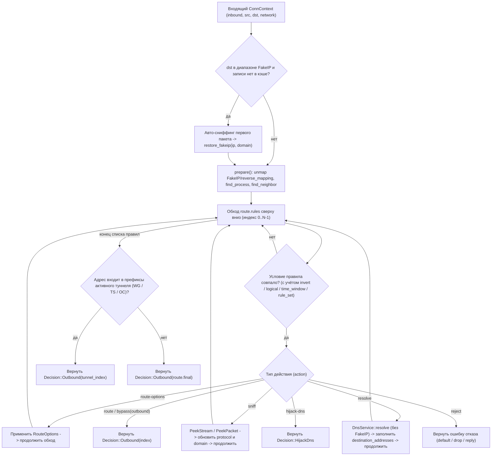
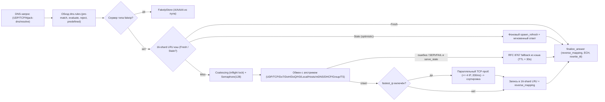

# Маршрутизация, сниффинг, FakeIP, DNS и наборы правил

Подсистемы маршрутизации (`route/*`) и разрешения имён (`dns/*`) образуют единый контур принятия решений для каждого соединения. Они разделяют реестр наборов правил (`RuleSetRegistry`), кэш соответствий `IP -> domain` (`FakeIpStore`, `reverse_mapping`) и механизм обратной связи при фоновом обновлении удалённых списков.

---

## 1. Устройство маршрутизатора и порядок вычисления правил

При поступлении нового TCP-соединения или UDP-потока формируется `ConnContext` и выполняется обход `RouterInner::route_walk`.



### Приоритеты и инварианты маршрутизации

1. **Явные правила пользователя всегда выше маршрутов туннелей**: префиксы, полученные от `OpenConnect`, `WireGuard` и `Tailscale` (`tunnel_routes`), проверяются только после того, как ни одно правило `route.rules` не выдало терминального решения (с учётом `exclude`-префиксов туннеля).
2. **Нетерминальные действия накапливаются**: правило `sniff` может извлечь домен из TLS SNI, следующее правило `resolve` — разрешить этот домен в IP для сопоставления по GeoIP `rule_set`, правило `route-options` — задать `override_address`/`override_port` или `udp_disable_domain_unmapping`, и лишь последующее правило `route` выберет итоговый аутбаунд.
3. **Разделение логических и плоских правил**: правила `type: "logical"` (`and`/`or` с вложенностью) и правила с `invert: true` вычисляются как дерево предикатов, тогда как простые списки доменов/IP/портов в `rule_set` компилируются в специализированные индексы без обхода JSON.
4. **Индексация в памяти (`RuleSetIndex`)**:
   - `domain` — `HashSet<Box<str>>` (один хеш-поиск, ~160 нс даже на 200 000 записей).
   - `domain_suffix` — `HashSet<Box<str>>` с пошаговым обходом меток хоста справа налево (3–4 хеш-поиска вместо указательного trie).
   - `domain_keyword` — автомат `Aho-Corasick` для однопроходного поиска всех подстрок.
   - `ip_cidr` / `source_ip_cidr` — структура `PrefixSet`, группирующая сети по длине префикса с бинарным поиском только по фактически присутствующим длинам масок.

---

## 2. Протокольный сниффинг (`sniff.rs`, `sniff_quic.rs`)

Сниффинг извлекает прикладной протокол (`ctx.protocol`) и домен назначения (`ctx.domain`) без потери данных клиента.

### Потоковый сниффинг TCP (`PeekStream`)

Буфер накапливает начальные байты клиентского потока до истечения таймаута (`DEFAULT_SNIFF_TIMEOUT` или `timeout` в правиле). После совпадения (или таймаута) накопленный префикс `ctx.sniff_prefix` воспроизводится без изменений в исходящий сокет.

| Протокол (`protocol`) | Что анализируется | Извлекаемые поля |
|---|---|---|
| `tls` | Заголовок TLS-записи (`0x16`), разбор `ClientHello` через `core-tls::hello::parse_record`. | `protocol = "tls"`, домен из расширения SNI (IP-литералы отбрасываются). Детектирует наличие расширения ECH (`0xfe0d`): если домен уже известен из FakeIP или `reverse_mapping`, внешний `public_name` ECH его не перезаписывает. |
| `http` | Методы `GET`, `POST`, `HEAD`, `PUT`, `DELETE`, `OPTIONS`, `CONNECT`, `PATCH`, `TRACE` и заголовки HTTP/1.x. | `protocol = "http"`, домен из `Host` (с очисткой порта). Дополнительно распознаёт HTTP-запросы BitTorrent-трекеров (`info_hash` + `peer_id` + `port`) и webseed (`piece`/`ranges`) -> помечает `protocol = "bittorrent"`. |
| `dns` | DNS-запрос поверх TCP с 2-байтовым префиксом длины. | `protocol = "dns"`. |
| `bittorrent` | Рукопожатие BitTorrent (`\x13BitTorrent protocol`) и MSE/PE. | `protocol = "bittorrent"`. |
| `ssh` | Баннер протокола `SSH-2.0-...`. | `protocol = "ssh"`. |
| `rdp` | Заголовок TPKT / X.224 Connection Request (`Cookie: mstshash=...`). | `protocol = "rdp"`. |

### Пакетный сниффинг UDP (`PeekPacket`)

Датаграммы инспектируются без потребления и модификации:

| Протокол (`protocol`) | Что анализируется | Особенности |
|---|---|---|
| `quic` | Длинный заголовок QUIC v1/v2, снятие защиты заголовка (RFC 9001), вывод ключей Initial из DCID, AEAD-проверка тега и сборка CRYPTO-фреймов по смещению (до 64 KiB). | Пакет признаётся QUIC только после успешной проверки AEAD-тега. Поддерживаются фрагментированные постквантовые `ClientHello` (~1.8 KB, разносящиеся на несколько датаграмм `>= 1200 B`: сниффер возвращает `NeedMore` до сборки полного `ClientHello` и извлечения SNI). |
| `dns` | Валидный UDP DNS-запрос. | `protocol = "dns"`. |
| `stun` | Заголовок STUN с magic cookie `0x2112A442`. | `protocol = "stun"`. |
| `bittorrent` | uTP (`sniff_utp`), UDP-трекеры (`sniff_udp_tracker`), DHT bencode (`sniff_dht`). | `protocol = "bittorrent"`. |
| `dtls` | Заголовок DTLS ClientHello. | `protocol = "dtls"`. |
| `ntp` | Валидный клиентский пакет NTP. | `protocol = "ntp"`. |

### Исключения сниффинга (`SniffExclusions`)

На уровне инбаунда, глобально и внутри действия `sniff` поддерживаются списки исключений:
- `ips_excluded`: IP/CIDR, ключевое слово `private` / `geoip:private`, а также отрицания вида `!10.0.0.0/8` (приоритетнее положительных совпадений).
- `domains_excluded`: правила `full:`, `domain:` (суффикс, по умолчанию), `*.` (строгий поддомен), `keyword:` / `substr:`, `regexp:`.

---

## 3. Расписания `time_window`

Условие `time_window` доступно как в `route.rules`, так и в `dns.rules`. Поддерживается строка или массив строк (логическое ИЛИ между окнами) формата:

```text
[days] HH:MM-HH:MM [timezone]
```

- **Дни недели (`days`)**: опциональны (по умолчанию все дни, маска `0x7f`). Допускаются списки через запятую и диапазоны через `-`, сокращения на английском и русском (`mon`–`sun`, `monday`–`sunday`, `пн`–`вс`, `1`–`7`, `0` = воскресенье), а также псевдонимы `*` / `all` / `daily` / `everyday`, `weekdays` / `workdays`, `weekends` / `weekend`.
- **Интервал времени (`HH:MM-HH:MM`)**: полуоткрытый интервал `[start, end)` (`00:00-24:00` — круглые сутки). При `start > end` (например, `mon-fri 22:00-06:00`) включается перенос через полночь: вечерняя часть `[22:00, 24:00)` проверяет текущий день недели, а утренний хвост `[00:00, 06:00)` — предыдущий календарный день (так, утро субботы `02:30` попадает в хвост ночного окна пятницы).
- **Часовой пояс (`timezone`)**: опционален (`UTC`, `+03:00`, `-05:00` и т.д.). При отсутствии используется локальное время системы.

---

## 4. FakeIP (IPv4/IPv6) и персистентность

Механизм FakeIP (`FakeIpStore`) выдаёт локальным клиентам синтетические IP-адреса из настроенных CIDR-диапазонов (например, `198.18.0.0/15` для IPv4 и `fc00::/18` для IPv6; допустимы маски `<= /30` для IPv4 и `<= /125` для IPv6) в ответ на DNS-запросы `A`/`AAAA`, чтобы маршрутизатор и прокси-аутбаунды получали оригинальное доменное имя без преждевременного внешнего DNS-разрешения.

### Алгоритм выделения и защиты от рассогласования

- **Последовательное выделение**: курсор стартует с `network + 2` и циклически переходит к началу подсети при достижении конца диапазона.
- **Ограниченная ёмкость по ОЗУ**: двусторонние карты (`domain_to_v4`, `domain_to_v6` как `LruCache` и `addr_to_domain` как `HashMap`) ограничены сверху по классу памяти устройства: `4096` (`<= 128 MiB`), `8192` (`<= 256 MiB`), `16384` (`<= 512 MiB`), `32768` (`> 512 MiB`). При вытеснении старой записи парное прямое/обратное соответствие удаляется атомарно, исключая рассинхронизацию таблиц.
- **Изоляция внутренних запросов**: внутренние вызовы `DnsService::resolve` (например, для разрешения адреса самого прокси-сервера или DoH-апстрима) по умолчанию работают с `without_fakeip = true`, что исключает зацикливание диалера на виртуальный диапазон.
- **Самовосстановление после очистки кэша**: если клиент пытается подключиться к адресу из диапазона FakeIP, но запись отсутствует в `FakeIpStore`, `route_walk` автоматически запускает сниффинг первого пакета, извлекает SNI/Host и восстанавливает привязку через `dns.restore_fakeip(ip, domain)`.
- **Персистентность (`store_fakeip: true`)**: данные сохраняются в sidecar-файле `<cache.db>.volatile` в бакетах `fakeip_domain4`, `fakeip_domain6` и `fakeip_address` (плюс ключ `fakeip_metadata` с позициями курсоров, обновляемый раз в 128 новых выделений). При старте выполняется реконсиляция прямых и обратных бакетов; при горячей перезагрузке состояние переносится в памяти без обращений к диску.

---

## 5. DNS-пайплайн (`dns/*`)

При наличии секции `dns` запускается `DnsService` (при её отсутствии ядро работает в системном режиме через резолвер ОС).



### Поддерживаемые транспорты DNS (`Kind`)

| Тип | Протокол и особенности |
|---|---|
| `udp`, `tcp` | Классический DNS по UDP/TCP (с поддержкой `detour`, `bind_interface`, `routing_mark`, `domain_resolver` с кэшем адреса на 300 с). |
| `tls` | DNS-over-TLS (DoT; `server_port` по умолчанию `53`, поэтому стандартный порт `853` необходимо указывать явно). |
| `https` | DNS-over-HTTPS (DoH поверх HTTP/1.1 и пула HTTP/2, настраиваемые `path` и `headers`). |
| `quic` | DNS-over-QUIC (DoQ, RFC 9250, ALPN `doq`). |
| `h3` | DNS-over-HTTPS поверх HTTP/3 (ALPN `h3`). |
| `fakeip` | Выделение адресов из виртуальных подсетей IPv4/IPv6. |
| `local` | Системный резолвер ОС; опционально разрешает имена локальной сети через `neighbor_domain` и таблицу соседей. |
| `hosts` | Статические записи (`predefined` имеют приоритет над файлами; файлы кэшируются на 5 с с проверкой mtime и размера). |
| `mdns` | Многоадресный DNS (RFC 6762, порт `5353`, `224.0.0.251` и `ff02::fb`, link-local IPv6). Опрашивает каждый выбранный (или все не-loopback) интерфейсы, объединяя ответы. Автоматически определяет локальные зоны `.local.`, `254.169.in-addr.arpa.`, `8..b.e.f.ip6.arpa.`. Таймаут 1 с. |
| `dhcp` | Разрешение через DNS-серверы, полученные по DHCP. |
| `resolved` | Интеграция с локальным stub-резолвером `systemd-resolved`. |
| `tailscale` | MagicDNS и split-DNS активного эндпоинта `tailscale`. |
| `group` | Группа из нескольких DNS-серверов под одним тегом с опциональными локальными `hosts` и тремя режимами выбора: `stable` (липкий рабочий сервер), `fastest` (выборы по скорости ответа, `win_ttl = 5m`), `parallel` (параллельный опрос). Ошибки фиксируются в таблице на `error_ttl = 2m` (стирая накопленные победы во избежание флаппинга); при отказе всех участников включается survival-режим (один запрос через наименее «грязный» сервер без лавинного fan-out). |

### Кэширование, отказоустойчивость и оптимизация ответов

- **16-шардовый LRU-кэш (`ShardedCache`)**: разбивает пространство ключей `(server_tag, name, qtype)` на 16 независимых шардов с `O(1)` LRU-вытеснением, устраняя блокировки при конкурентных запросах. `HardwareProfile::dns_cache_capacity` масштабируется по RAM в диапазоне `512..8192` записей, при этом `DnsService` применяет нижний предел `ShardedCache` в `1024` записи (эффективный диапазон по умолчанию `1024..8192`). Кэшируются ответы `NOERROR` и `NXDOMAIN`.
- **Коалесцирование и защита от шторма**: одновременные запросы одного и того же `(tag, name, qtype)` объединяются через per-key `Weak<Mutex>` (`inflight`), чтобы к апстриму ушёл один сетевой пакет. Общее число параллельных запросов к апстримам ограничено семафором `MAX_UPSTREAM_EXCHANGES = 128`, а фоновых догрузок вторичного семейства адресов — `MAX_DETACHED_FAMILY_TASKS = 64`.
- **Optimistic DNS (`optimistic`)**: при обращении к истёкшей записи в пределах окна (по умолчанию 3 суток) кэш немедленно отдаёт устаревший ответ и ставит фоновую задачу обновления (`spawn_refresh`). Конфликтует с `disable_cache` и `disable_expire` (проверяется при старте).
- **Serve-stale fallback (RFC 8767, `serve_stale`)**: если апстрим вернул `SERVFAIL` или завершился сетевой ошибкой/таймаутом, ядро возвращает просроченную запись из кэша в пределах `serve_stale_duration` с переписанным `TTL = 30 s`.
- **Двухфазные правила `evaluate` / `respond` и RDRC**: правило `action: "evaluate"` запрашивает ответ у указанного сервера и продолжает обход `dns.rules`, позволяя следующим правилам сопоставить полученные IP (`ip_cidr`, `rule_set` с `match_response`) и либо отдать ответ (`action: "respond"`), либо перенаправить запрос на другой (резервный) DNS-сервер. Для совместимости со схемой кэша отклонённых ответов поддерживаются настройки `store_rdrc` и `rdrc_timeout` (бакет `rdrc2` изолирован в `.ephemeral`).
- **Выбор быстрейшего IP (`fastest_ip`)**: при получении нескольких публичных адресов `A`/`AAAA` (приватные, loopback, link-local, FakeIP `198.18.0.0/15`, NAT64, Teredo и документационные диапазоны отфильтровываются) запускается параллельное TCP-подключение к первым 4 кандидатам (по умолчанию порт `443`, таймаут `200 ms`). Победитель поднимается на первую позицию ответа и запоминается в раздельном для IPv4/IPv6 LRU-кэше `(domain, is_v6)`.
- **Обратное отображение (`reverse_mapping`)**: запоминает пары `IP -> domain` из ответов `A`, `AAAA`, `HTTPS` (`TYPE65`) и `SVCB` (`TYPE64`) (LRU на 1024 записи; при `store_dns: true` сохраняется в бакет `dns_cache` в `.ephemeral`), а также извлекает ECH `public_name` для защиты сниффера от подмены реального домена внешним SNI.
- **EDNS0 Client Subnet (`client_subnet`) и стратегии**: поддержка `as_is`, `prefer_ipv4`, `prefer_ipv6`, `ipv4_only`, `ipv6_only` (на уровне `dns`, сервера и конкретного правила). При `prefer_*` ядро не ждёт ответа от нежелательного семейства, если предпочтительное уже ответило.

---

## 6. Zero-copy `mmap` наборы правил (`.trs` / TSRS v2) и `.srs`

Для маршрутизации по крупным спискам (сотни тысяч доменов и десятки тысяч CIDR-блоков) на роутерах с малым ОЗУ ключевой проблемой является стоимость загрузки правил в кучу (heap). `tachyon-core` поддерживает три формата: JSON `source`, бинарный `.srs` (совместимый с `sing-box` v1–v5) и нативный zero-copy формат **`.trs` (TSRS v2)**.

### Сравнение форматов

| Характеристика | `source` (JSON) | `.srs` (v1–v5) | `.trs` (TSRS v2) |
|---|---|---|---|
| Контейнер | Текстовый JSON | Заголовок `SRS` + версия (1–5) + поток `zlib` | 96-байтный заголовок `TSRS` v2 + выровненные по 1 байту таблицы |
| Способ чтения в runtime | Парсинг в `RuleSetIndex` (heap) | Распаковка `zlib` -> компиляция в `RuleSetIndex` (heap) или авто-компиляция в `.trs` | Прямой `mmap(2)` (`PROT_READ | MAP_PRIVATE`) на Unix / `MapViewOfFile` на Windows без копирования в heap |
| Потребление heap-памяти | Высокое | Среднее (~63 B/домен в `RuleSetIndex`) | Близко к нулю (страницы подгружаются ядром ОС по требованию и могут выгружаться под давлением памяти) |
| Инкрементальные обновления | Полная загрузка | Полная загрузка | Поддержка бинарных дельта-патчей `TDLT` v1 (50–300 KiB вместо 40–80 MiB) |

### Внутренняя структура `.trs` (TSRS v2)

Все многобайтовые числа хранятся в явном формате Little-Endian (`align_of == 1`), что исключает ошибки невыровненного доступа на любых CPU (`x86_64`, `aarch64`, `mips`, `mipsel`, `armv6`, `riscv64`):

- **Заголовок (96 байт)**: магия `TSRS`, версия `2`, флаги (`HAS_EXTRA`, `DOM_DICT`, `V6_64BIT`), число логических правил, 64-битный триграммный Bloom-фильтр для ключевых слов и смещения/размеры всех секций.
- **Домены (`dom_blocks` + `dom_data`)**: ключи хранятся в перевёрнутом виде (`example.com` -> `moc\x01elpmaxe`) с флагами `EXACT` / `SUFFIX`, сгруппированы в блоки по 128 записей с front-coding сжатием общего префикса. Поиск идёт бинарно по 8-байтным индексным записям `DomainBlockIndex` (`first_prefix_be`, `block_offset`). Дополнительно применяется 7-битный словарь из 87 частых подстрок (`2..15 B`), а для компактных наборов (`<= 3` блоков / `<= 384` доменов) строится 256-байтный регистровый Bloom-фильтр, отсекающий `> 92%` промахов за 1 кэш-линию.
- **IPv4 и IPv6 интервалы**: все CIDR-сети при компиляции сливаются в непересекающиеся отсортированные интервалы `[start, end]`: `8 B` для IPv4, `16 B` для `/64`-выровненных IPv6 (`HEADER_FLAG_V6_64BIT`) или `32 B` для произвольных IPv6. Перед таблицей лежит 257-элементная директория по первому байту адреса, сужающая бинарный поиск до одного `/8`-среза.
- **Ключевые слова, порты и `extra`**: отсортированные диапазоны портов (`4 B`), таблица ключевых слов (предварительно фильтруемая 64-битным триграммным Bloom-фильтром в заголовке) и секция `extra` для сложных правил (`regex`, `logical`, `invert`, процесс/пользователь), компилируемая лениво через `OnceLock`.

### Режимы загрузки, `TDLT`-дельты и удалённые наборы

- **Режимы `mode`**: `auto` (открыть `mmap` напрямую или скомпилировать в `.trs`), `mmap` (строгий `mmap`), `memory` (загрузка образа в анонимную read-only память).
- **Инкрементальные патчи `TDLT` v1 (`delta_update`)**: проверяют SHA-256 исходного `.trs` и итогового образа, применяют операции добавления/удаления доменов, суффиксов, ключевых слов, CIDR и портов, затем выполняют атомарную замену файла (`atomic_write_trs`: запись в `.tmp.<pid>.<seq>` + `rename`), сохраняя старый `inode` валидным для уже открытых `mmap`-отображений.
- **Защита flash и мягкий старт (`TACHYON_RULESET_SOFT_START`)**: по умолчанию скомпилированные удалённые `.trs` сохраняются в `/tmp/tachyon-rulesets/<tag>.trs` (в RAM/tmpfs на Linux/OpenWrt), неиспользуемые файлы автоматически удаляются при старте/перезагрузке (`prune_stale_trs_files`). При старте ядра до поднятия WAN включён мягкий старт (можно отключить `TACHYON_RULESET_SOFT_START=0`): пустой набор не валит процесс, а подгружается в фоне по лестнице повторов `1s -> 3s -> 5s -> 10s -> 20s -> 30s`, после чего срабатывают очистка DNS-кэша и автоматический `recheck_routes`.

---

## Навигация

- [Оглавление документации](../README.md)
- [Архитектура ядра](./overview.md)
- [Аппаратная адаптация, управление памятью и защита flash](./memory-and-hardware.md)
- [Справочник конфигурации DNS](../02-config/dns.md)
- [Справочник маршрутизации и наборов правил](../02-config/route-and-rulesets.md)
- [Спецификация форматов наборов правил (`.trs`, `.srs`, `source`)](../03-protocols-and-formats/ruleset-formats.md)
