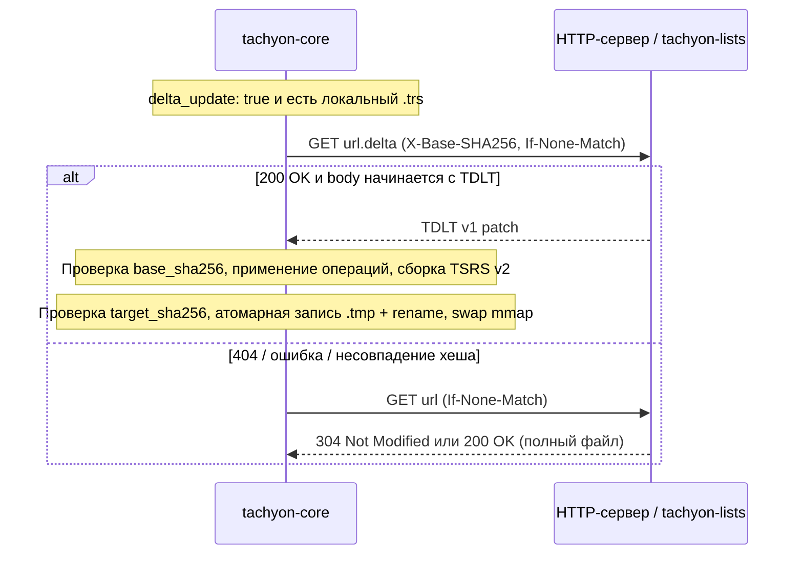

# Форматы наборов правил (`.trs`, `.srs`, JSON `source`) и инкрементальные дельты

Документ задаёт бинарную спецификацию нативного формата **Tachyon Rule-Set (`.trs`, TSRS v2)**, формата инкрементальных дельта-патчей (**TDLT v1**), совместимого бинарного контейнера **sing-box (`.srs` v1–v5)**, текстового формата **`source` JSON**, а также интерфейс CLI `tachyon-core rule-set` и интеграцию с удалёнными репозиториями списков (`tachyon-lists`).

---

## 1. Сравнение форматов наборов правил

| Характеристика | `.trs` (TSRS v2, нативный) | `.srs` (sing-box v1–v5) | `source` (JSON) |
| --- | --- | --- | --- |
| Магические байты | `TSRS` (`54 53 52 53`) | `SRS` (`53 52 53`) | UTF-8 JSON (`{ ... }`) |
| Версия контейнера | `2` (`u32` LE) | `1..=5` (`u8`) | `1..=5` (основные `1`–`3`, расширения `4`–`5`) |
| Сжатие файла | Фронт-кодирование + 87-токенный словарь (без распаковки целиком) | Поток `zlib` (распаковка всего файла в ОЗУ) | Отсутствует |
| Загрузка в память | Zero-copy `mmap(2)` (`PROT_READ`, `MAP_PRIVATE`) | Декомпрессия + построение структур в heap | Полный парсинг JSON в heap |
| Накладные расходы RSS | Минимальные (страницы подгружаются по требованию ядром ОС) | Пропорционально полному размеру базы | Наибольшие |
| Выравнивание полей | `align_of == 1` (явные Little-Endian байты, безопасно на MIPS/ARM/x86) | Потоковый парсинг `uvarint` / BE | Текстовый |
| Инкрементальные обновления | Да (`TDLT` v1 поверх `<url>.delta`) | Нет (полная перезагрузка по `ETag`) | Нет (полная перезагрузка по `ETag`) |
| Автоконвертация при загрузке | Не требуется | Компилируется в `/tmp/tachyon-rulesets/<tag>.trs` для `mmap` | Компилируется в `/tmp/tachyon-rulesets/<tag>.trs` для `mmap` |

---

## 2. Бинарный формат `.trs` (TSRS v2)

Формат **TSRS v2** (расширения файла `.trs`, поддерживается алиас `.tsr`) спроектирован для прямого отображения файла в виртуальное адресное пространство через `mmap(2)` (Unix/OpenWrt) или `CreateFileMappingW`/`MapViewOfFile` (Windows) без десериализации в кучу. Все многобайтовые числа хранятся в Little-Endian, границы IPv6 в 32-байтных записях — в сетевом порядке байт (Big-Endian). Каждая секция файла выровнена на границу **8 байт**.

### 2.1. Общая структура файла

```text
Offset 0x0000  +-----------------------------------------------------------+
               | Header (фиксированный размер: 96 байт)                    |
               +-----------------------------------------------------------+ (align 8)
               | DomainBlockIndex[dom_blocks_count]  (8 байт / запись)     |
               +-----------------------------------------------------------+ (align 8)
               | dom_data (словарь токенов + фронт-кодированные блоки)     |
               +-----------------------------------------------------------+ (align 8)
               | KeywordEntry[keywords_count]        (8 байт / запись)     |
               +-----------------------------------------------------------+ (align 8)
               | v4_dir[257]                         (257 * 4 = 1028 байт) |
               +-----------------------------------------------------------+ (align 8)
               | Ipv4Interval[v4_count]              (8 байт / запись)     |
               +-----------------------------------------------------------+ (align 8)
               | v6_dir[257]                         (257 * 4 = 1028 байт) |
               +-----------------------------------------------------------+ (align 8)
               | Ipv6Interval[v6_count] (32 Б) ИЛИ Ipv6Interval64 (16 Б)   |
               +-----------------------------------------------------------+ (align 8)
               | PortRangeEntry[dest_ports_count]    (4 байта / запись)    |
               +-----------------------------------------------------------+ (align 8)
               | string_table (непрерывный UTF-8 буфер для keywords)       |
               +-----------------------------------------------------------+ (align 8)
               | extra (JSON-массив сложных/regex/логических правил)       |
               +-----------------------------------------------------------+
```

### 2.2. Заголовок файла (`Header`, 96 байт)

| Смещение | Размер | Тип | Поле | Назначение |
| --- | --- | --- | --- | --- |
| `0..4` | 4 | `[u8; 4]` | `magic` | Константа `"TSRS"` (`0x54 0x53 0x52 0x53`) |
| `4..8` | 4 | `u32` LE | `version` | Версия формата (`2`) |
| `8..12` | 4 | `u32` LE | `flags` | Битовая маска флагов заголовка (см. ниже) |
| `12..16` | 4 | `u32` LE | `total_rules` | Исходное количество логических правил |
| `16..24` | 8 | `u64` LE | `kw_bloom` | 64-битный триграммный Bloom-фильтр для `domain_keyword` |
| `24..28` | 4 | `u32` LE | `dom_blocks_offset` | Смещение таблицы индексов доменных блоков |
| `28..32` | 4 | `u32` LE | `dom_blocks_count` | Количество записей `DomainBlockIndex` |
| `32..36` | 4 | `u32` LE | `dom_data_offset` | Смещение потока `dom_data` |
| `36..40` | 4 | `u32` LE | `dom_data_len` | Длина `dom_data` в байтах |
| `40..44` | 4 | `u32` LE | `keywords_offset` | Смещение таблицы `KeywordEntry` |
| `44..48` | 4 | `u32` LE | `keywords_count` | Количество ключевых слов |
| `48..52` | 4 | `u32` LE | `v4_dir_offset` | Смещение L1-директории IPv4 (`[u32 LE; 257]`, `0` если пусто) |
| `52..56` | 4 | `u32` LE | `v4_intervals_offset` | Смещение отсортированных интервалов IPv4 |
| `56..60` | 4 | `u32` LE | `v4_count` | Количество объединённых интервалов IPv4 |
| `60..64` | 4 | `u32` LE | `v6_dir_offset` | Смещение L1-директории IPv6 (`[u32 LE; 257]`, `0` если пусто) |
| `64..68` | 4 | `u32` LE | `v6_intervals_offset` | Смещение отсортированных интервалов IPv6 |
| `68..72` | 4 | `u32` LE | `v6_count` | Количество объединённых интервалов IPv6 |
| `72..76` | 4 | `u32` LE | `dest_ports_offset` | Смещение таблицы диапазонов портов назначения |
| `76..80` | 4 | `u32` LE | `dest_ports_count` | Количество записей `PortRangeEntry` |
| `80..84` | 4 | `u32` LE | `string_table_offset` | Смещение строковой таблицы ключевых слов |
| `84..88` | 4 | `u32` LE | `string_table_len` | Длина строковой таблицы в байтах |
| `88..92` | 4 | `u32` LE | `extra_offset` | Смещение секции fallback/сложных правил |
| `92..96` | 4 | `u32` LE | `extra_len` | Длина секции `extra` в байтах |

#### Флаги заголовка (`flags`)

| Бит | Значение | Описание |
| --- | --- | --- |
| `0` | `0x01` (`HAS_EXTRA`) | Секция `extra` непуста и содержит JSON-массив сложных правил |
| `1` | `0x02` (`DOM_DICT`) | В начале `dom_data` присутствует 87-токенный словарь подстрок |
| `2` | `0x04` (`V6_64BIT`) | Все IPv6-интервалы выровнены по `/64`; таблица хранит 16-байтные записи `Ipv6Interval64` вместо 32-байтных `Ipv6Interval` |

### 2.3. Секция доменов и суффиксов (`dom_blocks` + `dom_data`)

Точные домены (`domain`) и суффиксы (`domain_suffix`) объединяются в единый отсортированный индекс:

1. **Реверсивное кодирование ключа**: домен приводится к нижнему регистру ASCII, крайние точки удаляются, байты разворачиваются в обратном порядке, а символ `.` (`0x2E`) заменяется на `0x01`.
   - Пример: `api.example.com` -> `moc\x01elpmaxe\x01ipa`.
   - Поскольку `0x01` меньше всех допустимых символов доменного имени (`-`, `0-9`, `_`, `a-z`), все поддомены произвольного суффикса располагаются в отсортированной таблице непрерывно сразу за ключом суффикса.
   - При компиляции избыточные дочерние записи, полностью покрытые предком с флагом `DOM_FLAG_SUFFIX`, автоматически удаляются (pruning).
2. **Разбиение на блоки и фронт-кодирование**:
   - Отсортированные ключи разбиваются на блоки по `128` записей.
   - На каждый блок создаётся 8-байтная запись `DomainBlockIndex`:
     - `first_prefix_be` (`u32` LE, хранящий Big-Endian значение первых 4 байт первого ключа блока, дополненных нулями справа — сравнение целых чисел совпадает с лексикографическим порядком);
     - `block_offset` (`u32` LE) — байтовое смещение блока внутри `dom_data`.
3. **87-токенный словарь подстрок (`HEADER_FLAG_DOM_DICT`)**:
   - В начале `dom_data` записано: `[num_tokens: u8]`, затем `num_tokens` записей `[code: u8][len: u8 (1..=15)][bytes: len]`.
   - Коды берутся из 87 неиспользуемых 7-битных ASCII-кодов (`2..128` за исключением допустимых символов реверсивного ключа `{1, '-', '.', '0'-'9', '_', 'a'-'z'}`).
   - Старший бит (`0x80`) байта в потоке служит маркером конца записи.
4. **Формат записи внутри блока**:
   - Управляющий байт `hdr`: старшие 2 бита — флаги (`0x01` = `DOM_FLAG_EXACT`, `0x02` = `DOM_FLAG_SUFFIX`, `0x03` = оба), младшие 6 бит — длина общего префикса `shared` с предыдущей записью блока (`0..62`; значение `63` означает, что следующий байт содержит `shared - 63`).
   - Далее следует токенизированный суффикс ключа до байта с установленным битом `0x80`.
5. **Ускорение поиска при открытии**: при маппинге файла строится компактный in-memory 256-байтный Bloom-фильтр (`[u64; 32]`) по префиксам ключей и границы `min_prefix_be..=max_prefix_be`, что отсекает промахи без обращения к страницам `dom_data`.

### 2.4. Секция ключевых слов (`keywords` + `string_table` + `kw_bloom`)

- Записи `KeywordEntry` (8 байт: `offset: u32 LE`, `len: u16 LE`, `_pad: u16`) ссылаются на непрерывный буфер `string_table`, содержащий ключевые слова в нижнем регистре, отсортированные лексикографически.
- 64-битное поле `kw_bloom` в заголовке аккумулирует хеш-биты первых триграмм (3 байта: `((b0 * 31 + b1) * 31 + b2) & 63`) всех ключевых слов длиной `>= 3`. Если среди ключевых слов есть строка короче 3 байт, `kw_bloom` устанавливается в `0xFFFF_FFFF_FFFF_FFFF`. При проверке входящего домена сначала вычисляется маска его триграмм; при непересечении с `kw_bloom` сканирование таблицы `keywords` пропускается полностью.

### 2.5. Секции IPv4, IPv6 и портов

- **Объединение интервалов**: все CIDR преобразуются в замкнутые интервалы `[start, end]`, сортируются и сливаются (пересекающиеся и смежные объединяются).
- **L1-директория (`v4_dir` и `v6_dir`)**: массив из `257` элементов `u32` LE, индексируемый первым байтом IP-адреса (`0..=255`). Элементы `dir[b]..dir[b+1]` сужают бинарный поиск до диапазона интервалов, начинающихся с этого октета.
- **Форматы записей**:
  - `Ipv4Interval` (8 байт): `start: u32 LE`, `end: u32 LE`.
  - `Ipv6Interval` (32 байта): `start: [u8; 16] BE`, `end: [u8; 16] BE`.
  - `Ipv6Interval64` (16 байт, при флаге `HEADER_FLAG_V6_64BIT`): `start_hi: u64 LE`, `end_hi: u64 LE` (младшие 64 бита всегда `0..=u64::MAX`), что сокращает размер таблицы IPv6 вдвое для типовых GeoIP-наборов с префиксами `<= /64`.
  - `PortRangeEntry` (4 байта): `start: u16 LE`, `end: u16 LE` (одиночный порт кодируется как `start == end`).

### 2.6. Секция `extra` (regex и сложные правила)

Плоские `mmap`-таблицы (домены, ключевые слова, IP, порты) вычисляются с семантикой логического `OR`. В секцию `extra` (UTF-8 JSON-массив правил, инициализируемый лениво при первом обращении) автоматически переносятся:
- регулярные выражения `domain_regex` (причём остальные простые поля того же позитивного правила остаются в `mmap`-таблицах);
- правила с `invert: true`;
- логические правила (`type: "logical"`, `mode: "and" | "or"`);
- правила, одновременно задающие условия разных групп с семантикой `AND` (например, `domain_suffix` + `port` или `ip_cidr` + `port`);
- правила с полями вне пулов (`source_ip_cidr`, `source_port`, `network`, `query_type`, `process_name`, `package_name`, `wifi_ssid` и т.п.).

### 2.7. Инкрементальные дельта-патчи (TDLT v1)

Формат **TDLT** позволяет обновлять крупные наборы правил (десятки мегабайт), скачивая только патч изменений (десятки–сотни килобайт).

#### Бинарный формат файла `.delta` (`TDLT` v1)

```text
Offset 0..4    : Magic "TDLT" (0x54 0x44 0x4C 0x54)
Offset 4..8    : Version = 1 (u32 LE)
Offset 8..40   : base_sha256 (32 байта; все нули = пропустить проверку базового хеша)
Offset 40..72  : target_sha256 (32 байта; все нули = пропустить проверку целевого хеша)
Offset 72..EOF : Поток операций [opcode: u8][payload...]
```

#### Коды операций (`opcode`)

| Opcode | Операция | Формат аргумента |
| --- | --- | --- |
| `0x01` | `OP_ADD_DOMAIN` | `[len: u16 LE][UTF-8 bytes]` |
| `0x02` | `OP_DEL_DOMAIN` | `[len: u16 LE][UTF-8 bytes]` |
| `0x03` | `OP_ADD_SUFFIX` | `[len: u16 LE][UTF-8 bytes]` |
| `0x04` | `OP_DEL_SUFFIX` | `[len: u16 LE][UTF-8 bytes]` |
| `0x05` | `OP_ADD_KEYWORD` | `[len: u16 LE][UTF-8 bytes]` |
| `0x06` | `OP_DEL_KEYWORD` | `[len: u16 LE][UTF-8 bytes]` |
| `0x07` | `OP_ADD_CIDR` | `[len: u16 LE][UTF-8 CIDR string]` |
| `0x08` | `OP_DEL_CIDR` | `[len: u16 LE][UTF-8 CIDR string]` |
| `0x09` | `OP_ADD_PORT` | `[start: u16 LE][end: u16 LE]` |
| `0x0A` | `OP_DEL_PORT` | `[start: u16 LE][end: u16 LE]` |

#### Протокол удалённого дельта-обновления



### 2.8. Низкий RSS, `cache.db` и защита флеш-памяти

- **Режимы отображения (`mode`)** для `local` и `remote` rule-set:
  - `"auto"` (по умолчанию) — автоматически включает `mmap` (перекомпилирует `.srs`/`.json` в `.trs`), если `mmap: true`, файл уже `.trs`/`.tsr`, размер исходника `> 64 KiB` или оценка числа записей `>= 1024`;
  - `"mmap"` — принудительное использование `mmap` через `.trs`;
  - `"memory"` (алиас `"ram"`) — загрузка правил в оперативную память без `mmap`.
- **Размещение `.trs`-кэша**: по умолчанию `/tmp/tachyon-rulesets/<tag>.trs` на Unix/OpenWrt (tmpfs в ОЗУ, исключает износ SPI NAND/NOR флеш-памяти роутера; на Windows — `%TEMP%\tachyon-rulesets\<tag>.trs`). Путь переопределяется полем `cache_file`. Устаревшие `.trs`/`.tsr`/`.tmp` файлы несуществующих тегов удаляются при запуске.
- **Атомарная замена**: запись выполняется во временный файл `.<name>.<pid>.<seq>.tmp` в той же директории с последующим `rename(2)`, чтобы активные `mmap`-отображения старого inode продолжали безопасно обслуживать запросы до переключения указателя.
- **Ограничение записи в `cache.db`**: в бакет `rule_set` файла `cache.db` сохраняется полное тело набора правил только при размере `<= 64 KiB`; для более крупных наборов, обслуживаемых через `.trs` в `/tmp`, в `cache.db` хранится только компактный заголовок метаданных (`last_updated`, `etag`, `url_hash`).
- **Soft-start для удалённых списков**: по умолчанию при недоступности сети на старте (например, до поднятия WAN на роутере) ядро не завершается с ошибкой, а запускается с пустым набором и догружает его по лестнице повторов `1s -> 3s -> 5s -> 10s -> 20s -> 30s` (отключается через `TACHYON_RULESET_SOFT_START=0`).

---

## 3. Бинарный формат `.srs` (sing-box v1–v5)

`tachyon-core` полностью совместим по чтению и компиляции с бинарным форматом sing-box `.srs` версий `1`–`5`.

### 3.1. Структура контейнера

```text
Offset 0..3 : Magic "SRS" (0x53 0x52 0x53)
Offset 3..4 : Version (u8: 1..=5, текущая = 5)
Offset 4..N : Zlib-сжатый поток (RFC 1950, Compression::best при записи)
```

Распакованный поток:
```text
[rule_count: uvarint]
[Rule 0] [Rule 1] ... [Rule N-1]
```

Каждое правило начинается с байта `rule_type`:
- `0` (`default`): последовательность пар `[item_type: u8][item_payload]`, завершаемая тегом `0xFF` (`ITEM_FINAL`) и 1 байтом `invert` (`0`/`1`).
- `1` (`logical`): `[mode: u8 (0 = and, 1 = or)][subrule_count: uvarint][SubRule...][invert: u8]`. Максимальная глубина вложенности — `100`.

### 3.2. Таблица бинарных секций (Item Types) и версий формата

| Item ID | Поле JSON | Формат полезных данных | Мин. версия `.srs` |
| --- | --- | --- | --- |
| `0` | `query_type` | `[count: uvarint][u16 BE...]` (`1=A`, `2=AAAA`, `28/65=HTTPS`) | 1 |
| `1` | `network` | `[count: uvarint][varint_str...]` | 1 |
| `2` | `domain` + `domain_suffix` | Succinct trie: `[ver=0: u8][leaves: u64_slice][label_bitmap: u64_slice][labels: bytes]` | 1 (v1: legacy suffix; v2+: `ROOT_LABEL \n`) |
| `3` | `domain_keyword` | `[count: uvarint][varint_str...]` | 1 |
| `4` | `domain_regex` | `[count: uvarint][varint_str...]` | 1 |
| `5` | `source_ip_cidr` | IPSet: `[ver=1: u8][count: u64 BE][from_addr, to_addr...]` | 1 |
| `6` | `ip_cidr` | IPSet: `[ver=1: u8][count: u64 BE][from_addr, to_addr...]` | 1 |
| `7` | `source_port` | `[count: uvarint][u16 BE...]` | 1 |
| `8` | `source_port_range` | `[count: uvarint][varint_str...]` | 1 |
| `9` | `port` | `[count: uvarint][u16 BE...]` | 1 |
| `10` | `port_range` | `[count: uvarint][varint_str...]` | 1 |
| `11` | `process_name` | `[count: uvarint][varint_str...]` | 1 |
| `12` | `process_path` | `[count: uvarint][varint_str...]` | 1 |
| `13` | `package_name` | `[count: uvarint][varint_str...]` | 1 |
| `14` | `wifi_ssid` | `[count: uvarint][varint_str...]` | 1 |
| `15` | `wifi_bssid` | `[count: uvarint][varint_str...]` | 1 |
| `16` | `adguard_domain` | Список строк (декомпилируется в `domain_keyword`) | 1 |
| `17` | `process_path_regex` | `[count: uvarint][varint_str...]` | 2 |
| `18` | `network_type` | `[count: uvarint][u8...]` (`0=wifi`, `1=cellular`, `2=ethernet`, `3=other`) | 3 |
| `19` | `network_is_expensive` | Без payload (присутствие тега = `true`) | 3 |
| `20` | `network_is_constrained` | Без payload (присутствие тега = `true`) | 3 |
| `21` | `network_interface_address` | `[map_len: uvarint][net_type: u8, prefix_vec...]` | 4 |
| `22` | `default_interface_address` | `[count: uvarint][addr_bytes + prefix_bits: u8...]` | 4 |
| `23` | `package_name_regex` | `[count: uvarint][varint_str...]` | 5 |
| `0xFF` | `final` + `invert` | `[invert: u8]` — конец `default`-правила | 1 |

#### Эволюция версий `.srs` и автопонижение при компиляции

- **v1**: исходный формат; для `domain_suffix` без ведущей точки в succinct trie записывались две записи — точный домен и `PREFIX_LABEL` (`\r`) + `.suffix`.
- **v2**: введён компактный `ROOT_LABEL` (`\n`) для `domain_suffix` без ведущей точки (одна запись в trie вместо двух) и `process_path_regex`.
- **v3**: добавлены `network_type`, `network_is_expensive`, `network_is_constrained`.
- **v4**: добавлены `network_interface_address` и `default_interface_address`.
- **v5**: добавлено `package_name_regex`.
- При выполнении `rule-set compile` в `.srs` компилятор автоматически понижает версию контейнера (`5 -> 4 -> 3 -> 2`) до минимальной версии, покрывающей фактически используемые в правилах поля (совместимо с `downgradeRuleSetVersion` в sing-box).

---

## 4. JSON-формат `source`

Исходный текстовый формат rule-set представляет собой JSON-объект с двумя верхнеуровневыми полями:

```json
{
  "version": 3,
  "rules": [
    {
      "domain": ["example.com"],
      "domain_suffix": [".example.org", "cdn.net"],
      "domain_keyword": ["metrics"],
      "domain_regex": ["^ads[0-9]+\\."],
      "ip_cidr": ["198.51.100.0/24", "2001:db8::/32"],
      "port": [443],
      "port_range": ["8000:8080"]
    },
    {
      "type": "logical",
      "mode": "and",
      "rules": [
        { "network": "udp" },
        { "port": 443 }
      ],
      "invert": false
    }
  ]
}
```

### Версии схемы `source`

- Валидатор `core-config` и компилятор принимают версии **`1..=5`** (при `version` отсутствующем, `0` или `> 5` возвращается ошибка).
- **Версии `1`, `2`, `3`** покрывают основной стандартный набор headless-правил sing-box (версия `1` — базовые доменные/IP/портовые/процессные и Wi-Fi матчеры; версия `2` — оптимизация суффиксов и `process_path_regex`; версия `3` — `network_type`, `network_is_expensive`, `network_is_constrained`).
- **Версии `4` и `5`** расширяют схему полями `network_interface_address`, `default_interface_address` (v4) и `package_name_regex` (v5).
- Все списочные поля (`Listable[T]`) допускают как массив (`["a", "b"]`), так и одиночное скалярное значение (`"a"`). При `rule-set decompile` одноэлементные массивы сворачиваются в скаляр (поведение sing-box).
- Допустимые поля headless-правила: `type`, `query_type`, `network`, `domain`, `domain_suffix`, `domain_keyword`, `domain_regex`, `source_ip_cidr`, `ip_cidr`, `source_port`, `source_port_range`, `port`, `port_range`, `process_name`, `process_path`, `process_path_regex`, `package_name`, `package_name_regex`, `network_type`, `network_is_expensive`, `network_is_constrained`, `wifi_ssid`, `wifi_bssid`, `network_interface_address`, `default_interface_address`, `interface_address`, `preferred_by`, `dns_server_address`, `dns_search_domain`, `invert`.

---

## 5. Команды CLI `tachyon-core rule-set`

Все подкоманды принимают путь к файлу либо `stdin` / `-` для чтения со стандартного ввода.

| Подкоманда | Синтаксис | Назначение и поведение |
| --- | --- | --- |
| `compile` | `tachyon-core rule-set compile [-o <out>] [-f srs\|trs] <source>` | Компилирует JSON `source` (или перекомпилирует `.srs`) в `.srs` (по умолчанию) или в `.trs` (если указано `-f trs`/`tsr` или выходной файл оканчивается на `.trs`/`.tsr`). Для `.srs` выполняет автопонижение версии. |
| `decompile` | `tachyon-core rule-set decompile [-o <out>] <binary>` | Декомпилирует `.srs` (v1–v5) или `.trs` (TSRS v2, экспортируется с `version: 3`) в форматированный JSON `source`. По умолчанию заменяет расширение `.srs`/`.trs`/`.tsr` на `.json`. |
| `match` | `tachyon-core rule-set match [-d <domain>] [-i <ip>] <path> [target]` | Проверяет попадание домена или IP-адреса в `.trs` (прямо через `mmap`), `.srs` или `.json`. Допускает позиционный второй аргумент (автораспознавание IP vs домен). Выводит `[<idx>] match` или `no match`. |
| `format` | `tachyon-core rule-set format <path>` | Выводит красиво отформатированный JSON-документ из `.json` или `.srs` на `stdout`. |
| `upgrade` | `tachyon-core rule-set upgrade <path>` | Обновляет версию документа `.json` или `.srs` до текущей версии схемы (`5`) и печатает результат в JSON на `stdout`. |

### Примеры команд

```bash
# Компиляция JSON -> бинарный .trs (TSRS v2)
tachyon-core rule-set compile -f trs rules.json -o rules.trs

# Перекомпиляция готового .srs -> нативный .trs (TSRS v2)
tachyon-core rule-set compile geoip-ru.srs -o geoip-ru.trs

# Компиляция JSON -> совместимый .srs (с автопонижением версии)
tachyon-core rule-set compile rules.json -o rules.srs

# Проверка срабатывания на домене и IP через mmap .trs
tachyon-core rule-set match rules.trs --domain api.example.com
tachyon-core rule-set match rules.trs --ip 198.51.100.42

# Декомпиляция .trs обратно в JSON
tachyon-core rule-set decompile rules.trs -o rules.decoded.json
```

---

## 6. Подключение наборов правил и интеграция с `tachyon-lists`

Репозиторий готовых списков **`tachyon-lists`** (а также любые совместимые HTTP/CDN-зеркала) публикует предкомпилированные бинарные наборы `.trs` (TSRS v2), `.srs` (SRS v5) и инкрементальные патчи `<имя>.trs.delta` (`TDLT` v1).

### Поля конфигурации `route.rule_set[]`

| Тип | Поля |
| --- | --- |
| `inline` | `type`, `tag`, `format`, `rules` |
| `local` | `type`, `tag`, `format` (`"source"` \| `"binary"` \| `"trs"` \| `"tsr"`), `path`, `mmap` (`bool`), `mode` (`"auto"` \| `"mmap"` \| `"memory"`) |
| `remote` | `type`, `tag`, `format`, `url`, `initial_path`, `http_client`, `update_interval` (по умолчанию `24h`), `download_detour`, `mmap` (`bool`), `delta_update` (`bool`), `cache_interval`, `cache_file`, `mode` |

### Пример конфигурации с `tachyon-lists`, zero-copy `mmap` и `delta_update`

```json
{
  "route": {
    "rule_set": [
      {
        "type": "remote",
        "tag": "geosite-services",
        "format": "trs",
        "url": "https://raw.githubusercontent.com/Dushnilin/tachyon-lists/main/ruleset/geosite-services.trs",
        "download_detour": "direct",
        "update_interval": "12h",
        "mmap": true,
        "mode": "mmap",
        "delta_update": true,
        "cache_file": "/tmp/tachyon-rulesets/geosite-services.trs"
      },
      {
        "type": "local",
        "tag": "local-custom",
        "format": "trs",
        "path": "/etc/tachyon-core/custom.trs",
        "mode": "mmap"
      }
    ]
  }
}
```

При каждом обновлении:
1. Если `delta_update: true` и локальный базовый `.trs` существует, ядро запрашивает `<url>.delta` с заголовками `X-Base-SHA256` и `If-None-Match`.
2. При получении валидного `TDLT`-патча обновлённый `.trs` пересобирается, верифицируется по `target_sha256`, атомарно записывается на диск/tmpfs и подключается к роутеру без перезапуска соединений.
3. Если сервер не отдаёт `.delta` (404) или базовый хеш разошёлся, выполняется прозрачный откат к обычному условному `GET <url>` с `If-None-Match` (`304 Not Modified` сохраняет текущий набор без перезаписи).
