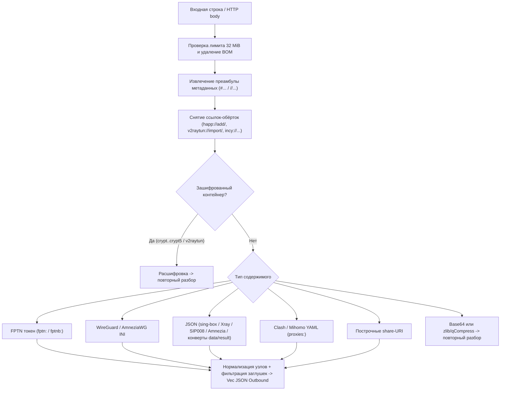

# Парсер подписок, форматы бандлов и URI-ссылки

Документ задаёт спецификацию подсистемы разбора и загрузки подписок `tachyon-core` (v0.6.2): поддерживаемые URI-схемы, форматы бандлов, зашифрованные контейнеры, адаптивный HTTP-загрузчик, обработку метаданных/заголовков и таблицы маппинга параметров URI в JSON-конфигурацию outbound.

---

## 1. Конвейер автоопределения и лимиты безопасности

Входной payload подписки (из URL, локального файла, inline-строки в `outbounds[]` или блока `subscriptions[]` / `outbound_providers[]`) проходит многоуровневое автоопределение с ограничением глубины рекурсии до `4` уровней:



### Защитные ограничения и очистка результата

- **Максимальный размер payload**: `32 MiB` (проверяется до декодирования и применяется как лимит при распаковке zlib).
- **Максимальное число узлов с одного источника**: `4096`.
- **Максимальная глубина вложенности** (обёртка -> шифрование -> Base64 -> бандл): `4`.
- **Фильтрация узлов-заглушек**: отбрасываются служебные баннеры панелей (адреса `0.0.0.0`, `127.0.0.1:1`, текстовые заглушки о неподдерживаемом клиенте). Если после фильтрации не осталось реальных узлов, попытка загрузки считается неуспешной (что позволяет адаптивному загрузчику перейти к следующему профилю `User-Agent`).
- **Уникализация тегов**: при разворачивании подписок в конфигурацию конфликтующие теги автоматически дедуплицируются.

---

## 2. Поддерживаемые URI-схемы

Регистр имени схемы при разборе нормализуется к нижнему регистру. Порт по умолчанию определяется по схеме: `80` (`http`), `22` (`ssh`), `1080` (`socks*`), `51820` (`wg*`/`awg*`), `8388` (`ss`), `443` (остальные).

### 2.1. Протокольные URI

| URI-схема (и алиасы) | Целевой `type` в JSON | Поддерживаемые форматы записи |
| --- | --- | --- |
| `vless://` | `vless` | `vless://<uuid>@<host>:<port>?<params>#<tag>` (Vision, REALITY, PQ `X25519MLKEM768`, `encryption: mlkem768x25519plus`, XHTTP/WS/gRPC/HTTPUpgrade/HTTP) |
| `vmess://` | `vmess` | V2RayN Base64 JSON (`vmess://<base64_json>[#<tag>]`) и стандартный URI (`vmess://[security:]<uuid>@<host>:<port>?<params>#<tag>`) |
| `trojan://`, `trojan-go://` | `trojan` | `trojan://<password>@<host>:<port>?<params>#<tag>` (`trojan-go://` при наличии `path`/`host` без `type` включает `ws`) |
| `ss://`, `shadowsocks://` | `shadowsocks` | SIP002 (`ss://<base64(method:pass)>@<host>:<port>?plugin=...&uot=1#<tag>`), открытый `method:pass@host:port`, legacy `ss://<base64(method:pass@host:port)>#<tag>` |
| `hy2://`, `hysteria2://` | `hysteria2` | `hy2://<password>@<host>:<port>?<params>#<tag>` (`obfs=salamander\|gecko`, `finalmask`/`fm`, `mport`, `hop_interval`, `pinSHA256`, `upmbps`/`downmbps`) |
| `hysteria://`, `hy://` | `hysteria` | `hysteria://<host>:<port>?auth=...&obfs=...&upmbps=...&downmbps=...#<tag>` |
| `tuic://`, `tuic5://` | `tuic` | `tuic://<uuid>:<password>@<host>:<port>?congestion_control=...&udp_relay_mode=...#<tag>` |
| `anytls://` | `anytls` | `anytls://<password>@<host>:<port>?sni=...&fp=...&alpn=...#<tag>` |
| `naive://`, `naive+https://`, `naive+http2://`, `naive+h2://`, `naive+quic://`, `naive+h3://` | `naive` | `naive+https://<user>:<pass>@<host>:<port>?uot=1#<tag>` (`+quic`/`+h3` или `quic=1` включают HTTP/3) |
| `snell://` | `snell` | `snell://<psk>@<host>:<port>?version=4\|5\|6&obfs=...&uot=1&reuse=1#<tag>` |
| `shadowtls://`, `stls://` | `shadowtls` | `shadowtls://<password>@<host>:<port>?version=3&sni=...#<tag>` |
| `mieru://`, `mierus://` | `mieru` | `mieru://<user>:<pass>@<host>:<port>?port=<ranges>&protocol=TCP\|UDP&multiplexing=...#<tag>` |
| `fptn:`, `fptn://`, `fptnb:`, `fptnb//` | `fptn` (разворачивается в список узлов + `urltest` + `selector`) | `fptn:<base64(json)>` или `fptnb:<base64(brotli(json))>` (токен со списком `servers[]`, `username`, `password`, `md5_fingerprint`) |
| `wg://`, `wireguard://`, `awg://`, `amneziawg://` | `wireguard` | Стандартный URI (`awg://<privkey>@<host>:<port>?publickey=...&jc=...&i1=...#<tag>`) или сжатый контейнер без `@` (Amnezia zlib/qCompress INI или JSON) |
| `vpn://` | `wireguard` / `vless` / `shadowsocks` / `openvpn` / др. | Сжатый контейнер AmneziaVPN (Qt `qCompress`/zlib + Base64 -> JSON `containers` или INI) |
| `phobos://` | `wireguard` | Проприетарный контейнер WireGuard/AWG |
| `masque://` | `masque` | `masque://<host>:<port>?private_key=...&public_key=...&ip=...&ipv6=...&profile=...#<tag>` |
| `tewfai://` | `tewfai` | `tewfai://<password>@<host>:<port>?transport=...&fec=1&shaper=1&pqc=1#<tag>` |
| `wdtt://`, `qwdtt://`, `csqtt://` | `wdtt` | Компактные URI для WebRTC/DTLS/TURN-туннеля |
| `mtproto://`, `tg://proxy?`, `tg://proxy/?`, `https://t.me/proxy?`, `http://t.me/proxy?` | `mtproto` | `tg://proxy?server=<host>&port=<port>&secret=<hex>` и `mtproto://<secret>@<host>:<port>#<tag>` |
| `trusttunnel://` | `trusttunnel` | `trusttunnel://<user>:<pass>@<host>:<port>?quic=1&sni=...#<tag>` |
| `openconnect://`, `anyconnect://` | `openconnect` | `openconnect://<user>:<pass>@<host>:<port>?flavor=anyconnect&cookie=...#<tag>` |
| `socks://`, `socks5://`, `socks5h://` | `socks` | `socks5://[<user>:<pass>@]<host>:<port>?uot=1#<tag>` |
| `http://`, `https://` | `http` | Прокси-URI **только при наличии** учётных данных (`user:pass@`) или явного порта (`:8080`); обычные веб-URL отклоняются как не-прокси |
| `ssh://` | `ssh` | `ssh://<user>[:<pass>]@<host>:<port>?...#<tag>` |
| `sudoku://` | `sudoku` | `sudoku://<key>@<host>:<port>?table_type=...&custom_table=...#<tag>` |

### 2.2. Схемы-обёртки и зашифрованные ссылки

| Префикс | Назначение |
| --- | --- |
| `happ://add/`, `happ://import/` | Глубокая ссылка-обёртка (снимается с percent-декодированием до 4 уровней) |
| `v2raytun://import/`, `v2raytun://add/` | Глубокая ссылка-обёртка v2rayTun |
| `incy://add/`, `incy://import/` | Глубокая ссылка-обёртка Incy |
| `http(s)://...` с вложенным `happ://crypt...` / `happ://add/` / `v2raytun://...` | Извлечение вложенной ссылки из URL-редиректа (включая percent-кодированные параметры) |
| `happ://crypt/`, `happ://crypt2/`, `happ://crypt3/`, `happ://crypt4/`, `happ://crypt5/` (и короткие `crypt/`..`crypt5/`) | Зашифрованные подписки и ссылки Happ |
| `v2raytun://crypt/` | Зашифрованные ссылки v2rayTun |

---

## 3. Поддерживаемые форматы бандлов и контейнеров

1. **Plain URI list**: список URI (по одному на строку, с необязательной преамбулой комментариев `#...` / `//...`).
2. **Base64 bundle**: Standard Base64, URL-safe Base64 (с padding и без, игнорируются пробелы и переносы строк), внутри которого может находиться URI-список, JSON, Clash YAML или WireGuard INI.
3. **Clash / Mihomo YAML**: распознаётся по ключу `proxies:`; конвертирует описания узлов (включая `vless`, `vmess`, `trojan`, `ss`, `hysteria2`, `tuic`, `anytls`, `wireguard`, `socks5`, `http`, `snell`, `mieru` и их TLS/REALITY/transport/obfs/AWG параметры) в формат `tachyon-core`.
4. **sing-box / tachyon-core JSON**: объект с `outbounds` / `endpoints` или JSON-массив объектов outbound.
5. **Xray JSON**: объект с `outbounds`, использующий поля `protocol`, `settings`, `streamSettings` (`realitySettings`, `tlsSettings`, `xhttpSettings`/`splithttpSettings`, `wsSettings`, `grpcSettings`, `httpupgradeSettings`, `finalmask`, `sockopt`) — конвертируется в схему `tachyon-core`.
6. **SIP008 JSON**: объект Shadowsocks `{"version": 1, "servers": [...]}` с маппингом `remarks` -> `tag` и нормализацией плагина `simple-obfs` -> `obfs-local`.
7. **Панельные JSON-конверты**: извлечение массивов узлов из обёрток с ключами `data` / `result`.
8. **WireGuard / AmneziaWG INI (`.conf`)**: разбор секций `[Interface]` и `[Peer]` (включая все параметры AWG 1.x / 2.0 / 3.x: `Jc`, `Jmin`, `Jmax`, `S1`–`S4`, `H1`–`H4`, `I1`–`I5`, `J1`–`J3`, `ITime`, `HeaderProtectionKey`, `ServerPorts`, `HopInterval`). Если HTTP-ответ содержит только секцию `[Interface]` без `[Peer]`, клиент синтезирует `[Peer]` из HTTP-заголовков ответа (`X-Peer-Public-Key` / `X-WG-Public-Key`, `X-Peer-Endpoint` / `X-Peer-Host` + `X-Peer-Port`, `X-Preshared-Key`).
9. **AmneziaVPN `vpn://` и `awg://` контейнеры**: распаковка Base64 + Qt `qCompress` (4-байтная длина BE + zlib) или сырого zlib -> извлечение конфигураций из JSON `containers` либо INI.
10. **FPTN токены (`fptn:` / `fptnb:`)**: Base64 (для `fptnb:` предварительно распаковывается Brotli; недоступно в lite-сборке без фичи `brotli`) -> JSON `{ "version", "service_name", "username", "password", "servers": [{ "name", "host", "port", "md5_fingerprint" }] }`. При указании `{"type": "fptn", "token": "..."}` в `outbounds` автоматически разворачивается в узлы `<tag>/<server.name>`, группу `urltest` (`<tag>-urltest`) и `selector` с исходным `<tag>`.
11. **Зашифрованные подписки `Happ` (`crypt`–`crypt5`) и `v2rayTun`**:
    - `happ://crypt/`..`crypt4/` и `v2raytun://crypt/`: асимметричное RSA-дешифрование ссылки или контента; для `crypt`..`crypt4` при неуспехе RSA выполняется откат к симметричному **AES-256-CBC** (16-байтный IV + блоки кратные 16 байтам) с ключом, выводимым из HWID (в порядке приоритета: `custom_hwid`, переменная окружения `TACHYON_SUBSCRIPTION_HWID`, аппаратный `device_hwid` в разных регистрах, значение по умолчанию).
    - `happ://crypt5/`: гибридный конверт с перестановкой байтовых пар, 8-байтным идентификатором ключа, опциональной солью, RSA-обёрткой 32-байтного сессионного ключа и AEAD-шифрованием полезной нагрузки алгоритмом **ChaCha20-Poly1305**.
    - **Шифрование тела HTTP-ответа (`Encrypt-Tag`)**: если URL подписки содержит query-параметр `?key=keyNN` и HTTP-ответ содержит заголовок `Encrypt-Tag` (16-байтный тег аутентификации в Base64), тело ответа (Base64) автоматически расшифровывается по **AES-128-GCM** до передачи парсеру.
    - Если после расшифровки контейнера получена новая HTTP(S)-ссылка (однострочная, отличная от исходной), загрузчик автоматически выполняет вторичный HTTP-запрос по ней.

---

## 4. Адаптивный HTTP-загрузчик и заголовки подписки

### 4.1. Каскад профилей `User-Agent` и `HWID`

Поскольку панели (`3x-ui`, `Marzban`, `Remnawave`, `Pasarguard`, `Hiddify`, `Happ`) и промежуточные WAF по-разному фильтруют запросы, загрузчик перебирает детерминированный каскад пар `(User-Agent, режим HWID)` и останавливается на первом ответе HTTP `200..299`, из которого успешно извлечён хотя бы один реальный узел:

1. Пользовательский `user_agent` / `ua` (если задан в конфиге подписки).
2. `tachyon-core/<ver> (compatible; sing-box 1.14.3)`
3. `v2rayNG/1.8.29`
4. `Happ/4.6.2` и `Happ`
5. `Clash.Meta/v1.19.10` и `Mihomo/1.19.10`
6. `v2rayN/7.10`
7. `HiddifyNext/2.5.7`
8. `tachyon-core/<ver>`
9. Вариации с режимом `HwidOnly` (только `X-HWID` + `HWID` без `X-Device-*` для панелей, фильтрующих немобильные заголовки), с `legacy_hwid`, и без HWID-заголовков (`sing-box 1.14.3`, браузерный `Chrome/131`).

> Сетевые ошибки уровня DNS/TCP/TLS не зависят от `User-Agent` и немедленно завершают запрос без перебора каскада.

### 4.2. Исходящие заголовки идентификации устройства (`HWID`)

При `send_hwid: true` (или в режиме совместимости) отправляются:

| Заголовок | Значение |
| --- | --- |
| `X-HWID` | Идентификатор устройства (`custom_hwid` или вычисленный аппаратный HWID; на OpenWrt — формат `xxxx-xxxx-xxxx-xxxx` из MAC и модели роутера) |
| `HWID` | Дублирует `X-HWID` для панелей, читающих заголовок без префикса `X-` |
| `X-Device-OS` | Название ОС (не отправляется в режиме `HwidOnly`) |
| `X-Ver-OS` | Версия ОС (не отправляется в режиме `HwidOnly`) |
| `X-Device-Model` | Модель устройства / роутера (не отправляется в режиме `HwidOnly`) |

### 4.3. Входящие заголовки и метаданные подписки

Метаданные читаются как из HTTP-заголовков ответа, так и из первых `64` строк комментариев (`#key: value` или `//key: value`) в сыром, Base64-декодированном или расшифрованном теле подписки (комментарии имеют приоритет при заполнении, недостающие поля добираются из HTTP-заголовков).

| HTTP-заголовок | Алиасы в комментариях тела | Формат значения и назначение |
| --- | --- | --- |
| `Subscription-Userinfo` | `subscription-userinfo`, `userinfo` | `upload=<B>; download=<B>; total=<B>; expire=<unix_ts>` — квота трафика и срок действия (экспортируется в Clash API `/providers/proxies`) |
| `Profile-Update-Interval` | `profile-update-interval`, `update-interval` | Целое число часов (`> 0`) — рекомендуемый интервал обновления |
| `Profile-Title` | `profile-title`, `title`, `remarks` | Название профиля; поддерживаются `base64:<...>`, RFC 2047 `=?UTF-8?B?...?=` и `%XX`-кодирование |
| `Content-Disposition` | — | Извлечение `filename*=UTF-8''...` или `filename="..."` (с отсечением `.yaml`/`.yml`/`.json`/`.txt`/`.conf`) как резервного названия профиля |
| `Profile-Web-Page-Url` | `profile-web-page-url`, `web-page-url`, `homepage` | URL личного кабинета |
| `Support-Url` | `support-url` | URL поддержки |
| `Announce` | `announce`, `announcement`, `description` | Текст объявления от провайдера |
| `Announce-Url` / `X-Announce-Url` | `announce-url`, `announcement-url` | Ссылка к объявлению |
| `Subscription-Refill-Date` / `Refill-Date` | `subscription-refill-date`, `refill-date` | Unix timestamp следующего сброса квоты |
| `Encrypt-Tag` | — | 16-байтный Base64 GCM-тег для расшифровки тела при `?key=keyNN` |
| `X-Peer-Public-Key`, `X-Peer-Endpoint`, `X-Preshared-Key` | — | Дополнение неполного WireGuard `[Interface]` секцией `[Peer]` |

---

## 5. Таблица маппинга параметров URI -> JSON-поля

### 5.1. Общие параметры TLS, REALITY, uTLS, ECH и фрагментации

| Query-параметры URI (регистронезависимо) | JSON-путь в объекте outbound | Правила преобразования |
| --- | --- | --- |
| `security` (`tls`, `xtls`, `reality`, `none`), `tls=1` | `tls.enabled`, `tls.reality.enabled` | При наличии `pbk`/`publickey` автоматически включается `reality`. Для VLESS без `encryption` и порт `443` / наличие TLS-параметров включает неявный TLS (если не указано `security=none`) |
| `sni`, `peer`, `servername` | `tls.server_name` | По умолчанию подставляется `host` из URI |
| `allowInsecure`, `allow_insecure`, `insecure`, `skip-cert-verify` | `tls.insecure` | `true` при `1` / `true` |
| `alpn` | `tls.alpn` | Разбивается по запятой в массив строк (`h2,http/1.1` -> `["h2", "http/1.1"]`) |
| `fp`, `fingerprint`, `client-fingerprint` | `tls.utls.enabled = true`, `tls.utls.fingerprint` | Нормализуется к поддерживаемому uTLS-профилю; для REALITY при отсутствии `fp` ставится `"chrome"` |
| `pbk`, `publickey`, `public_key` | `tls.reality.public_key` | Включает `tls.reality.enabled = true` |
| `sid`, `shortid`, `short_id` | `tls.reality.short_id` | Hex-строка short ID |
| `support_x25519mlkem768`, `pq`, `post_quantum`, `pqv`, `mldsa65Verify` | `tls.reality.support_x25519mlkem768` (REALITY) или `tls.pq` (обычный TLS) | Также извлекается из JSON-параметра `extra` |
| `pinSHA256`, `pin_sha256`, `pin-sha256`, `pcs`, `pinnedPeerCertSha256`, `certificate_sha256` | `tls.certificate_sha256` | Список SHA-256 отпечатков (разделители `,` / `;`, двоеточия и дефисы удаляются) |
| `verifyPeerCertByName`, `verify_peer_cert_by_name`, `verifyPeerCertInNames` | `tls.verify_peer_cert_by_name` | Нормализованный список имён сертификата |
| `ech`, `echConfigList`, `ech_config_list`, `ech_config` | `tls.ech` | Объект конфигурации ECH |
| `fragment`, `tls_fragment` (или `fm` с `"fragment"`) | `tls.fragment` / `fragment` | Фрагментация TLS ClientHello / TCP-сегментация |

### 5.2. Общие параметры потоковых транспортов (`transport`)

| Query-параметры URI | JSON-путь в `transport` | Примечание |
| --- | --- | --- |
| `type`, `net`, `network` | `transport.type` | `ws`/`websocket` -> `ws`; `grpc`/`gun` -> `grpc`; `httpupgrade`/`http-upgrade` -> `httpupgrade`; `http`/`h2` -> `http`; `xhttp`/`splithttp` -> `xhttp`; `tcp`+`headerType=http` -> `http` |
| `path` (или путь URI) | `transport.path` | Для `ws`: параметр `?ed=N` внутри `path` автоматически выносится в `max_early_data` и `early_data_header_name: "Sec-WebSocket-Protocol"` |
| `host`, `obfsParam`, `authority` | `transport.headers.Host` (`ws`), `transport.host` (`httpupgrade`/`xhttp`/`http`) | Для `http` разбивается по `,` в массив строк |
| `ed`, `max_early_data` и `eh`, `early_data_header_name` | `transport.max_early_data`, `transport.early_data_header_name` | Только для `ws` |
| `serviceName`, `service_name` | `transport.service_name` | Для `grpc` (fallback на `path`) |
| `mode` | `transport.mode` | Для `xhttp`: `auto`, `packet-up`, `stream-up`, `stream-one` |
| `extra` (JSON-строка) | Разворачивается в плоские поля `transport.*` и `transport.xmux` | Поддерживаются camelCase и snake_case ключи Xray/sing-box |
| `h2_params`, `h2Params`, `h2-params` | `transport.h2_params` | Параметры HTTP/2 для `xhttp` |

### 5.3. Протокольно-специфичные параметры URI

| Протокол | Параметры URI | JSON-поля outbound |
| --- | --- | --- |
| **VLESS** | `userinfo` -> `uuid`; `flow`; `encryption` (кроме `none`); `packetEncoding` / `packet_encoding` | `uuid`, `flow`, `encryption`, `packet_encoding` |
| **VMess (JSON)** | `add`->`server`, `port`->`server_port`, `id`->`uuid`, `aid`->`alter_id`, `scy`->`security`, `ps`->`tag`, `net`->`transport.type`, `type`->`headerType`, `host`, `path`, `tls`, `sni`, `alpn`, `fp` | `server`, `server_port`, `uuid`, `alter_id`, `security`, `tls`, `transport` |
| **Shadowsocks** | `userinfo` -> `method` + `password`; `plugin=<name>;<opts>`; `uot` / `udp-over-tcp` | `method`, `password`, `plugin` (`simple-obfs` -> `obfs-local`), `plugin_opts`, `udp_over_tcp` |
| **Hysteria2** | `userinfo` / `auth` -> `password`; `obfs=salamander\|gecko`; `obfs-password`; `packetSize` / `min_packet_size` / `max_packet_size`; `fm` / `finalmask` (JSON); `upmbps` / `downmbps`; `mport` / `ports`; `hop_interval` / `mportHopInt` | `password`, `obfs` (`type`, `password`, `min_packet_size`, `max_packet_size`), `up_mbps`, `down_mbps`, `server_ports` (`-` -> `:`), `hop_interval` |
| **TUIC v5** | `userinfo` (`uuid:pass`); `congestion_control`; `udp_relay_mode`; `zero_rtt_handshake` / `reduce_rtt` | `uuid`, `password`, `congestion_control`, `udp_relay_mode`, `zero_rtt_handshake` |
| **WireGuard / AWG** | `userinfo` / `privatekey`; `publickey` / `pub`; `address` / `ip`; `psk`; `mtu`; `keepalive`; `reserved`; `jc`, `jmin`, `jmax`, `s1`–`s4`, `h1`–`h4`, `i1`–`i5` (`j1`–`j3`), `id`, `ib`, `itime`, `hpk`/`header_protection_key`, `awg_ip`, `random_trailers`, `disable_cookies`, `server_ports`, `hop_interval`, `hop_interval_max` | `private_key`, `peer_public_key`, `local_address`, `pre_shared_key`, `mtu`, `persistent_keepalive_interval`, `reserved`, все AWG-поля + поля endpoint |
| **NaiveProxy** | `userinfo` (`user:pass`); схема `+quic`/`+h3` или `quic=1`; `uot` | `username`, `password`, `quic`, `udp_over_tcp` |
| **Snell** | `userinfo` (`psk`); `version`/`v`; `obfs`; `obfs-host`; `uot`; `reuse` | `psk`, `version`, `obfs`, `udp_over_tcp`, `reuse` |
| **Mieru** | `userinfo` (`user:pass`); `port`/`ports`/`port-range`; `protocol`/`transport`; `multiplexing`; `traffic-pattern`; `handshake-mode`; `mtu` | `username`, `password`, `server_ports`/`server_port`, `transport`, `multiplexing`, `mtu` |

---

## 6. Пайплайн фильтрации и трансформации подписок в конфиге

Секции `subscriptions[]` (алиас `outbound_providers[]`) или inline-объект `{"type": "subscription", ...}` в `outbounds[]` поддерживают конвейер обработки узлов:

- `include` (алиас `filter`) — регулярное выражение включения узлов по тегу;
- `exclude` — регулярное выражение исключения узлов по тегу;
- `rename` — строка `"pattern => replacement"`, массив правил или объект `{ "pattern": "replacement" }`;
- `prefix` (`tag_prefix`) и `suffix` (`tag_suffix`) — префикс и суффикс к тегу каждого узла;
- `override` (`patch`) — JSON-объект, применяемый глубоким слиянием (deep merge) поверх каждого узла (например, для массового задания `detour`, `tcp_fast_open`, `domain_resolver`).

На уровне runtime локальные файлы подписок отслеживаются по `(mtime, blake3)` с автоматической горячей перезагрузкой, а удалённые подписки обновляются по расписанию или по запросу `PUT /providers/proxies/{name}` через Clash API.

---

## 7. Примеры преобразования URI -> JSON

### Пример 1: VLESS + REALITY + Vision + PQ

**Входной URI**:
```text
vless://11111111-2222-3333-4444-555555555555@edge.example.com:443?security=reality&sni=www.example.org&fp=chrome&pbk=AAAAAAAAAAAAAAAAAAAAAAAAAAAAAAAAAAAAAAAAAAA&sid=01ab&flow=xtls-rprx-vision&pq=1#EU-Reality
```

**Результат JSON**:
```json
{
  "type": "vless",
  "tag": "EU-Reality",
  "server": "edge.example.com",
  "server_port": 443,
  "uuid": "11111111-2222-3333-4444-555555555555",
  "flow": "xtls-rprx-vision",
  "tls": {
    "enabled": true,
    "server_name": "www.example.org",
    "utls": {
      "enabled": true,
      "fingerprint": "chrome"
    },
    "reality": {
      "enabled": true,
      "public_key": "AAAAAAAAAAAAAAAAAAAAAAAAAAAAAAAAAAAAAAAAAAA",
      "short_id": "01ab",
      "support_x25519mlkem768": true
    }
  }
}
```

### Пример 2: Hysteria2 с Salamander и port hopping

**Входной URI**:
```text
hy2://secret-pass@hy.example.com:443?sni=hy.example.com&obfs=salamander&obfs-password=obfs-key&mport=20000-30000&hop_interval=30s&upmbps=100&downmbps=500#HY2-Hop
```

**Результат JSON**:
```json
{
  "type": "hysteria2",
  "tag": "HY2-Hop",
  "server": "hy.example.com",
  "server_port": 443,
  "password": "secret-pass",
  "up_mbps": 100,
  "down_mbps": 500,
  "server_ports": ["20000:30000"],
  "hop_interval": "30s",
  "obfs": {
    "type": "salamander",
    "password": "obfs-key"
  },
  "tls": {
    "enabled": true,
    "server_name": "hy.example.com"
  }
}
```

### Пример 3: VLESS + XHTTP + `extra` (XMUX)

**Входной URI**:
```text
vless://11111111-2222-3333-4444-555555555555@cdn.example.com:443?type=xhttp&security=tls&sni=cdn.example.com&path=%2Fstream&mode=packet-up&extra=%7B%22xPaddingBytes%22%3A%22100-500%22%2C%22xmux%22%3A%7B%22maxConnections%22%3A%222-4%22%7D%7D#CDN-XHTTP
```

**Результат JSON**:
```json
{
  "type": "vless",
  "tag": "CDN-XHTTP",
  "server": "cdn.example.com",
  "server_port": 443,
  "uuid": "11111111-2222-3333-4444-555555555555",
  "tls": {
    "enabled": true,
    "server_name": "cdn.example.com"
  },
  "transport": {
    "type": "xhttp",
    "path": "/stream",
    "mode": "packet-up",
    "x_padding_bytes": "100-500",
    "xmux": {
      "max_connections": "2-4"
    }
  }
}
```
