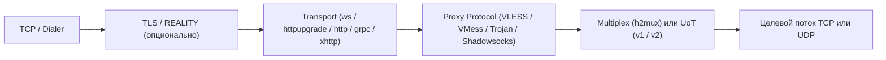
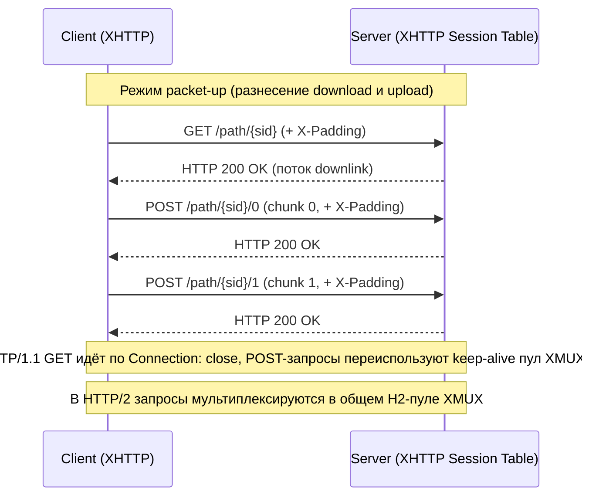

# Транспортный уровень, мультиплексирование и UDP-over-TCP

Документ описывает проводные (wire) контракты, параметры конфигурации и правила взаимодействия для потоковых транспортов (`transport`), уровня мультиплексирования (`multiplex`) и туннелирования датаграмм UDP-over-TCP (`udp_over_tcp`) в `tachyon-core` (v0.6.2).

---

## 1. Общая архитектура стека потокового транспорта

Потоковые транспорты встраиваются между уровнем TCP/TLS и прокси-протоколом (VLESS, VMess, Trojan). Для верхнего протокола транспорт выглядит как полнодуплексный байтовый поток.



### Матрица поддержки транспортов и слоёв по протоколам

| Протокол | `transport` (Outbound) | `transport` (Inbound) | `multiplex` (Outbound) | `multiplex` (Inbound) | `udp_over_tcp` (Outbound) | `udp_over_tcp` (Inbound) |
| --- | --- | --- | --- | --- | --- | --- |
| VLESS | `ws`, `httpupgrade`, `http`, `grpc`, `xhttp` | `ws`, `httpupgrade`, `http`/`h2`, `grpc`, `xhttp` | Да (`h2mux`) | Да (`h2mux`) | Нет (нативный UDP / `xudp`) | Да (перехват magic-адреса) |
| VMess | `ws`, `httpupgrade`, `http`, `grpc`, `xhttp` | `ws`, `httpupgrade`, `http`/`h2`, `grpc`, `xhttp` | Да (`h2mux`) | Да (`h2mux`) | Нет (нативный UDP / `xudp`) | Да (перехват magic-адреса) |
| Trojan | `ws`, `httpupgrade`, `http`, `grpc`, `xhttp` | `ws`, `httpupgrade`, `http`/`h2`, `grpc`, `xhttp` | Да (`h2mux`) | Да (`h2mux`) | Нет (нативный UDP) | Да (перехват magic-адреса) |
| Shadowsocks | Нет (вместо него `plugin`) | Нет | Да (`h2mux`) | Да (`h2mux`) | Да (v1 / v2) | Да (перехват magic-адреса) |
| SOCKS5 | Нет | Нет | Нет | Нет | Да (v1 / v2) | Да (перехват magic-адреса) |
| NaiveProxy | Встроенный H2/H3 CONNECT | Встроенный H2/H3 CONNECT | Нет (пулинг H2/H3) | Нет | Да (v1 / v2) | Да (перехват magic-адреса) |
| AnyTLS | Нет (поверх TLS) | Нет (поверх TLS) | Встроенный session-mux | Встроенный session-mux | Да (v2, принудительно для UDP) | Да (перехват magic-адреса) |
| TUIC v5 | Нет (поверх QUIC) | Нет (поверх QUIC) | Потоки QUIC | Потоки QUIC | Да (`udp_over_stream`, v2) | Да (перехват magic-адреса) |

> Примечание: транспорт `quic` валидируется в схеме конфигурации для обратной совместимости с sing-box, но на серверной и клиентской стороне не реализован и при попытке запуска отклоняется с явной ошибкой.

### Согласование ALPN по умолчанию

Если поле `tls.alpn` не задано явно в конфигурации outbound, транспортный слой выставляет список ALPN автоматически:

| Транспорт | Режим TLS | ALPN по умолчанию | Поведение при явном `tls.alpn` |
| --- | --- | --- | --- |
| `ws` | TLS | `["http/1.1"]` | `h3` удаляется; без REALITY сужается до `["http/1.1"]` |
| `httpupgrade` | TLS | `["http/1.1"]` | `h3` удаляется; без REALITY сужается до `["http/1.1"]` |
| `http` | TLS | `["h2", "http/1.1"]` | Используется конфигурация пользователя |
| `http` | Plain TCP | нет | Принудительно HTTP/1.1 |
| `grpc` | TLS | `["h2", "http/1.1"]` | Используется конфигурация пользователя |
| `xhttp` | TLS / REALITY | `["h2", "http/1.1"]` | `h3` удаляется; при `alpn: ["http/1.1"]` или без TLS используется ветка HTTP/1.1 |

### Пул прогретых соединений (`preconnect` / `warm_pool`)

Для транспортов без внутреннего мультиплексирования (`none`, `httpupgrade`, а также `ws` без early data) поддерживается опциональный пул заранее установленных TCP+TLS+transport соединений.

- Конфигурация на уровне outbound или внутри `transport`:
  - `preconnect: true` — размер пула `2`, `idle_timeout: "45s"`;
  - `preconnect: <N>` — размер пула от `1` до `16`, `idle_timeout: "45s"`;
  - `preconnect: { "enabled": true, "size": 4, "idle_timeout": "45s" }`.
- Перед выдачей соединение проверяется на жизнеспособность неблокирующим чтением и сроком простоя; после выдачи пул асинхронно пополняется до целевого размера.

---

## 2. Потоковые транспорты (`transport`)

### 2.1. HTTP/1.1 и HTTP/2 (`type: "http"`)

Транспорт `http` выбирает версию протокола по наличию TLS:

- **Без TLS (HTTP/1.1)**: отправляется один потоковый HTTP/1.1-запрос без `Content-Length` и без `Transfer-Encoding: chunked`. Тело запроса и тело ответа передаются как непрерывный байтовый поток до закрытия соединения.
  - Заголовки запроса и первая порция данных верхнего протокола склеиваются в одну отправку.
  - Метод по умолчанию — `PUT`, путь по умолчанию — `/`.
  - Если `host` — массив, для каждого соединения выбирается случайный элемент; при пустом массиве подставляется `<server>:<port>`.
  - Клиент проверяет код ответа `200`; сервер отвечает `HTTP/1.1 200 OK` с `Content-Type: application/octet-stream` и `Connection: close`.
- **Поверх TLS (HTTP/2)**: устанавливается HTTP/2-сессия с переиспользованием в пуле (`H2`), где каждый прокси-поток открывается отдельным HTTP/2-запросом (`END_STREAM=false`).
  - При пустом `host` для совместимости с v2fly/sing-box используется authority `www.example.com`.
  - Hop-by-hop заголовки (`host`, `connection`, `keep-alive`, `proxy-connection`, `transfer-encoding`, `upgrade`, `te`, `trailer`) отфильтровываются.
  - Серверная сторона принимает как TLS с ALPN `h2`, так и HTTP/2 prior-knowledge (`PRI * HTTP/2.0\r\n`) или HTTP/1.1, сопоставляя `:path` с настроенным `path` (при несовпадении возвращает `404`).

#### Поля конфигурации `http`

| Поле | Тип | По умолчанию | Описание |
| --- | --- | --- | --- |
| `host` | `string \| string[]` | `""` | Заголовок `Host` (HTTP/1.1) или `:authority` (HTTP/2); из массива выбирается случайный элемент |
| `path` | `string` | `"/"` | Путь запроса (автоматически дополняется ведущим `/` на клиенте) |
| `method` | `string` | `"PUT"` | HTTP-метод запроса |
| `headers` | `object \| array` | `{}` | Дополнительные HTTP-заголовки (`{"Name": "Val"}` или `[{"name": "...", "value": "..."}]`) |
| `idle_timeout` | `duration` | `"300s"` | Интервал простоя HTTP/2-соединения перед отправкой keep-alive PING / закрытием |
| `ping_timeout` | `duration` | `"15s"` (при заданном `idle_timeout`) | Таймаут ожидания HTTP/2 PING ACK |

---

### 2.2. Оптимизация HTTP/2 flow control (`WINDOW_UPDATE`)

Все транспорты поверх HTTP/2 (`http`, `grpc`, `xhttp`, `h2mux`, `naive` H2) используют общую конфигурацию HTTP/2-стека с двумя ключевыми инженерными параметрами:

1. **Порог генерации `WINDOW_UPDATE` = `1/32` окна** (вместо стандартных `1/2` в upstream-реализации HTTP/2).
   - Стандартный порог `50%` на каналах с высоким BDP (высокий RTT при большой пропускной способности) вызывает периодические «пилообразные» остановки отправителя: пока получатель не вычитает половину окна и не отправит `WINDOW_UPDATE`, отправитель упирается в потолок окна.
   - При пороге `1/32` обновление окна отправляется инкрементально малыми порциями, удерживая конвейер полностью заполненным без избыточного расхода памяти под гигантские окна на роутерах с ограниченной ОЗУ.
2. **Аппаратное масштабирование окон и размера кадра**:
   - Для `http`, `grpc` и `h2mux` максимальный размер DATA-кадра ограничен `120 KiB` (ниже порога `128 KiB` `mmap`-аллокации в musl `mallocng`, что позволяет переиспользовать буферы без системных вызовов `mmap`/`munmap`).
   - Начальные окна потока (`initial_window_size`), соединения (`initial_connection_window_size`) и `max_send_buffer_size` масштабируются автоматически по профилю доступной ОЗУ устройства.
   - Для `xhttp` поверх HTTP/2 используется отдельный профиль: `max_frame_size = 1 MiB`, `initial_connection_window_size = 1 GiB + 65535`, `initial_window_size` в диапазоне `1–2 MiB` (<= 512 MiB ОЗУ) или `1–4 MiB` (> 512 MiB ОЗУ), `idle_timeout = 300s`. Все параметры переопределяются через `h2_params`.

---

### 2.3. WebSocket (`type: "ws"`)

Реализация RFC 6455, передающая поток данных верхнего протокола в бинарных фреймах (`opcode = 0x2`).

#### Рукопожатие (Handshake)

```text
GET <path> HTTP/1.1\r\n
Host: <host>\r\n
Upgrade: websocket\r\n
Connection: Upgrade\r\n
Sec-WebSocket-Key: <base64(16 random bytes)>\r\n
Sec-WebSocket-Version: 13\r\n
[<early_data_header_name>: <encoded early payload>\r\n]
[<пользовательские headers>]\r\n
\r\n
```

- Клиент проверяет статус `101` и корректность `Sec-WebSocket-Accept = Base64(SHA-1(Sec-WebSocket-Key + "258EAFA5-E914-47DA-95CA-C5AB0DC85B11"))`.
- Приоритет определения заголовка `Host`: `transport.host` -> `headers["Host"]` -> адрес сервера (IPv6 берётся в квадратные скобки, без зоны). Дублирующийся заголовок `Host` из `headers` отбрасывается.
- Серверная сторона валидирует путь (включая query-строку, если она задана в `path`) и обязательные WebSocket-заголовки; при несоответствии возвращает HTTP-ответ отказа, совместимый с sing-box.

#### Early Data (`0-RTT` поверх WebSocket Upgrade)

Если задано `max_early_data > 0`, первые до `max_early_data` байт полезной нагрузки верхнего протокола передаются прямо в заголовке HTTP Upgrade:

| Конфигурация `early_data_header_name` | Имя заголовка | Кодировка на клиенте | Приём на сервере |
| --- | --- | --- | --- |
| Не задано / пусто | `Sec-WebSocket-Protocol` | Standard Base64 (с padding) | Декодируется URL-safe (с/без padding) и Standard Base64 (с/без padding); также поддерживается передача в хвосте URL-пути (`<path><base64>`) |
| Задано (например `Sec-WebSocket-Protocol` или кастомный заголовок) | Указанное имя | URL-safe Base64 без padding (`base64url` no-pad) | Декодируется из указанного заголовка в любом варианте Base64 |

Если в `headers` указан тот же заголовок, что используется для early data, и early data непуста, пользовательское значение пропускается во избежание дублирования.

#### Кадрирование (RFC 6455)

- Клиент маскирует исходящие фреймы 4-байтным ключом (RFC 6455 §5.3); сервер отправляет немаскированные фреймы.
- Чтение поддерживает фреймы с произвольными 2/4/10-байтными заголовками (маскированные и немаскированные), автоматические ответы `PONG` (`0xA`) на входящий `PING` (`0x9`) и корректное завершение по `CLOSE` (`0x8`).

#### Поля конфигурации `ws`

| Поле | Тип | По умолчанию | Описание |
| --- | --- | --- | --- |
| `path` | `string` | `"/"` | URI-путь запроса (может содержать query-параметры) |
| `headers` | `object \| array` | `{}` | Дополнительные HTTP-заголовки |
| `max_early_data` | `uint32` | `0` | Максимальный размер early data в байтах (`0` — отключено) |
| `early_data_header_name` | `string` | `""` | Имя заголовка для early data (по умолчанию `Sec-WebSocket-Protocol`) |

---

### 2.4. HTTPUpgrade (`type: "httpupgrade"`)

Облегчённый вариант WebSocket Upgrade без последующего кадрирования и маскирования RFC 6455: сразу после получения `HTTP/1.1 101 Switching Protocols` соединение переходит в режим сырого двунаправленного байтового потока.

- **Запрос клиента**:
  ```text
  GET <path> HTTP/1.1\r\n
  Host: <host>\r\n
  Upgrade: websocket\r\n
  Connection: Upgrade\r\n
  [<пользовательские headers>]\r\n
  \r\n
  ```
- **Совместимость с Xray HTTPUpgrade**:
  - Если в пользовательских `headers` задан `Sec-WebSocket-Key: ""` или `Sec-WebSocket-Key: "auto"`, клиент автоматически генерирует случайный 16-байтный Base64-ключ и добавляет `Sec-WebSocket-Version: 13` (если версия не указана явно).
  - Серверная сторона: если клиент прислал непустой `Sec-WebSocket-Key`, сервер отвечает `101 Switching Protocols` с валидным `Sec-WebSocket-Accept`; иначе отвечает минимальным заголовком `101` с `Connection: Upgrade` и `Upgrade: websocket`.
- **Поля конфигурации**: `host` (`string`), `path` (`string`, по умолчанию `"/"`), `headers` (`object | array`).

---

### 2.5. gRPC (`type: "grpc"`)

Реализация совместимого с V2Ray/Xray/sing-box транспорта `gun` / `gun-lite` поверх HTTP/2 (TLS с ALPN `h2` или HTTP/2 prior-knowledge без TLS).

#### Проводной формат запроса и сообщений

- **HTTP/2 запрос**:
  - `:method = POST`
  - `:scheme = https` (при TLS) или `http` (без TLS)
  - `:authority = <SNI или server>:<port>`
  - `:path` формируется по правилам `service_name` (см. таблицу ниже)
  - `content-type: application/grpc`
  - `te: trailers`
  - `user-agent: grpc-go/1.48.0`
- **HTTP/2 ответ сервера**: `:status = 200`, `content-type: application/grpc`, `te: trailers` (при неверном пути, методе или `content-type` возвращается `404`).
- **Кодирование сообщений (`Hunk`)** в обе стороны:

```text
+------------------+-----------------------+----------+--------------------+----------------+
| Compressed (1 B) | Message Length (4 B)  | Tag (1B) | Data Len (varint)  | Payload Data   |
|      0x00        |  uint32 big-endian    |   0x0A   |  Protobuf varint   |  <Data Len B>  |
+------------------+-----------------------+----------+--------------------+----------------+
```

- Байт сжатия всегда `0x00` (сжатые gRPC-кадры не поддерживаются и отклоняются).
- `0x0A` — тег Protobuf поля №1 типа `bytes` (length-delimited).
- Неизвестные хвостовые поля Protobuf внутри сообщения пропускаются потоково.

#### Формирование `:path` по `service_name` и multi-mode

`tachyon-core` поддерживает стандартные имена сервисов и расширенный синтаксис пользовательских путей Xray (включая суффикс `|multi` / `|TunMulti`):

| Входной `service_name` | Декодированный `:path` | Закодированный `:path` на проводе | Примечание |
| --- | --- | --- | --- |
| `"TunService"` | `/TunService/Tun` | `/TunService/Tun` | Стандартная форма `/{escaped}/Tun` |
| `"a/b"` (без ведущего `/`) | `/a/b/Tun` | `/a%2Fb/Tun` | Внутренние `/` кодируются как `%2F` (совместимость с Go `url.PathEscape`) |
| `"/custom/path/Stream"` | `/custom/path/Stream` | `/custom/path/Stream` | Ведущий `/` активирует режим кастомного пути Xray; `/` сохраняются |
| `"/a/b/Tun\|TunMulti"` или `"/a/b/Tun\|multi"` | `/a/b/Tun` | `/a/b/Tun` | Суффикс после `\|` (указание `multi-mode` в Xray) отрезается от имени потока |
| `""` (пусто) | `//Tun` | `//Tun` | Совместимость со значением по умолчанию |

- Поведение multi-mode: все потоки gRPC мультиплексируются в пуле долгоживущих HTTP/2-соединений (до `100` одновременных потоков на сессию; максимальное число сессий в пуле адаптируется к аппаратному профилю; в однопоточном режиме — 1 сессия). Каждый прокси-поток соответствует отдельному HTTP/2-потоку на общем соединении, поэтому сервер не закрывает TCP/TLS-соединение при завершении первого потока.

#### Поля конфигурации `grpc`

| Поле | Тип | По умолчанию | Описание |
| --- | --- | --- | --- |
| `service_name` | `string` | `""` | Имя gRPC-сервиса или кастомный путь с ведущим `/` |
| `idle_timeout` | `duration` | `"300s"` | Время простоя сессии в пуле |
| `ping_timeout` | `duration` | `"15s"` (если задан `idle_timeout`) | Таймаут keep-alive PING |
| `permit_without_stream` | `bool` | `false` | Разрешать отправку HTTP/2 PING при отсутствии активных потоков |

---

### 2.6. XHTTP / SplitHTTP (`type: "xhttp"`)

Транспорт XHTTP (совместимый с Xray SplitHTTP и sing-box-extended) работает поверх HTTP/2 (при TLS/REALITY с ALPN `h2`) и поверх HTTP/1.1 (при plain TCP или явном `alpn: ["http/1.1"]`, а также при откате сервера на `http/1.1`).

#### Режимы работы (`mode`)

| Режим | Выбор в `auto` | Схема потоков и разнесение download / upload |
| --- | --- | --- |
| `stream-one` | Выбирается автоматически при использовании **REALITY** | Единый двунаправленный `POST` на базовый `<path>` без идентификатора сессии. Тело запроса — uplink, тело ответа — downlink. |
| `stream-up` | Только при явном указании | **Download**: `GET` с `session_id` (без `seq`). **Upload**: отдельный потоковый `POST` (chunked в HTTP/1.1 или DATA-поток в HTTP/2) с тем же `session_id`. |
| `packet-up` | Выбирается автоматически во всех случаях **кроме REALITY** | **Download**: `GET` с `session_id` (без `seq`). **Upload**: серия пронумерованных запросов (`seq = 0, 1, 2, ...`), каждый переносит чанк полезной нагрузки. |
| `auto` | По умолчанию | REALITY -> `stream-one`; обычный TLS / plain HTTP -> `packet-up`. |



> Замечание по разнесению download/upload: в `tachyon-core` разнесение выполняется на уровне HTTP-запросов и соединений к одному серверу (в `packet-up` и `stream-up` загрузка идёт отдельным `GET`, а отправка — отдельным `POST` или пулом keep-alive/H2-соединений XMUX). Отдельный блок Xray `downloadSettings` (перенаправление download-половины на другой сервер/TLS) в схеме конфигурации `tachyon-core` не используется и при валидации неизвестных полей отклоняется.

#### Размещение метаданных и полезной нагрузки (Placement Engine)

Идентификатор сессии (`session`), порядковый номер пакета (`seq`), полезная нагрузка uplink (`uplink_data`) и паддинг (`x_padding`) могут перемещаться между путём, query-строкой, HTTP-заголовками и `Cookie`:

| Параметр | Допустимые значения | По умолчанию | Имя ключа по умолчанию |
| --- | --- | --- | --- |
| `session_placement` (алиас `session_id_placement`) | `path`, `query`, `header`, `cookie` | `path` | `X-Session` (для `header`), `x_session` (для `query`/`cookie`) |
| `seq_placement` | `path`, `query`, `header`, `cookie` | `path` | `X-Seq` (для `header`), `x_seq` (для `query`/`cookie`) |
| `uplink_data_placement` | `auto`, `body`, `header`, `cookie` | `body` | `X-Data` (для `header`), `x_data` (для `cookie`). Значения `header`/`cookie` разрешены **только** в режиме `packet-up` |
| `uplink_http_method` | `POST`, `GET`, `HEAD`, `OPTIONS`, `PUT`, `PATCH`, `DELETE` | `POST` | `GET` вне `packet-up` вызывает предупреждение и откатывается к `POST` |
| `x_padding_placement` | `queryInHeader`, `header`, `query`, `cookie` | `queryInHeader` | `x_padding_header` = `X-Padding`, `x_padding_key` = `x_padding` |
| `x_padding_method` | `repeat-x`, `tokenish` | `repeat-x` | При `x_padding_obfs_mode: false` (режим совместимости с Xray) паддинг передаётся в `Referer: <scheme>://<authority><path>?x_padding=000...` |

- **Длина и генерация `session_id`**: по умолчанию случайный UUID в формате с дефисами (36 символов). Если заданы `session_length` (алиас `session_id_length`) и `session_table` (алиас `session_id_table`, по умолчанию `"hex"` при заданной длине), идентификатор генерируется из указанного алфавита.
- **Паддинг (`x_padding_bytes`)**: диапазон по умолчанию `"100-1000"`. При `x_padding_obfs_mode: true` используется выбранное размещение (`header`/`query`/`cookie`/`queryInHeader`) и метод (`repeat-x` — повторение `X`, `tokenish` — псевдослучайные токен-строки). Сервер при `x_padding_obfs_mode: true` также добавляет ответный заголовок паддинга и (в `stream-up`) поддерживает периодическую отправку данных по `sc_stream_up_server_secs` (по умолчанию `"20-80"`).
- **Лимиты и паузы в `packet-up`**:
  - `sc_max_each_post_bytes`: по умолчанию `1000000` (для `body`) или `4096` (для `header`/`cookie`).
  - `uplink_chunk_size`: минимум `64`; по умолчанию `2048-3072` (`cookie`), `3000-4000` (`header`), либо равно `sc_max_each_post_bytes` (`body`).
  - `sc_min_posts_interval_ms`: минимальная пауза между POST-пакетами, по умолчанию `30` мс.
  - `sc_max_concurrent_posts`, `sc_max_buffered_posts`, `server_max_header_bytes`.
- **Заголовки по умолчанию**: для имитации браузерного `fetch` клиент добавляет `user-agent`, `sec-fetch-site`, `sec-fetch-mode`, `sec-fetch-dest`, `sec-ch-ua`, `sec-ch-ua-mobile`, `sec-ch-ua-platform`, `priority`, `accept`, `cache-control`, если они не переопределены в `headers`. В режимах `stream-one` и `stream-up` добавляется `content-type: application/grpc`, если не указано `no_grpc_header: true`.

#### Нормализация блока `extra`

`tachyon-core` автоматически разворачивает объект или JSON-строку `extra` (включая вложенные `extra.extra` и camelCase-ключи из подписок Xray / панелей вроде 3x-ui / Remnawave) в плоские snake_case-поля `transport`:
- `xPaddingBytes` -> `x_padding_bytes`, `xPaddingObfsMode` -> `x_padding_obfs_mode`, `xPaddingPlacement` -> `x_padding_placement`, `xPaddingMethod` -> `x_padding_method`, `xPaddingKey` -> `x_padding_key`, `xPaddingHeader` -> `x_padding_header`;
- `noGRPCHeader` -> `no_grpc_header`, `noSSEHeader` -> `no_sse_header`;
- `scMaxEachPostBytes` -> `sc_max_each_post_bytes`, `scMinPostsIntervalMs` -> `sc_min_posts_interval_ms`, `scMaxBufferedPosts` -> `sc_max_buffered_posts`, `scMaxConcurrentPosts` -> `sc_max_concurrent_posts`, `scStreamUpServerSecs` -> `sc_stream_up_server_secs`;
- `sessionPlacement` / `sessionIDPlacement` -> `session_placement`, `sessionKey` / `sessionIDKey` -> `session_key`, `sessionTable` / `sessionIDTable` -> `session_table`, `sessionLength` / `sessionIDLength` -> `session_length`;
- `seqPlacement` -> `seq_placement`, `seqKey` -> `seq_key`, `uplinkDataPlacement` -> `uplink_data_placement`, `uplinkDataKey` -> `uplink_data_key`, `uplinkChunkSize` -> `uplink_chunk_size`, `uplinkHTTPMethod` -> `uplink_http_method`;
- `xmux` и `h2Params` -> `xmux` и `h2_params`.
- Диапазоны допускают запись числом (`4`), строкой (`"1-3"`), массивом (`[600, 900]`) или объектом (`{"from": 600, "to": 900}`).

#### Пул соединений `xmux`

`xmux` — чисто клиентская политика переиспользования TCP/TLS-соединений (HTTP/1.1 keep-alive и HTTP/2-пул) без изменения проводного формата XHTTP.

| Поле `xmux` (snake_case / camelCase) | Значение по умолчанию (если блок отсутствует или пуст) | Описание |
| --- | --- | --- |
| `max_connections` / `maxConnections` | `3` | Максимальное число соединений в пуле (`0` — без явного лимита) |
| `max_concurrency` / `maxConcurrency` | `0` (без лимита) | Максимум одновременных потоков на одно соединение. **Взаимоисключаемо** с `max_connections` (указание обоих одновременно — ошибка валидации) |
| `c_max_reuse_times` / `cMaxReuseTimes` | `0` (без лимита) | Максимальное число выдач (переиспользований) одного соединения |
| `h_max_request_times` / `hMaxRequestTimes` | `"600-900"` | Максимальное число HTTP-запросов через одно соединение (каждый POST в `packet-up` уменьшает счётчик) |
| `h_max_reusable_secs` / `hMaxReusableSecs` | `"1800-3000"` | Время жизни соединения в пуле в секундах |
| `h_keep_alive_period` / `hKeepAlivePeriod` | `0` (45 с на проводе) | Период HTTP/2 keep-alive PING в секундах (`0` = 45 с, отрицательное значение отключает PING) |

Правило «всё или ничего» (совместимо с Xray):
- Если объект `xmux` отсутствует, пуст (`{}`) или все его поля равны `0`, применяются значения по умолчанию из таблицы выше.
- Если задано хотя бы одно ненулевое поле, все остальные неуказанные диапазоны остаются равными `0` (без ограничения).
- Значение из каждого диапазона разыгрывается случайно **один раз** при создании пула (`max_connections`, `max_concurrency`) или конкретного соединения (`c_max_reuse_times`, `h_max_request_times`, `h_max_reusable_secs`).
- Вывод устаревшего соединения из эксплуатации отложенный (deferred eviction): активные потоки завершаются штатно, новые запросы на него не направляются.

#### Параметры `h2_params` для XHTTP

Необязательный блок `h2_params` (алиас `h2Params`, допустим на верхнем уровне `transport` или внутри `extra`) позволяет переопределить параметры HTTP/2 на клиенте и сервере:
- `initial_window_size` (`1..=2147483647`),
- `initial_connection_window_size` (алиасы `conn_window_size`, `connection_window_size`, `65535..=2147483647`),
- `max_frame_size` (`16384..=16777215`),
- `max_concurrent_streams` (`>= 1`),
- `max_send_buffer_size` (`>= 1024`),
- `max_header_list_size` (`>= 256`, также заполняется из `server_max_header_bytes`),
- `idle_timeout`, `keep_alive_interval` (алиас `h_keep_alive_period`), `keep_alive_timeout`.

---

## 3. Мультиплексирование (`multiplex`)

`tachyon-core` реализует протокол мультиплексирования `sing-mux` поверх потоковых прокси-протоколов (VLESS, VMess, Trojan, Shadowsocks).

### Статус протоколов мультиплексирования

| Протокол (`multiplex.protocol`) | Идентификатор на проводе | Валидация конфигурации | Outbound | Inbound |
| --- | --- | --- | --- | --- |
| `h2mux` (или `""` по умолчанию) | `0x02` | Поддерживается | Полная поддержка | Полная поддержка |
| `smux` | `0x00` | Принимается схемой | Отклоняется при открытии потока (`not supported`) | Отклоняется при рукопожатии (`unsupported protocol 0`) |
| `yamux` | `0x01` | Принимается схемой | Отклоняется при открытии потока (`not supported`) | Отклоняется при рукопожатии (`unsupported protocol 1`) |

> `smux` и `yamux` намеренно не эмулируются частично: конфиги с этими значениями проходят разбор параметров, но на этапе установления сессии возвращается явная ошибка. Рекомендуемый и стандартный протокол мультиплексирования в экосистеме sing-box и `tachyon-core` — `h2mux`.

### Проводной протокол `h2mux` (`sp.mux.sing-box.arpa:444`)

#### 1. Установление несущей сессии

Клиент открывает обычный туннель прокси-протокола на специальный адрес:
- **Домен**: `sp.mux.sing-box.arpa`
- **Порт**: `444`
- (Для VLESS/VMess сервер также распознаёт выделенный байт команды `COMMAND_MUX`.)

#### 2. Заголовок сессии (Session Handshake)

Сразу после открытия туннеля и до HTTP/2-преамбулы (`PRI * HTTP/2.0\r\n\r\nSM\r\n\r\n`) клиент отправляет заголовок сессии:

```text
Без padding (version = 0):
+--------------+---------------+-----------------------------+
| Version (1B) | Protocol (1B) | HTTP/2 Client Preface ...   |
|     0x00     |     0x02      | "PRI * HTTP/2.0\r\n..."     |
+--------------+---------------+-----------------------------+

С padding (version = 1):
+--------------+---------------+--------------+---------------+-------------------+----------------------+
| Version (1B) | Protocol (1B) | Padding (1B) | PadLen (2B BE)| Pad Bytes (0x00)  | PadStream(HTTP/2...) |
|     0x01     |     0x02      |     0x01     |  256..=767    |   <PadLen bytes>  |  16 padded frames... |
+--------------+---------------+--------------+---------------+-------------------+----------------------+
```

- Сервер принимает обе версии (`0x00` и `0x01`) под таймаутом рукопожатия:
  - Если байт после `[version, protocol]` равен `0x01`, считываются 2 байта длины (`u16` BE) и указанное количество байт паддинга, после чего поток оборачивается в слой декодирования паддинга.
  - Если байт равен `0x00` (версия `1` без паддинга), он отбрасывается.
  - Иначе (версия `0` без паддинга) этот байт является первым байтом преамбулы HTTP/2 (`'P'` = `0x50`) и возвращается в начало потока чтения.

#### 3. Паддинг первых 16 кадров (`padding: true`)

При включённом `padding: true` первые `16` записей в каждом направлении кодируются кадрами следующего формата, после чего соединение переходит в прозрачный режим без накладных расходов:

```text
+-------------------+-------------------+-------------------+-------------------+
| DataLen (2 B BE)  |  PadLen (2 B BE)  |  Data (<DataLen>) |  Pad (<PadLen>)   |
|  <= 15360 bytes   |    256..=767 B    |   payload bytes   |   zero padding    |
+-------------------+-------------------+-------------------+-------------------+
```

#### 4. Открытие логического потока внутри HTTP/2

Каждый мультиплексируемый поток открывается методом `CONNECT` внутри HTTP/2-сессии:
- Запрос клиента: HTTP/2 `CONNECT` на `https://<dest>` с заголовком `version: 0` (`END_STREAM=false`).
- Ответ сервера: HTTP/2 `:status = 200` (`END_STREAM=false`).
- **Заголовок потока** (отправляется клиентом в теле запроса, склеивается с первой записью данных):

```text
+------------------+------------------------------------------+
|  Flags (2 B BE)  |  Destination (SOCKS-формат sing-box)     |
|  bit 0: UDP      |  0x01 + IPv4(4) + Port(2)                |
|  bit 1: AddrPkt  |  0x04 + IPv6(16) + Port(2)               |
|  (TCP: 0x0000)   |  0x03 + Len(1) + Domain(Len) + Port(2)   |
+------------------+------------------------------------------+
```

- **Ответ на заголовок потока**: сервер отправляет `1` байт статуса (`0x00` = `STATUS_SUCCESS`; ненулевой байт означает ошибку).
- **Формат UDP внутри `h2mux` (поддерживается на inbound)**:
  - `flags & 2 != 0` (`AddrPacket`, т.е. `flags = 0x0003`): каждая датаграмма имеет вид `[sing_addr_port][len: u16 BE][payload]` с индивидуальным адресом назначения на каждый пакет.
  - Целевой домен `sp.packet-addr.v2fly.arpa` (`SeqPacket`): `[len: u16 BE][vless_addr_port + payload]`.
  - `flags & 1 != 0` без бита `2`: фиксированный адрес из заголовка потока, датаграммы `[len: u16 BE][payload]`.

### Планирование сессий, `smart_queue` и `brutal`

#### Параметры конфигурации `multiplex`

| Поле | Тип | По умолчанию | Описание |
| --- | --- | --- | --- |
| `enabled` | `bool` | `false` | Включение мультиплексирования |
| `protocol` | `string` | `"h2mux"` | `h2mux`, `smux`, `yamux` (исполняется только `h2mux`) |
| `max_connections` | `uint` | `4` (ОЗУ < 128 MiB) / `8` (>= 128 MiB) | Максимум базовых TCP/TLS-сессий |
| `min_streams` | `uint` | `0` (внутренний порог упаковки — `2` потока до открытия новой сессии) | Минимум потоков на сессию до открытия следующей |
| `max_streams` | `uint` | `0` (без жёсткого лимита) | Жёсткий лимит потоков на одну сессию при достижении `max_connections` |
| `padding` | `bool` | `false` | Включение `version=1` и паддинга первых 16 кадров |
| `smart_queue` | `bool \| object` | наследуется от глобальной настройки | Изоляция «тяжёлых» (bulk) потоков от интерактивных: когда поток передаёт >= `bulk_threshold_bytes`, сессия помечается как несущая bulk-нагрузку, и новые потоки предпочитают сессии без bulk-потоков или открывают новую сессию в пределах `max_connections` |
| `bulk_threshold_bytes` | `uint64` | глобальный порог (минимум `1024`) | Порог в байтах для классификации потока как bulk (также `smart_queue.bulk_threshold_kib`) |
| `brutal` | `object` | не задано | `{ "enabled": bool, "up_mbps": int, "down_mbps": int }` |

#### Ограничение `brutal` в `multiplex`

Объект `multiplex.brutal` (`enabled`, `up_mbps`, `down_mbps`) валидируется схемой конфигурации для совместимости с конфигами sing-box (TCP Brutal kernel module). Поскольку `tachyon-core` не требует и не загружает сторонний ядерный модуль Linux `tcp_brutal.ko`, алгоритм управления перегрузкой **Brutal** реализован в пользовательском пространстве поверх QUIC (в Hysteria2 / TUIC), а в TCP-мультиплексоре `h2mux` блок `multiplex.brutal` принимается конфигурацией без применения TCP-модуля ядра.

---

## 4. UDP-over-TCP (`UoT` v1 и v2)

`UoT` (sing-box UDP-over-TCP) инкапсулирует UDP-датаграммы внутри надёжного потокового прокси-соединения. Применяется для протоколов, не имеющих собственного UDP-транспорта (NaiveProxy, AnyTLS, TCP-only Shadowsocks/SOCKS5) или в сетях, где прямой UDP ограничивается.

### Конфигурация `udp_over_tcp`

Допустимы булева и объектная формы:

```json
{
  "udp_over_tcp": true
}
```
```json
{
  "udp_over_tcp": {
    "enabled": true,
    "version": 2
  }
}
```

- `true` или `{"enabled": true}` (либо `version: 0`) выбирает **версию 2** (по умолчанию).
- Допустимые версии: `1`, `2` (и `0` как синоним `2`); любая другая версия отклоняется.

### Версии протокола и magic-адреса

| Параметр | UoT v1 (legacy) | UoT v2 (по умолчанию) |
| --- | --- | --- |
| Magic-домен назначения | `sp.udp-over-tcp.arpa` | `sp.v2.udp-over-tcp.arpa` |
| Порт назначения | `0` | `0` |
| Заголовок запроса туннеля | Отсутствует | `[is_connect: 1 B][SOCKS Addr]` |
| Режимы кадрирования датаграмм | Только `PerDatagram` | `Connect` (`is_connect = 1`) и `PerDatagram` (`is_connect = 0`) |

### Форматы адресов и кадров на проводе

Важная деталь совместимости: в UoT v2 заголовок открытия туннеля и заголовки индивидуальных датаграмм используют **разные** байты типа адреса (`ATYP`):

| Тип адреса | Заголовок запроса UoT v2 (SOCKS-формат) | Заголовок датаграммы (`PerDatagram`, v1 и v2) | Структура после байта типа |
| --- | --- | --- | --- |
| IPv4 | `0x01` | `0x00` | `4 B IPv4` + `2 B Port (BE)` |
| IPv6 | `0x04` | `0x01` | `16 B IPv6` + `2 B Port (BE)` |
| Домен (FQDN) | `0x03` | `0x02` | `1 B Len` + `<Len> B ASCII` + `2 B Port (BE)` |

#### Схема кадров

1. **Заголовок запроса (только UoT v2)**:
   ```text
   +-----------------+-------------------------------------------+
   | is_connect (1B) | Target Address (SOCKS: 0x01/0x04/0x03)    |
   | 0x01 или 0x00   | [ATYP][Addr][Port: u16 BE]                |
   +-----------------+-------------------------------------------+
   ```
2. **Кадр датаграммы в режиме `Connect` (v2, `is_connect = 1`)** — адрес зафиксирован в заголовке запроса:
   ```text
   +-------------------+---------------------------------+
   | Length (2 B BE)   | UDP Payload (0..=65535 bytes)   |
   +-------------------+---------------------------------+
   ```
3. **Кадр датаграммы в режиме `PerDatagram` (v1 и v2 с `is_connect = 0`)** — каждый пакет несёт свой адрес назначения / источника:
   ```text
   +------------------------------------------+-------------------+---------------------------+
   | Addr (UoT: 0x00 IPv4/0x01 IPv6/0x02 FQDN)| Length (2 B BE)   | UDP Payload (<= 65535 B)  |
   +------------------------------------------+-------------------+---------------------------+
   ```

### Обработка на серверной стороне (Inbound)

Перехват UoT реализован централизованно на уровне диспетчера потоковых inbound-соединений: если любой потоковый inbound (VLESS, VMess, Trojan, Shadowsocks, NaiveProxy, AnyTLS, SOCKS, HTTP и др.) декодирует запрос TCP-подключения к домену `sp.v2.udp-over-tcp.arpa` или `sp.udp-over-tcp.arpa` (независимо от порта), соединение не проксируется как TCP, а передаётся в обработчик UoT:
- для v2 считывается заголовок `[is_connect][SOCKS Addr]` и выбирается соответствующий режим кадрирования ответов;
- для v1 сразу запускается цикл чтения кадров `PerDatagram`;
- каждая извлечённая датаграмма маршрутизируется через общий `Router` как полноценное UDP-соединение, а ответные датаграммы упаковываются в тот же формат и возвращаются в клиентский поток.

### Примеры конфигурации

#### XHTTP с `extra`, `xmux` и `h2_params`

```json
{
  "type": "vless",
  "tag": "vless-xhttp",
  "server": "edge.example.com",
  "server_port": 443,
  "uuid": "00000000-0000-0000-0000-000000000000",
  "tls": {
    "enabled": true,
    "server_name": "edge.example.com",
    "alpn": ["h2", "http/1.1"]
  },
  "transport": {
    "type": "xhttp",
    "host": "edge.example.com",
    "path": "/api/v1/stream",
    "mode": "packet-up",
    "x_padding_bytes": "100-1000",
    "x_padding_obfs_mode": true,
    "x_padding_placement": "header",
    "x_padding_header": "X-Request-Nonce",
    "x_padding_method": "tokenish",
    "xmux": {
      "max_connections": "2-4",
      "h_max_request_times": "600-900",
      "h_max_reusable_secs": "1800-3000",
      "h_keep_alive_period": 45
    },
    "h2_params": {
      "max_frame_size": 1048576,
      "initial_window_size": 2097152,
      "idle_timeout": "300s"
    }
  }
}
```

#### VLESS / VMess с `h2mux`, `padding` и `smart_queue`

```json
{
  "multiplex": {
    "enabled": true,
    "protocol": "h2mux",
    "max_connections": 4,
    "min_streams": 4,
    "padding": true,
    "smart_queue": true,
    "bulk_threshold_bytes": 131072
  }
}
```
